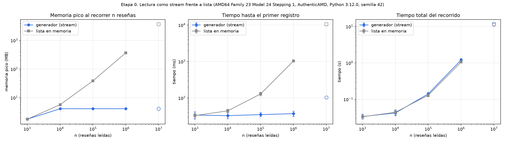
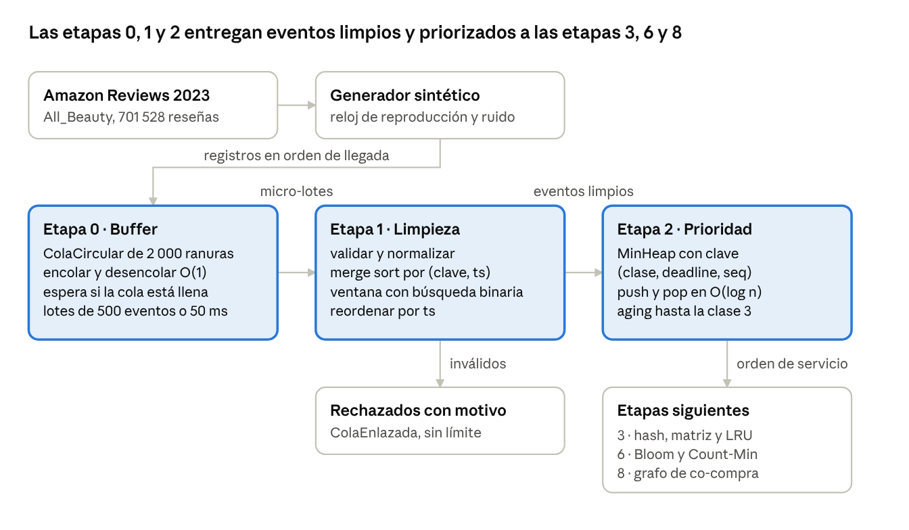
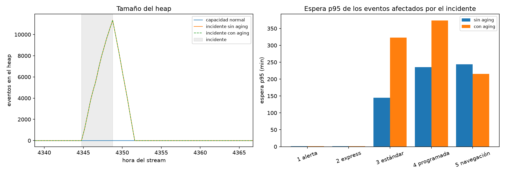

# Informe de las etapas 0, 1 y 2

Proyecto EDA 2026-2 · Grupo 1 · Escenario B (comercio electrónico)

25 de octubre de 2026

## Resumen

Las etapas 0, 1 y 2 reciben el stream crudo de eventos de comercio electrónico y lo entregan limpio y ordenado por prioridad a las etapas siguientes. Para alimentarlas se usaron las últimas 1 500 000 reseñas de la categoría `Office_Products` de Amazon Reviews 2023, que generaron un stream de 10 512 167 registros. De ese stream salieron 9 940 617 eventos limpios en orden de atención.

| Etapa | Función | Estructura propia | Complejidad | Resultado principal |
| --- | --- | --- | --- | --- |
| 0. Ingesta y buffer | Recibir el stream y entregarlo en micro-lotes | Cola circular de capacidad fija | O(1) por operación | Ningún evento perdido de 10.5 millones; pendiente log-log de 0.98 y 8 bytes por elemento |
| 1. Preprocesamiento | Validar, normalizar, deduplicar y ordenar | Merge sort y búsqueda binaria | O(b log b) por lote y O(log w) por búsqueda | 98 781 de 98 781 rechazos esperados; desorden del 4.62 % al 0.26 % |
| 2. Cola con prioridades | Atender primero lo urgente | Min-heap binario con aging | O(log n) por operación y heapify en O(n) | Alertas y compras express dentro de plazo durante un incidente; con aging, la navegación afectada espera un 18 % menos |

Todas las estructuras se implementaron a mano y se compararon con alternativas de la biblioteca estándar de Python en tamaños de 1K a 10M, con semilla 42. El crecimiento medido se resume con la pendiente log-log, que se explica en las condiciones de los experimentos. El buffer nunca supera 2 000 eventos y la ventana de claves de la etapa 1 no pasa de 683 entradas, así que las tres etapas procesan el stream completo con memoria acotada.

## Contexto y datos

El escenario B pide un stream de 10 millones de búsquedas, vistas, carritos, compras, devoluciones, reseñas y alertas de pago. Como ningún dataset público trae ese stream completo, se partió de un dataset real, Amazon Reviews 2023 (McAuley-Lab), y el stream se generó sintéticamente a partir de él.

### Dataset

La categoría elegida es `Office_Products`. El notebook `00-download-data.ipynb` descarga las reseñas y los metadatos, asigna el tipo de cada columna y ordena las 12 845 712 reseñas por `timestamp` mediante ordenamiento externo. El resultado son dos archivos Parquet, uno de reseñas de unos 1.5 GB y otro de 710 503 productos de unos 505 MB.

Las reseñas no se cargan completas. Se leen con `ParquetFile.iter_batches` en bloques de 10 000 filas, solo con las columnas necesarias, y un generador de Python las entrega una por una. El pipeline trabaja sobre una **ventana reciente** con las últimas 1 500 000 reseñas del archivo, un bloque continuo que conserva el orden temporal real del stream. Los metadatos del Parquet indican en qué grupo de filas empieza la ventana, de modo que solo se leen 9 de los 65 grupos. Como el generador produce unos 7 registros por reseña, la ventana da un stream de unos 10.5 millones de eventos.

La decisión de leer el dataset como stream se comprobó midiendo. El generador se comparó con una lista en memoria al recorrer de 1K a 10M reseñas.

*Fuente: `notebooks/etapa0_ingesta_buffer.ipynb`, reseñas de `Office_Products`; 100 repeticiones de 1K a 1M y una corrida única con 10M (puntos huecos).*

- **Memoria.** La memoria de la lista es O(n). Crece unos 370 bytes por reseña y llega a 368.5 MB con 1M y a 3 689 MB con 10M. La del generador es O(1), con un pico de 4.1 MB desde 10K hasta 10M que corresponde al tamaño de un bloque. Con 10M, la lista ocupa unas 900 veces más memoria.
- **Latencia.** La lista solo entrega el primer registro cuando terminó de leer todas las reseñas, y esa espera pasa de 33 ms con 1K a 1.04 s con 1M y 10.6 s con 10M. El generador lo entrega apenas lee el primer bloque, en 33 a 37 ms de 1K a 1M y en 103 ms con 10M.
- **Tiempo total.** Con 1M el recorrido completo tomó 1.21 s con el generador y 1.06 s con la lista, y con 10M, 11.4 s y 11.6 s. Las dos formas hacen el mismo trabajo de lectura, por lo que el ahorro de memoria no tiene un costo de tiempo apreciable.

Del análisis de los datos salieron tres características que condicionan el diseño.

- El precio viene como texto con formatos mezclados. Es nulo en el 59.7 % de los productos, 3 784 tienen un guion (`"—"`) y 606 un texto como `"from 14.99"`.
- Las reseñas están ordenadas por tiempo, lo que permite anclar cada recorrido de compra al timestamp real de su reseña.
- `bought_together` casi siempre es nulo, por lo que el grafo de co-compra necesita órdenes simuladas.

### Generador sintético

Cada reseña real se convierte en un recorrido de compra `search → view → cart → purchase → review → return`. Del dataset se conservan el usuario, el producto, la calificación, el timestamp y si la compra fue verificada. La categoría, el texto de búsqueda y el precio salen del catálogo; el precio se pasa crudo a la etapa 1 y solo se reemplaza por uno sintético cuando falta.

El recorrido ocurre en los 30 minutos previos a la reseña. Cada evento tiene la hora en que ocurrió (`ts`) y la hora en que llega al pipeline, y el generador los entrega por hora de llegada con **desorden controlado**. Un evento normal llega en su propio `ts`, pero el 5 % llega con un retraso aleatorio de hasta 120 s, reproducible con la semilla. Sin esos eventos tardíos el stream saldría ordenado. En la ejecución completa llegaron tarde 502 881 de 10 062 954 eventos, el 5.0 %.

El retraso máximo de 120 s es menor que la duración de un lote en tiempo del stream (mediana de 1 114 s y mínimo de 442 s) y que la ventana de deduplicación de la etapa 1 (600 s). Con eso, un evento tardío cae como mucho en el lote siguiente y su reenvío todavía se detecta.

| Ruido inyectado | Probabilidad | Etapa que lo trata |
| --- | --- | --- |
| Duplicado exacto | 3 % por evento | 1 |
| Duplicado casi exacto (otro `event_id`, `ts` ±0.4 s, formato distinto) | 1.5 % por evento | 1 |
| Registro malformado (seis tipos de error) | 1 % por evento | 1 |
| Llegada tardía de hasta 120 s | 5 % por evento | 1 |
| Ráfaga de fraude con cuenta, tarjeta y dispositivo señalados | 0.2 % por reseña | 2 y 6 |
| Alerta de pago | 30 % de las compras fraudulentas, 0.3 % de las legítimas | 2 y 6 |

Además, el 25 % de las órdenes incluye de 1 a 3 productos adicionales del mismo grupo sintético, para que el grafo de la etapa 8 tenga comunidades. El generador cuenta cada inyección, y esos conteos son la referencia contra la que se verifica la etapa 1.

## Arquitectura

El diagrama resume el flujo de datos entre las tres etapas y hacia las etapas siguientes.

Cada etapa deja su salida en archivos dentro de `data/interim/<CATEGORIA>/`, de donde la lee la siguiente. La categoría, las rutas y los parámetros del experimento se definen en un solo lugar, `src/config.py`. La etapa 0 exporta además las listas de cuentas, tarjetas y dispositivos señalados que usa el Bloom Filter de la etapa 6.

## Etapa 0. Ingesta y buffer

La etapa 0 es la entrada del pipeline. Recibe el stream del generador en un buffer FIFO de capacidad fija y lo entrega a la etapa 1 en micro-lotes. El buffer separa el ritmo del generador del ritmo del preprocesamiento y, al tener capacidad acotada, permite aplicar backpressure.

### Diseño

- **Estructura.** `ColaCircular` guarda los elementos en un arreglo de capacidad fija y lleva dos datos de control, `inicio` y `tam`. La posición final se obtiene como `(inicio + tam) % capacidad`, de modo que encolar y desencolar cuestan O(1) sin mover ningún elemento. La memoria es O(capacidad) y se reserva una sola vez.
- **Alternativa propia.** `ColaEnlazada` también cuesta O(1) por operación, pero no tiene límite de capacidad. Por eso se usa en la cola de rechazados de la etapa 1, donde no se puede perder ningún elemento.
- **Concurrencia.** El productor corre en un hilo y el consumidor en el hilo principal. Ambos comparten el buffer, protegido por un candado y dos variables de condición.
- **Backpressure.** Cuando el buffer se llena, el productor se bloquea hasta que el consumidor libera espacio. Esta política se eligió en lugar de descartar eventos porque en el escenario B no se pueden perder compras ni alertas de fraude, y además mantiene la memoria acotada.
- **Micro-lotes.** Un lote se cierra al llegar a 500 eventos o al pasar 50 ms, lo que ocurra primero. El tamaño aprovecha que la etapa 1 ordena por lote, y el límite de tiempo acota la latencia cuando el stream es lento.

### Resultados

La ejecución completa entregó los 10 512 167 eventos en 21 025 micro-lotes, sin perder ninguno, en 200 s. El productor se bloqueó 17 866 veces y esperó 57.6 s en total, porque escribir cada lote en JSON es más lento que generar los eventos. El backpressure actuó entonces con el consumidor real, sin necesidad de simular uno lento.

Para observar el mecanismo de forma controlada se hizo una demostración con 10 000 reseñas (71 535 eventos) y capacidad de 2 000. Un consumidor lento, de 40 ms por lote, bloqueó al productor 139 veces durante 3.8 s en total, y aun así entregó exactamente los mismos eventos que un consumidor rápido. Con un productor de poco tráfico, los lotes se cerraron por tiempo y ningún evento esperó más de 52.5 ms.

La tabla resume los experimentos de complejidad de las colas.

| Estructura | Pendiente log-log | Tiempo por operación a 1M | Memoria por elemento |
| --- | --- | --- | --- |
| `ColaCircular` (propia) | 0.98 | 324 ns | 8 B |
| `ColaEnlazada` (propia) | 0.97 | 293 ns | 48 B |
| `collections.deque` (C) | 0.98 | 63 ns | 8 B |
| `list.pop(0)` | 2.08 | 316 µs | 8 B |

Las tres colas O(1) mantienen un tiempo por operación casi constante de 1K a 10M, entre 253 y 435 ns las propias y entre 59 y 72 ns `deque`. En cambio, `list.pop(0)` pasa de 167 ns por operación con 1K a 6.5 µs con 100K y 316 µs con 1M, como corresponde a un costo O(n) por operación. `deque` es unas 5 veces más rápida que las colas propias porque está escrita en C, pero esa diferencia es un factor constante y no cambia el orden. Se eligió `ColaCircular` porque cuesta O(1), ocupa la sexta parte de la memoria de la lista enlazada y su capacidad fija es lo que permite el backpressure.

## Etapa 1. Preprocesamiento por lotes

La etapa 1 recibe los micro-lotes crudos de la etapa 0 y los convierte en eventos que cumplen el esquema, tienen un formato único, no están repetidos y están ordenados por tiempo. Su deduplicación es exacta. La deduplicación probabilística con Bloom Filter corresponde a la etapa 6, y las dos no se solapan.

### Diseño

Cada lote pasa por cuatro pasos. En lo que sigue, b es el tamaño del lote y w el número de claves que guarda la ventana de deduplicación.

1. **Validar y normalizar** en un solo recorrido. Cada campo tiene su regla, y los registros inválidos van a una `ColaEnlazada` de rechazados junto con el motivo. El `ts` pasa de milisegundos a segundos, la categoría a una forma canónica (`office_products`) y la búsqueda a minúsculas. Del precio, que llega como texto crudo del catálogo, se toma el primer número. Así, `$19.99`, `19,99`, `1,299.00` y `from $12.50` se convierten a número, y `—` queda sin precio. Una coma seguida de dos dígitos al final se lee como decimal y cualquier otra como separador de miles. Una compra sin precio, o con precio de 0 o menos, se rechaza como `precio_invalido`.
2. **Ordenar el lote por `(clave, ts)`** con merge sort propio y recorrerlo una vez. La clave es `(event_type, user_id, parent_asin, order_id, query)` y no incluye `event_id`. Dos eventos se consideran duplicados si comparten clave y sus `ts` difieren en 1 s o menos. Después de ordenar, los duplicados quedan juntos y basta un recorrido, así que el costo total es O(b log b) en lugar de O(b²).
3. **Buscar duplicados de lotes anteriores** en una ventana, que es un arreglo ordenado con las claves de los últimos 600 s. Cada búsqueda binaria propia cuesta O(log w), y la ventana se actualiza una vez por lote con una mezcla lineal en O(w + b).
4. **Reordenar el lote por `ts`** con merge sort, que es estable y conserva el orden relativo de los eventos con el mismo `ts`. El lote limpio se escribe en el archivo de salida en cuanto termina este paso, de modo que la memoria no crece con el número de eventos.

Se eligió merge sort porque garantiza O(n log n) incluso en el peor caso y es estable. Quicksort con una elección ingenua del pivote, como el primer elemento, se degrada a O(n²) con datos casi ordenados, que es como llegan los lotes. Un `set()` deduplica más rápido, pero solo reconoce claves idénticas y no admite la tolerancia de tiempo que requieren los reintentos.

### Verificación contra lo inyectado

Como el generador cuenta todo el ruido que inyecta, la etapa 1 se puede verificar contra esa referencia. La comparación usó el stream completo de 10 512 167 registros. La columna Esperado ajusta lo inyectado por los casos que la etapa debe tratar de otra forma.

| Concepto | Inyectado | Esperado | Detectado |
| --- | --- | --- | --- |
| Registros rechazados | 100 629 | 98 781 | 98 781 |
| Duplicados exactos | 299 972 | 299 951 | 299 288 |
| Duplicados casi exactos | 149 241 | 149 233 | 173 481 |

Los rechazos coinciden exactamente, también por motivo. Lo esperado suma 663 compras de productos que en el catálogo tienen precio `—` o 0, que se rechazan con razón, y resta las búsquedas con producto vacío, que siguen siendo válidas.

En los duplicados, la etapa detecta 23 585 más de los esperados en términos netos. Esa diferencia coincide, salvo 90, con los 23 675 pares de eventos legítimos que comparten clave y están a 1 s o menos, el 0.24 % de los eventos. De ellos, 17 415 son reseñas reales en las que un mismo usuario calificó variantes del mismo `parent_asin` con el mismo timestamp, y 6 221 son vistas repetidas, equivalentes a un doble clic. Por otro lado, la etapa detecta 663 duplicados exactos menos de los esperados. No son duplicados perdidos, sino copias de un evento que ya había quedado unido a otro legítimo, y por eso se cuentan como casi exactas. La ventana detectó 2 282 duplicados entre lotes y llegó a tener 683 entradas.

### Desorden temporal

Un evento está fuera de orden si su `ts` es menor que el de algún evento entregado antes. Si ese evento anterior está en el mismo lote, el desorden es dentro del lote; si está en un lote anterior, es entre lotes.

| Momento | Fuera de orden | Dentro del lote | Entre lotes |
| --- | --- | --- | --- |
| Al entrar a la etapa 1 | 4.62 % | 457 358 | 26 852 |
| Al salir de la etapa 1 | 0.26 % | 0 | 25 380 |

La etapa elimina todo el desorden dentro de cada lote. El que queda viene de eventos tardíos que llegaron cuando su lote ya se había cerrado.

### Rendimiento en el pipeline

En lotes de unos 500 registros, validar y normalizar tomó 1.7 ms por lote, ordenar y deduplicar 1.0 ms, la búsqueda en la ventana 0.8 ms y reordenar 0.6 ms. Los 21 025 lotes se procesaron en 85 s, unos 124 000 registros por segundo. El paso más costoso es la validación, aunque sea O(b), porque cada registro pasa por varias reglas escritas en Python. Los ordenamientos pesan menos porque, con b ≈ 500, el factor log₂ 500 ≈ 9 es pequeño.

### Experimentos

| Experimento | Método | Pendiente log-log | Esperado |
| --- | --- | --- | --- |
| Ordenación | `merge_sort` (propio) | 1.13 | n log n |
| Ordenación | `sorted()` (C) | 1.10 | n log n |
| Búsqueda de 1 000 valores | Búsqueda binaria (propia) | 0.19 | log n |
| Búsqueda de 1 000 valores | Búsqueda lineal | 1.03 | n |
| Deduplicación | `merge_sort` y recorrido (propio) | 1.17 | n log n |
| Deduplicación | `set()` (C) | 1.11 | n |

Con 1M la búsqueda binaria resolvió cada consulta en 2.4 µs, frente a 13.4 ms de la búsqueda lineal, unas 5 600 veces menos. Con 10M la diferencia fue de 3.6 µs frente a 123 ms. En la deduplicación, `set()` fue unas 15 veces más rápido que ordenar y recorrer con `merge_sort` (3.3 s frente a 51 s con 10M), y con 1M su memoria pico fue de 56 bytes por elemento frente a 81. Las pendientes de los métodos que ordenan quedan algo por encima de 1.1 porque, con millones de elementos, los datos dejan de caber en la caché del procesador. Ese efecto no aparece en la etapa, que ordena lotes de unos 500 eventos.

## Etapa 2. Cola con prioridades

La etapa 2 recibe los eventos limpios y decide en qué orden se atienden cuando la capacidad de servicio es limitada. Para eso usa un min-heap binario propio sobre un arreglo, con `push` y `pop` en O(log n) y `heapify` de Floyd en O(n).

### Clases, plazos y clave

| Clase | Eventos | Plazo |
| --- | --- | --- |
| 1 | Alerta de pago | 5 min |
| 2 | Compra express | 2 h |
| 3 | Compra estándar y devolución | 24 h |
| 4 | Compra programada | 72 h |
| 5 | Búsqueda, vista, carrito y reseña | 30 min |

La clave del heap es `(clase, deadline, seq)`. El deadline es el `ts` del evento más el plazo de su clase, y `seq` es el orden de inserción. Dentro de una clase sale primero el evento que vence antes y, ante un empate total, el que entró primero, de modo que la cola es estable. La navegación representa el 79 % de la carga, mientras que las clases 1 a 4 suman en promedio unos 3.3 eventos por minuto.

### Aging

Con capacidad limitada, una cola de prioridades pura puede dejar esperando sin límite a los eventos de clases bajas. El aging lo evita subiendo una clase a cada evento por cada 15 minutos de espera, sin pasar de la clase 3. Como las claves de un heap no se pueden modificar en su lugar, cada 5 minutos se recalcula la clase efectiva de todas las entradas y se reconstruye el heap con `heapify`, en O(n). Repartido entre esos 5 minutos, ese costo debería ser menor que el de insertar y extraer los eventos del mismo intervalo, aunque no se midió por separado.

El tope en la clase 3 protege a las clases con plazos cortos. El aging solo aprovecha la holgura de las clases 3 y 4, cuyos plazos son de 24 h y 72 h.

### Simulación del servicio

La simulación avanza un minuto del stream por ciclo. En cada minuto entran al heap los eventos de ese minuto, cada 5 minutos se aplica el aging y, al final del minuto, se extraen tantos eventos como permita la capacidad. Se eligió el minuto como ciclo porque, con los timestamps reales, un lote de 500 eventos cubre unos 19 minutos del stream, y un ciclo por lote no podría medir el plazo de 5 minutos de las alertas.

Los 9 940 617 eventos no se cargan en memoria. Cada escenario vuelve a leer el archivo de la etapa 1 desde el inicio, así que todos reciben los mismos eventos, y en memoria solo quedan el heap y una fila numérica por evento atendido.

Los eventos cubren 438 días del stream, con 15.8 llegadas por minuto en promedio y un máximo de 97. La capacidad normal se fijó en 107 eventos por minuto, un 10 % sobre ese máximo. Con ella, todas las clases esperan un minuto o menos y el 100 % de los eventos se atiende dentro de plazo.

### Incidente de capacidad

Para que la prioridad tenga efecto, se simuló una caída de la capacidad a 5 eventos por minuto durante 4 horas, ubicada en las 4 horas con más llegadas del stream. En esas horas llegan 52 eventos por minuto, de los cuales 11.2 son de las clases 1 a 4, frente a 3.3 en promedio. La capacidad del incidente no alcanza ni siquiera para lo urgente. El heap llega a 11 353 eventos y tarda 2.8 horas en vaciarse después del incidente.

Fuera del incidente todo se atiende en menos de un minuto, por lo que la comparación se hace sobre los **eventos afectados**, es decir, los 19 338 que entran al heap entre el inicio del incidente y el momento en que el heap se vacía. Son el 0.19 % del stream. La gráfica muestra, además del tamaño del heap, la espera p95 de cada clase, que es el tiempo que no supera el 95 % de sus eventos.

*Fuente: `notebooks/etapa2_cola_prioridades.ipynb`, incidente de 4 h a 5 eventos por minuto, 19 338 eventos afectados de 9 940 617. A la izquierda, el tamaño del heap; a la derecha, la espera p95 por clase.*

Las alertas y las compras express se atienden en menos de 2 minutos con y sin aging, porque son pocas y la prioridad por clase las pone primero. Con aging, la espera media de la navegación afectada baja un 18 %, de 146.5 a 119.9 minutos, y su p95 pasa de 244.2 a 215.4. Ese tiempo lo ceden las compras estándar y programadas, que aun así se atienden al 100 % dentro de plazo. En cambio, solo el 8 % de la navegación afectada cumple su plazo de 30 minutos, con aging o sin él. La cola de prioridades decide quién espera, pero no reduce la espera total. Sobre todo el stream, el 99.8 % de la navegación y el 100 % de las demás clases se atienden dentro de plazo.

### Experimentos

| Experimento | Método | Pendiente log-log | Esperado |
| --- | --- | --- | --- |
| n push y n pop | `MinHeap` (propio) | 1.15 | n log n |
| n push y n pop | `heapq` (C) | 1.23 | n log n |
| n push y n pop | Lista ordenada con `insort` y `pop(0)` | 1.94 | n² |
| Construcción, claves decrecientes | n `push` (propio) | 1.04 | n log n |
| Construcción, claves decrecientes | `heapify` de Floyd (propio) | 1.02 | n |

Con 100K la lista ordenada ya es 6.3 veces más lenta que `MinHeap`, y con 1M, 65 veces (474 s por repetición frente a 7.3 s). `heapq` es 4.4 veces más rápido que el heap propio con 1K, pero solo 1.8 veces con 10M, porque con millones de elementos el tiempo depende más del acceso a memoria que del lenguaje. En el peor caso, construir el heap con n `push` costó entre 3.5 y 4.6 veces lo que costó con `heapify` en todos los tamaños; con 10M, 19.8 s frente a 5.3 s. Esa diferencia respalda el uso de `heapify` en las pasadas de aging. Las tres estructuras usan entre 8 y 9 bytes por elemento.

## Integración y verificación

Cada etapa está implementada en módulos de `src/` y en un notebook reproducible que importa esos módulos. La categoría, las rutas, la semilla y el tamaño de la ventana se cambian en un solo lugar, `src/config.py`, y los notebooks se entregan ejecutados, con sus salidas y gráficas.

| Artefacto | Contenido |
| --- | --- |
| `notebooks/00-download-data.ipynb` | Descarga de reseñas y catálogo de `Office_Products` en Parquet |
| `notebooks/etapa0_ingesta_buffer.ipynb` | Lectura del dataset, generador, colas, backpressure, micro-lotes y experimentos de complejidad |
| `notebooks/etapa1_preprocesamiento.ipynb` | Validación, merge sort, deduplicación, verificación, desorden temporal y experimentos de complejidad |
| `notebooks/etapa2_cola_prioridades.ipynb` | Min-heap, aging, simulación por minutos, incidente y experimentos de complejidad |
| `src/` | `config.py`, `events.py`, `metricas.py`, `etapa_0/generator.py`, `etapa_0/queue.py`, `etapa_1/preprocess.py` y `etapa_2/heap.py` |
| `tests/` | 45 tests del heap, la normalización de precios y el generador, en `tests/etapa_0/`, `tests/etapa_1/` y `tests/etapa_2/`; todos pasan |
| `results/` | CSV y gráficas de los experimentos, en `results/etapa_0/`, `results/etapa_1/` y `results/etapa_2/` |

La etapa 2 deja los eventos en orden de servicio en `data/interim/Office_Products/`, con `priority` y `deadline` asignados, para las etapas 3, 6 y 8. Su salida incluye 15 018 alertas de pago. De ellas, 11 099 usan una tarjeta señalada y 3 919 son falsas alarmas que la etapa 6 debe verificar antes de bloquear una operación. También incluye 324 550 órdenes con más de un producto, de 1 335 292 en total, que alimentan el grafo de co-compra.

### Condiciones de los experimentos

El pipeline se ejecutó con las 1 500 000 reseñas de la ventana reciente de `Office_Products` y semilla 42. Los experimentos de complejidad están en el notebook de cada etapa y usan los tamaños 1K, 10K, 100K, 1M y 10M.

- **De 1K a 1M.** 100 repeticiones por tamaño y por método, también en la comparación del generador con la lista.
- **10M.** Una corrida única por método, en tiempo y en memoria. Según el tiempo medido, 100 repeticiones tardarían unos 20 minutos en las colas, 56 minutos en la lectura, 6 horas en los experimentos de la etapa 1 y 4 horas en los del heap.
- **Estructuras O(n²).** `list.pop(0)` y la lista ordenada se midieron con 100 repeticiones hasta 100K y con 3 repeticiones en 1M, porque cada repetición en 1M tarda entre 8 y 10 minutos. No se midieron en 10M, donde una sola repetición tardaría entre 13 y 17 horas.

Para comparar el crecimiento medido con el teórico se ajustó por mínimos cuadrados una recta a log(tiempo) frente a log(n), sobre los promedios de 1K a 1M. Si el costo es proporcional a nᵏ, la pendiente de esa recta es k. Un costo O(n) da una pendiente cercana a 1, uno O(n log n) una pendiente entre 1.0 y 1.1 en este rango, uno O(n²) una cercana a 2 y uno O(log n) una cercana a 0.

Durante cada medición de tiempo se desactivó el recolector de basura, y la memoria se midió con `tracemalloc` en una pasada aparte. La plataforma fue Windows 10, AMD64 Family 23 Model 24, 8 núcleos, 32.1 GB de RAM y Python 3.12.0.

## Limitaciones y decisiones corregidas

Siete decisiones se corrigieron después de medir, y quedan cuatro limitaciones conocidas.

### Decisiones corregidas

| Decisión inicial | Lo que mostró la medición | Corrección |
| --- | --- | --- |
| Aging hasta la clase 2 | La navegación envejecida, con deadline de 30 min, adelantaba a las compras express, con deadline de 2 h, y la mitad de ellas salió de plazo en el incidente | Aging limitado a la clase 3 |
| Plazo de 1 min para alertas | Con la simulación por lotes, el 60 % de las alertas aparecía fuera de plazo con espera cero | Plazo de 5 min |
| Simulación del servicio lote por lote | Con los timestamps reales cada lote cubre unos 19 min del stream; solo el 30 % de las alertas aparecía en plazo y el aging subía de clase a casi todo en cada pasada | Simulación por minutos del stream, con aging cada 5 minutos |
| Porcentaje en plazo redondeado antes de multiplicar por 100 | Todos los porcentajes en plazo salían en múltiplos de 10 | Se redondea después de multiplicar |
| Comparar n `push` con `heapify` usando claves aleatorias | En el caso promedio n `push` también es lineal y no se distinguía de `heapify` | Se agregó el peor caso, con claves decrecientes |
| Desarrollo con 50 000 reseñas y eventos guardados en listas | Las etapas 1 y 2 guardaban todos los eventos en memoria, lo que con 10 millones de eventos no cabía en los 17 GB de RAM del equipo de desarrollo | Ventana única de 1 500 000 reseñas; las etapas escriben y leen los eventos por archivo, lote por lote |
| Resumir el incidente sobre todo el stream | Con 438 días de stream, el promedio diluía el incidente y la navegación esperaba 0.8 min con y sin aging | Resumen sobre los eventos afectados por el incidente |

### Limitaciones

- **Tolerancia de deduplicación.** La tolerancia de 1 s fusiona pares legítimos muy cercanos, el 0.24 % de los eventos. La mayoría son reseñas de variantes del mismo producto con el mismo timestamp, y se separarían agregando `asin` al registro y a la clave.
- **Orden temporal entre lotes.** La etapa 1 ordena dentro de cada lote, y al salir queda un 0.26 % de eventos fuera de orden entre lotes. Un orden total exigiría retener los eventos durante el retraso máximo, a costa de más latencia.
- **Tiempo del stream acelerado.** La etapa 0 reproduce el stream más rápido que el tiempo real, así que los plazos y la capacidad de la etapa 2 se miden en minutos del stream y no del reloj de la máquina.
- **Archivos intermedios.** Las etapas se conectan por archivos JSON de 3.3 a 3.6 GB. Leerlos y escribirlos toma casi dos tercios del tiempo de la etapa 1 (153 de 237 s). En un pipeline en línea, las etapas se pasarían los lotes directamente.

## Conclusiones

1. Las estructuras propias cumplen la complejidad esperada en las mediciones de 1K a 10M. La cola circular es O(1) por operación, merge sort O(n log n), la búsqueda binaria O(log n) por consulta y el heap O(log n) por operación.
2. Las versiones de la biblioteca estándar escritas en C son más rápidas por un factor constante de 2 a 21, sin cambiar el orden de complejidad. Las alternativas con peor orden, como `list.pop(0)`, la lista ordenada y la búsqueda lineal, se alejan cada vez más al crecer n.
3. Las decisiones de diseño responden a requisitos del escenario y no solo a la velocidad. El backpressure evita perder eventos, ordenar y recorrer admite la tolerancia de tiempo de los reintentos y el tope del aging protege las órdenes urgentes.
4. La verificación contra el ruido inyectado confirma la etapa 1. Los rechazos coinciden exactamente, el error de la deduplicación es del 0.24 % y se explica por pares legítimos dentro de la tolerancia, y el desorden temporal baja del 4.62 % al 0.26 %.
5. Las tres etapas procesan el stream completo de 10.5 millones de eventos con memoria acotada, y la salida de la etapa 2 alimenta a las siguientes con 15 018 alertas para la etapa 6 y 324 550 órdenes multiproducto para el grafo de la etapa 8.

## Referencias

- Bloom, B. H. (1970). Space/time trade-offs in hash coding with allowable errors. *Communications of the ACM*, 13(7), 422–426.
- Cormen, T. H., Leiserson, C. E., Rivest, R. L., y Stein, C. (2022). *Introduction to Algorithms* (4.ª ed.). MIT Press. Caps. 2, 6 y 10.
- Floyd, R. W. (1964). Algorithm 245: Treesort 3. *Communications of the ACM*, 7(12), 701.
- Hou, Y., Li, J., He, Z., Yan, A., Chen, X., y McAuley, J. (2024). Bridging language and items for retrieval and recommendation. *arXiv:2403.03952*. Dataset Amazon Reviews 2023.
- Leskovec, J., Rajaraman, A., y Ullman, J. D. (2020). *Mining of Massive Datasets* (3.ª ed.). Cambridge University Press. Cap. 4.
- Williams, J. W. J. (1964). Algorithm 232: Heapsort. *Communications of the ACM*, 7(6), 347–348.
