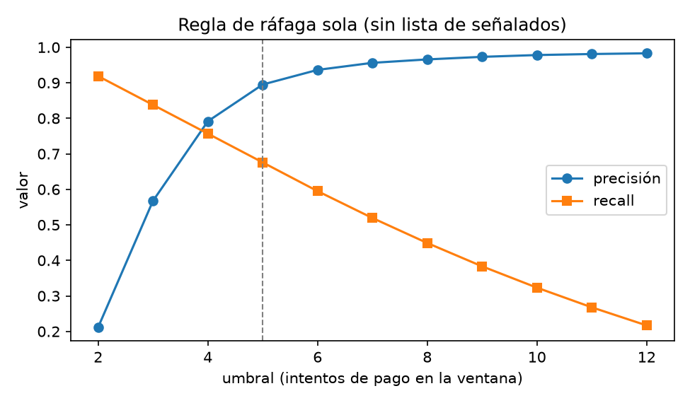
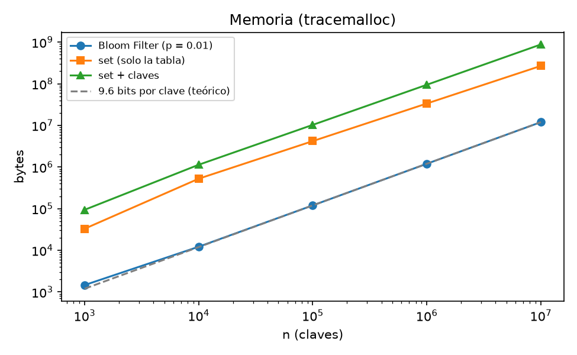
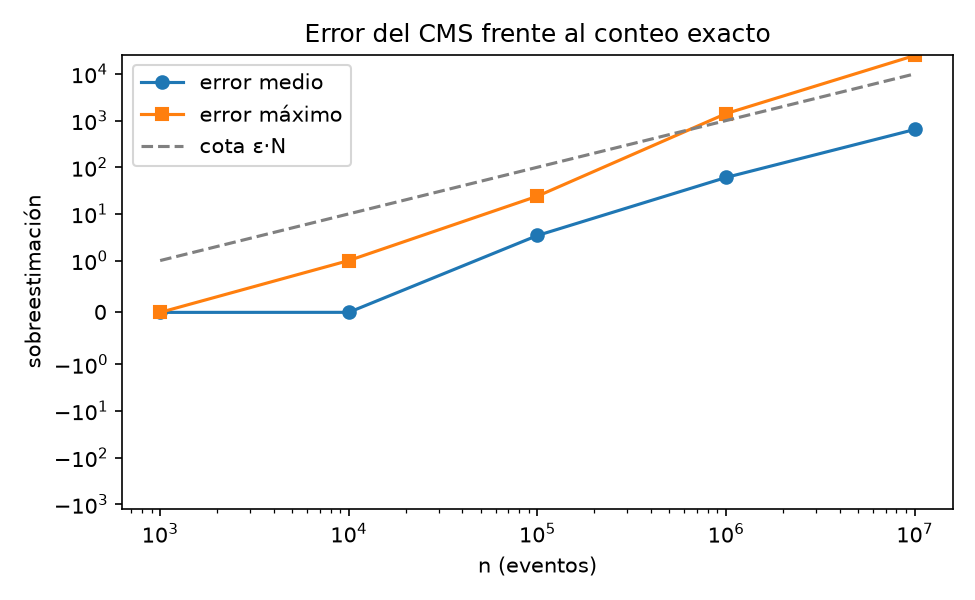

# Informe de la etapa 6

Proyecto EDA 2026-2 · Grupo 1 · Escenario B (comercio electrónico)

22 de octubre de 2026

## Resumen

La etapa 6 resuelve la detección de posible fraude del escenario B, que pide "reconocer medios de pago, dispositivos o cuentas señaladas y estimar la intensidad de intentos dentro de una ventana temporal; verificar alertas antes de bloquear operaciones". Usa dos estructuras probabilísticas implementadas a mano, un **Bloom Filter** para la pertenencia a la lista de señalados y un **Count-Min Sketch** por ventanas para la frecuencia de intentos de pago por tarjeta. Toda alerta se confirma con una estructura exacta antes de actuar. La etapa procesó los 9 940 617 eventos que entrega la etapa 2.

| Estructura | Pregunta | Complejidad | Resultado principal |
| --- | --- | --- | --- |
| Bloom Filter | ¿La cuenta, tarjeta o dispositivo está señalado? | O(k) por operación, m = 9.6 bits por clave con p = 1 % | 73 veces menos memoria que un `set` con sus claves a 10M; falsos positivos medidos de 0.98 % a 1.03 % frente al 1 % teórico; ningún falso negativo |
| Count-Min Sketch | ¿Cuántos intentos de pago hizo la tarjeta en la ventana? | O(d) por operación, w·d contadores fijos | 116 KB fijos frente a 49 MB del `dict` a 10M eventos; nunca subestima; error relativo de 0.27 % en las 10 claves más frecuentes |
| Detector (las dos + verificación) | ¿Se bloquea, se retiene o se aprueba la operación? | 9.7 µs por evento revisado | 47 766 bloqueos con precisión y recall de 100 %; 62 970 falsos positivos del Bloom Filter descartados por la verificación |

Los experimentos van de 1K a 10M con semilla 42, y se comparan con `set` y `dict` en tiempo, memoria, falsos positivos y error de frecuencia. La etapa reutiliza la `TablaHash` de la etapa 3 como estructura exacta de verificación.

## Contexto y datos

| Fuente | Contenido | Uso en la etapa |
| --- | --- | --- |
| `etapa2_eventos.jsonl` | 9 940 617 eventos limpios en el orden de servicio de la etapa 2 (3.6 GB) | Stream que se revisa, leído línea por línea con `leer_eventos` de la etapa 3 |
| `listas_senalados.json` | 30 cuentas, 200 tarjetas y 50 dispositivos señalados, generados por la etapa 0 | Claves que se insertan en el Bloom Filter y en la `TablaHash` exacta |
| `etapa0_inyecciones.json` | 2 970 ráfagas con 37 095 compras fraudulentas y 3 958 alertas de pago legítimas | Verdad de referencia para evaluar; el detector no la consulta |

Una ráfaga del generador usa una cuenta, una tarjeta y un dispositivo señalados y hace de 5 a 20 compras de un producto cada una, separadas por 5 a 40 segundos. De las 37 095 compras fraudulentas inyectadas, 36 667 llegan a la etapa 6; el resto lo eliminó la etapa 1 por malformado o duplicado.

Las salidas de las etapas 1 y 2 se regeneraron con `scripts/regenerar_etapas_1_2.py`, que replica los pasos de escritura de sus notebooks con las clases de `src/`. La salida coincide con la del grupo, con 9 940 617 eventos, la misma cifra del informe de las etapas 3 a 5.

## Arquitectura

| Origen | Artefacto | Destino | Uso |
| --- | --- | --- | --- |
| Etapa 2 | `etapa2_eventos.jsonl` | Etapa 6 | Compras y alertas de pago a revisar |
| Etapa 0 | `listas_senalados.json` | Etapa 6 | Lista de señalados |
| Etapa 3 | `TablaHash` | Etapa 6 | Verificación exacta de los positivos del Bloom Filter |
| Etapa 6 | `etapa6_ordenes_bloqueadas.json` | Etapa 8 | 36 803 órdenes que se excluyen del grafo de co-compra |
| Etapa 6 | `etapa6_alertas.jsonl` | Etapa 9 | 50 697 alertas con motivo, estimación, conteo exacto y decisión, para el panel de alertas |

## Diseño

### Bloom Filter

Un arreglo de m bits (`bytearray`) y k funciones hash. Insertar enciende los k bits de la clave; consultar responde "posiblemente sí" si los k están encendidos y "seguro que no" si alguno está apagado. Tras insertar n claves, la probabilidad de falso positivo es (1 − e^(−kn/m))^k. Para una tasa objetivo p, los valores que la minimizan son m = −n·ln p / (ln 2)² y k = (m/n)·ln 2 (Bloom, 1970; Broder y Mitzenmacher, 2004). Con p = 0.01 resultan 9.59 bits por clave y k = 7, sin importar el largo de la clave.

Las k posiciones se calculan por doble hashing, g_i(x) = h1(x) + i·h2(x) mod m, con h1 y h2 tomados de las dos mitades de un único BLAKE2b de 128 bits. Kirsch y Mitzenmacher (2006) demostraron que esta construcción conserva la tasa de falsos positivos asintótica con dos hashes en vez de k; es la misma que usa el `BloomFilter` de Guava, que parte un MurmurHash3 de 128 bits. Se usa BLAKE2b de `hashlib` porque es determinista entre ejecuciones, el mismo criterio que el CRC32 de las etapas 0 y 3, y porque calcula 128 bits de una sola vez. Cada clave lleva su tipo como prefijo (`tarjeta:pay_…`, `cuenta:A…`) para que valores de tipos distintos no se confundan.

En el detector, n = 280 claves dan m = 2 684 bits (336 bytes) y k = 7.

### Count-Min Sketch por ventanas

Una matriz de d filas × w contadores de 64 bits (`array('q')`). Agregar una clave suma 1 en un contador por fila; estimar devuelve el mínimo de sus d contadores. Como cada contador acumula también a las claves que colisionan con ella, la estimación nunca es menor que la frecuencia real. Con w = ⌈e/ε⌉ y d = ⌈ln(1/δ)⌉, cumple f ≤ f̂ ≤ f + ε·N con probabilidad 1 − δ, donde N es el total insertado (Cormode y Muthukrishnan, 2005). La memoria es w·d contadores, independiente del número de claves distintas. Apache Spark (`org.apache.spark.util.sketch.CountMinSketch`) y RedisBloom (`CMS.*`) ofrecen la misma estructura.

El enunciado pide definir clave, ventana y umbral.

| Parámetro | Valor | Justificación |
| --- | --- | --- |
| Clave | `payment_id` de cada intento de pago (una orden) | Cada orden genera un solo pago, aunque tenga varios productos. Los productos de una orden comparten tarjeta, ts, clase y plazo, así que la etapa 2 los entrega seguidos; basta recordar la última orden contada |
| Ventana | Fijas de 5 minutos; la estimación suma la ventana del evento y la anterior | Una ráfaga dura de 25 s a 13 min. Con una sola ventana fija, una ráfaga que cruza el borde quedaría partida en dos conteos bajo el umbral |
| Umbral | 5 intentos | La ráfaga más corta del generador tiene 5 compras; la sección "Elección del umbral" lo justifica con los datos |
| ε y δ | 0.01 y 0.01, con w = 272, d = 5 y 10.6 KB por ventana | En dos ventanas hay del orden de decenas de órdenes, así que ε·N es menor que 1 en casi todas |
| Ventanas retenidas | 288 (24 h) en un arreglo circular, 3.1 MB en total | La etapa 2 entrega en orden de prioridad y no de ts. Durante su incidente hay eventos que se atienden horas después. La ventana v ocupa la posición v mod 288; un evento más viejo que las ventanas retenidas se descarta y se cuenta aparte |

### Detector y verificación

El `DetectorFraude` revisa cada `purchase` y cada `payment_alert`.

1. **Lista de señalados.** Consulta la cuenta, la tarjeta y el dispositivo en el Bloom Filter. Un positivo se confirma en la `TablaHash` exacta de la etapa 3. Si se confirma, la operación se **bloquea**; si no, es un falso positivo del filtro y no tiene efecto.
2. **Intensidad.** Si es el primer producto de una orden, suma el intento a la tarjeta en el CMS de su ventana. Si la estimación llega al umbral, cuenta exactamente las órdenes de esa tarjeta en las dos ventanas, guardadas en una lista por ventana. Si el conteo exacto también llega al umbral, la orden queda **retenida para revisión** (por ejemplo, autenticación adicional). Una ráfaga sin clave señalada indica un patrón sospechoso, pero no basta para probar el fraude.

La estructura exacta cuesta O(órdenes en la ventana) por verificación, pero solo se consulta para el 1.4 % de las compras que el CMS marca. El filtro probabilístico decide rápido qué casos merecen la verificación cara, que es el uso que propone el enunciado.

## Ejecución sobre el stream

`scripts/etapa6_detectar.py` recorrió los 9 940 617 eventos en 55 s, de los cuales 19 s son del detector (9.7 µs por evento revisado) y el resto es la lectura del JSON. Se revisaron 1 993 954 compras y alertas de pago, que corresponden a 1 336 626 intentos de pago.

| Decisión | Fraude real | Legítimo |
| --- | --- | --- |
| Bloquear | 47 766 | 0 |
| Revisar | 0 | 2 931 |
| Aprobar | 0 | 1 943 257 |

- **Bloqueos.** Precisión 1.000 y recall 1.000. Todas las operaciones fraudulentas usan una cuenta señalada.
- **Todas las alertas.** Precisión 0.942. Las 2 931 retenidas legítimas son usuarios que hicieron 5 o más órdenes en 10 minutos con la misma tarjeta; la verificación exacta confirma que esas órdenes existen, y por eso se retienen en lugar de bloquearse.
- **Bloom Filter.** De 5 981 862 consultas, 143 298 positivos fueron confirmados y **62 970 fueron falsos positivos**, una tasa de 1.08 % frente al 1.00 % teórico. Sin la verificación exacta, cada uno habría bloqueado una operación legítima.
- **Count-Min Sketch frente al conteo exacto.** La línea base es un `dict` de `(tarjeta, ventana) → órdenes`. En 1 978 936 compras no hubo ninguna subestimación; el 0.14 % tiene alguna sobreestimación, con un máximo de 15. El CMS dio 27 717 alertas y 6 no superaron la verificación exacta. Ningún evento llegó más de 24 h tarde.
- **Memoria.** El Bloom Filter ocupa 336 bytes y el CMS 3.1 MB, ambos fijos. El conteo exacto necesitó 1 260 275 pares `(tarjeta, ventana)`, que crecen con el stream.

### Elección del umbral

La regla de ráfaga se evaluó sola, sin la lista de señalados, para medir qué aportaría el CMS contra una tarjeta que todavía no está en la lista. Una compra cuenta como alerta si su tarjeta llega al umbral en la ventana.

| Umbral | Fraude detectado | Legítimas retenidas | Precisión | Recall |
| --- | --- | --- | --- | --- |
| 3 | 30 722 | 23 403 | 0.568 | 0.838 |
| 4 | 27 752 | 7 305 | 0.792 | 0.757 |
| **5** | **24 780** | **2 903** | **0.895** | **0.676** |
| 6 | 21 817 | 1 484 | 0.936 | 0.595 |
| 8 | 16 460 | 582 | 0.966 | 0.449 |

Con umbral 5, la regla sola detecta dos tercios de las compras fraudulentas con 89.5 % de precisión. El recall no puede llegar a 1, porque las primeras 4 compras de cada ráfaga aún no alcanzan el umbral. Bajar a 4 sube el recall en 8 puntos, pero multiplica por 2.5 las compras legítimas retenidas. Se eligió 5, que coincide con el tamaño mínimo de una ráfaga.

## Experimentos

`scripts/etapa6_experimentos.py` midió las dos estructuras frente a sus alternativas exactas, con 100 repeticiones para 1K y 10K, 20 para 100K, 5 para 1M y 3 para 10M. A 10M, una construcción del Bloom Filter en Python tarda cerca de 30 s; con 3 repeticiones la desviación estándar ya es de 0.5 % del promedio. La memoria actual y pico se midió con `tracemalloc` en una pasada aparte. La plataforma fue macOS 26.6 en Apple Silicon (arm64), 10 núcleos, 17.2 GB de RAM, Python 3.12.13, semilla 42.

### Bloom Filter frente a set

n claves distintas con forma de tarjeta, p = 0.01; 100 000 claves ausentes para medir falsos positivos.

| n | Inserción Bloom (µs) | Inserción set (µs) | Memoria Bloom | Memoria set + claves | Veces menos | FP medida | FP teórica |
| --- | --- | --- | --- | --- | --- | --- | --- |
| 1K | 2.85 ± 0.37 | 0.03 | 1.5 KB | 94 KB | 64 | 0.0098 | 0.0100 |
| 10K | 2.60 ± 0.19 | 0.05 | 12 KB | 1.1 MB | 93 | 0.0099 | 0.0100 |
| 100K | 2.63 ± 0.09 | 0.07 | 120 KB | 10.3 MB | 86 | 0.0098 | 0.0100 |
| 1M | 2.66 ± 0.02 | 0.09 | 1.2 MB | 94.6 MB | 79 | 0.0100 | 0.0100 |
| 10M | 2.80 ± 0.01 | 0.11 | 12.0 MB | 878.4 MB | 73 | 0.0103 | 0.0100 |

- **Tiempo.** El tiempo por operación es constante en las dos estructuras, con pendiente 0 en log-log, como predice O(k) frente a O(1) esperado. El `set` es de 25 a 95 veces más rápido en valor absoluto porque está escrito en C dentro del intérprete; el Bloom Filter está en Python puro y calcula un BLAKE2b y 7 posiciones por clave.
- **Memoria.** Las dos crecen como O(n), con pendiente 1. El Bloom Filter sigue la recta teórica de 9.6 bits por clave; el `set` necesita además las claves mismas, de 61 bytes cada una. Aun contando solo la tabla del `set`, sin las claves, el Bloom Filter ocupa de 22 a 43 veces menos.
- **Errores.** La tasa medida coincide con la teórica en todos los tamaños, y no hubo ningún falso negativo.

### Count-Min Sketch frente a dict

n eventos sobre n/10 claves con frecuencias Zipf (a = 1.2); ε = 0.001 y δ = 0.01, es decir, w = 2 719 y d = 5.

| n | Claves distintas | Actualización CMS (µs) | Actualización dict (µs) | Memoria CMS | Memoria dict + claves | Error medio | Error máximo | Cota ε·N | Claves sobre la cota |
| --- | --- | --- | --- | --- | --- | --- | --- | --- | --- |
| 1K | 98 | 1.21 | 0.03 | 116 KB | 8.6 KB | 0.00 | 0 | 1 | 0 % |
| 10K | 959 | 1.11 | 0.04 | 116 KB | 78 KB | 0.001 | 1 | 10 | 0 % |
| 100K | 8 950 | 1.11 | 0.04 | 116 KB | 692 KB | 3.4 | 24 | 100 | 0 % |
| 1M | 77 262 | 0.84 | 0.03 | 116 KB | 6.1 MB | 60 | 1 411 | 1 000 | 0.0013 % |
| 10M | 627 550 | 0.93 | 0.04 | 116 KB | 49.3 MB | 644 | 24 793 | 9 997 | 0.0008 % |

- **Memoria.** La del CMS es constante, mientras que la del `dict` crece con las claves distintas. Con pocas claves el `dict` ocupa menos (con 959 claves, 78 KB frente a 116 KB); con 8 950 claves el CMS ya ocupa 6 veces menos, y a 10M, 425 veces menos.
- **Error.** No hubo ninguna subestimación en ningún tamaño. Como la memoria es fija y N crece, el error absoluto crece en proporción a N. La fracción de claves sobre la cota ε·N es mucho menor que el δ = 1 % permitido. Las claves más frecuentes, que son las que importan para detectar intensidad, tienen error relativo de 0.27 %.
- **Compromiso memoria-error.** Con 1M eventos, pasar de ε = 0.1 (1.1 KB) a ε = 0.0001 (1.1 MB) baja el error medio de 16 742 a 2. La memoria y el error se mueven en proporción inversa, como predice w = e/ε.

Los gráficos de tiempo y de falsos positivos están en `results/etapa6_bloom_tiempo.png`, `results/etapa6_bloom_fp.png`, `results/etapa6_cms_tiempo_memoria.png` y `results/etapa6_cms_epsilon.png`.

## Limitaciones y decisiones corregidas

### Decisiones corregidas

- **El CMS contaba productos y no intentos de pago.** En la primera versión cada evento `purchase` sumaba 1, y una orden de 4 productos más otra orden en minutos llegaba al umbral. En una muestra de 300 000 eventos la precisión de las alertas era de 0.64. Al contar una vez por orden subió a 0.95, sin perder recall.
- **Toda alerta bloqueaba.** Con eso, las ráfagas legítimas confirmadas (usuarios que compran varias cosas seguidas) se bloqueaban. Ahora solo bloquea una clave señalada confirmada; la ráfaga sola retiene la orden para revisión.

### Limitaciones

- **La verdad de referencia es sintética.** Todas las ráfagas del generador usan claves señaladas, así que en este stream el Bloom Filter detecta todo el fraude y el CMS no agrega recall. El análisis del umbral mide su aporte frente a tarjetas que todavía no están en la lista.
- **Doble hashing en el CMS.** Dos claves con el mismo (h1 mod w, h2 mod w) colisionan en las d filas a la vez, una probabilidad de 1/w² en vez de 1/w^d con hashes independientes. Explica algunos errores máximos altos con ε grande, aunque la fracción de claves sobre la cota quedó siempre por debajo de δ. Se puede corregir tomando d hashes independientes del mismo BLAKE2b (8 bytes por fila).
- **Ventanas fijas en lugar de deslizantes.** La suma de dos ventanas aproxima una ventana deslizante de entre 5 y 10 minutos.
- **La regla "última orden contada"** depende de que la etapa 2 entregue seguidos los productos de una orden. Si se intercalaran, una orden se contaría más de una vez, lo que sobreestima y nunca oculta una ráfaga.
- **Python puro.** El Bloom Filter y el CMS son de 20 a 95 veces más lentos que `set` y `dict`, que están en C. La ventaja demostrada corresponde a la memoria y a las garantías de error.

## Conclusiones

El Bloom Filter responde la pertenencia a la lista de señalados con 9.6 bits por clave, 73 veces menos memoria que un `set` a 10M, y con una tasa de falsos positivos que coincide con la teórica. El Count-Min Sketch estima la intensidad de intentos por tarjeta con memoria fija y nunca subestima, que es la dirección segura para una alerta. En el stream completo, la verificación exacta descartó 62 970 falsos positivos del Bloom Filter y 6 alertas falsas del CMS, de modo que ningún error de las estructuras probabilísticas produjo un bloqueo incorrecto. Los bloqueos quedaron con precisión y recall de 100 %. La salida alimenta a la etapa 8, que excluye 36 803 órdenes bloqueadas del grafo de co-compra, y a la etapa 9, que muestra las 50 697 alertas.

## Referencias

- Bloom, B. H. (1970). Space/time trade-offs in hash coding with allowable errors. *Communications of the ACM*, 13(7), 422–426. https://doi.org/10.1145/362686.362692
- Broder, A., y Mitzenmacher, M. (2004). Network applications of Bloom filters: A survey. *Internet Mathematics*, 1(4), 485–509.
- Cormode, G., y Muthukrishnan, S. (2005). An improved data stream summary: The Count-Min sketch and its applications. *Journal of Algorithms*, 55(1), 58–75. https://doi.org/10.1016/j.jalgor.2003.12.001
- Kirsch, A., y Mitzenmacher, M. (2006). Less hashing, same performance: Building a better Bloom filter. *Proceedings of ESA 2006*, LNCS 4168, 456–467.
- Leskovec, J., Rajaraman, A., y Ullman, J. D. (2020). *Mining of Massive Datasets* (3.ª ed.). Cambridge University Press. Cap. 4.
- Implementaciones de referencia: Google Guava (`com.google.common.hash.BloomFilter`), Apache Spark (`org.apache.spark.util.sketch.CountMinSketch`) y RedisBloom (comandos `BF.*` y `CMS.*`).
