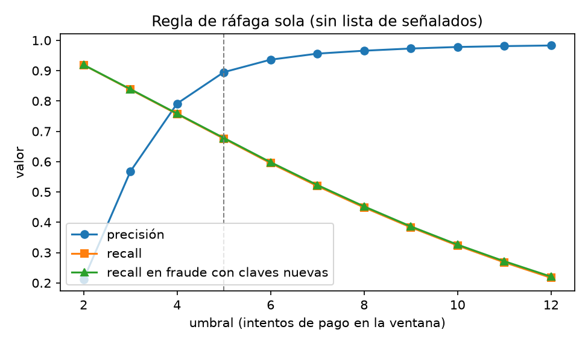
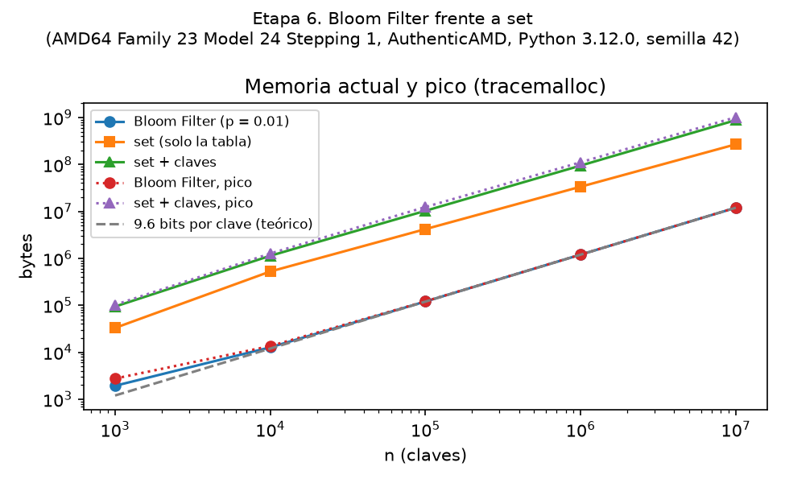
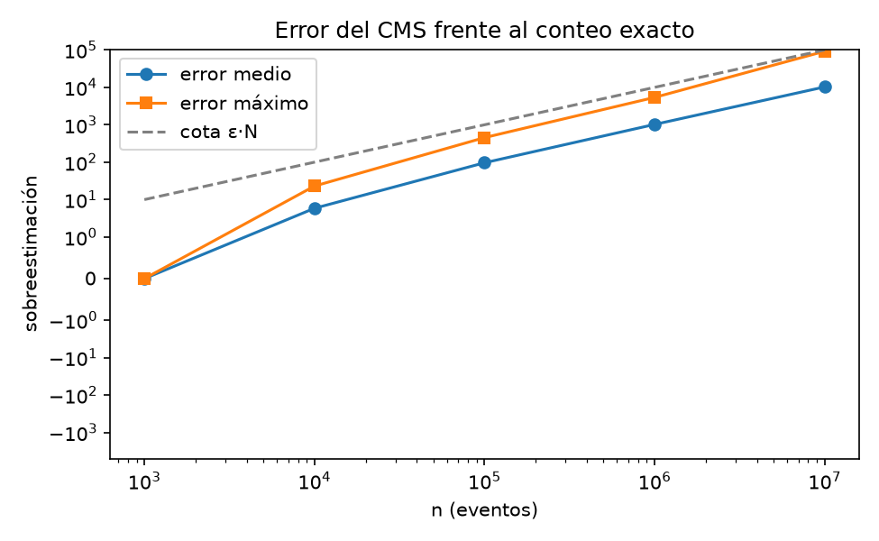
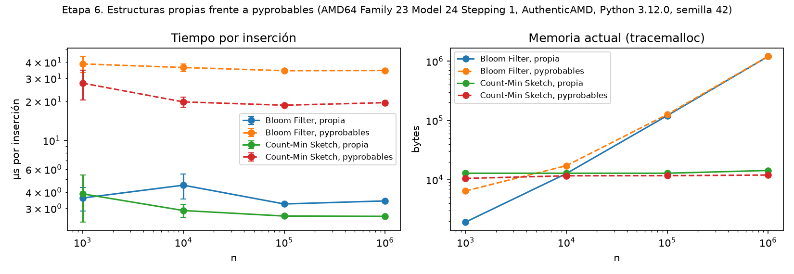

# Informe de la etapa 6

Proyecto EDA 2026-2 · Grupo 1 · Escenario B (comercio electrónico)

25 de octubre de 2026

## Resumen

La etapa 6 resuelve la detección de posible fraude del escenario B, que pide "reconocer medios de pago, dispositivos o cuentas señaladas y estimar la intensidad de intentos dentro de una ventana temporal; verificar alertas antes de bloquear operaciones". Usa dos estructuras probabilísticas implementadas a mano, un **Bloom Filter** para la pertenencia a la lista de señalados y un **Count-Min Sketch** por ventanas para la frecuencia de intentos de pago por tarjeta. Toda alerta se confirma con una estructura exacta antes de actuar. La etapa procesó los 9 940 617 eventos que entrega la etapa 2, con un detector que conoce solo la mitad de la lista de señalados.

| Estructura | Pregunta | Complejidad | Resultado principal |
| --- | --- | --- | --- |
| Bloom Filter | ¿La cuenta, tarjeta o dispositivo está señalado? | O(k) por operación, m = 9.6 bits por clave con p = 1 % | 73 veces menos memoria que un `set` con sus claves a 10M; falsos positivos medidos de 0.95 % a 1.06 % frente al 1 % teórico; ningún falso negativo |
| Count-Min Sketch | ¿Cuántos intentos de pago hizo la tarjeta en la ventana? | O(d) por operación, w·d contadores fijos | 16 KB fijos frente a 49 MB del `dict` a 10M eventos (3 090 veces menos); nunca subestima; ninguna clave sobre la cota ε·N |
| Detector (las dos + verificación) | ¿Se bloquea, se retiene o se aprueba la operación? | 28.1 µs por evento revisado | 41 532 bloqueos con precisión 1.000 y recall 0.869; 3 247 fraudes con claves nuevas retenidos por la regla de ráfaga; 61 183 falsos positivos del Bloom Filter descartados por la verificación |

Los experimentos van de 1K a 10M con semilla 42, y se comparan con `set` y `dict` en tiempo, memoria, falsos positivos y error de frecuencia, y con la biblioteca `pyprobables` como implementación de referencia. La etapa reutiliza la `TablaHash` de la etapa 3 como estructura exacta de verificación.

## Contexto y datos

| Fuente | Contenido | Uso en la etapa |
| --- | --- | --- |
| `etapa2_eventos.jsonl` | 9 940 617 eventos limpios en el orden de servicio de la etapa 2 (3.6 GB) | Stream que se revisa, leído línea por línea con `leer_eventos` de la etapa 3 |
| `listas_senalados.json` | 30 cuentas, 200 tarjetas y 50 dispositivos señalados, generados por la etapa 0 | La mitad de cada lista (`FRACCION_CONOCIDA = 0.5`) se inserta en el Bloom Filter y en la `TablaHash` exacta; la lista completa es la verdad de referencia |
| `etapa0_inyecciones.json` | 2 970 ráfagas con 37 095 compras fraudulentas y 3 958 alertas de pago legítimas | Verdad de referencia para evaluar; el detector no la consulta |

Una ráfaga del generador usa una cuenta, una tarjeta y un dispositivo señalados y hace de 5 a 20 compras de un producto cada una, separadas por 5 a 40 segundos. De las 37 095 compras fraudulentas inyectadas, 36 667 llegan a la etapa 6; el resto lo eliminó la etapa 1 por malformado o duplicado.

La etapa 0 usa las claves de `listas_senalados.json` en todas sus ráfagas. Si el detector conociera las listas completas, detectaría todo el fraude por construcción y la evaluación no mediría nada. Por eso el detector conoce solo la mitad de cada lista, elegida con la semilla: 15 cuentas, 100 tarjetas y 25 dispositivos. La otra mitad representa defraudadores que todavía no están en la lista. Una ráfaga escapa del Bloom Filter solo si su cuenta, su tarjeta y su dispositivo son nuevos, lo que ocurre en promedio en 1 de cada 8 ráfagas; para ellas solo queda la regla de intensidad del Count-Min Sketch.

## Arquitectura

| Origen | Artefacto | Destino | Uso |
| --- | --- | --- | --- |
| Etapa 2 | `etapa2_eventos.jsonl` | Etapa 6 | Compras y alertas de pago a revisar |
| Etapa 0 | `listas_senalados.json` | Etapa 6 | Lista de señalados |
| Etapa 3 | `TablaHash` | Etapa 6 | Verificación exacta de los positivos del Bloom Filter |
| Etapa 6 | `etapa_6/ordenes_bloqueadas.json` | Etapa 8 | 31 994 órdenes que se excluyen del grafo de co-compra |
| Etapa 6 | `etapa_6/alertas.jsonl` | Etapa 9 | 47 710 alertas con motivo, estimación, conteo exacto y decisión, para el panel de alertas |
| Etapa 6 | `etapa_6/metricas.json` | Informe | Conteos, tiempos, memoria y evaluación de la ejecución sobre el stream |
| Etapa 6 | `etapa_6/compras.npz` | Notebook de la etapa 6 | Por compra, la estimación del CMS, el conteo exacto, si es fraude y si tiene alguna clave conocida |

Las salidas de la etapa quedan en `data/interim/<CATEGORIA>/etapa_6/`.

## Diseño

### Bloom Filter

Un arreglo de m bits (`bytearray`) y k funciones hash. Insertar enciende los k bits de la clave; consultar responde "posiblemente sí" si los k están encendidos y "seguro que no" si alguno está apagado. Tras insertar n claves, la probabilidad de falso positivo es (1 − e^(−kn/m))^k. Para una tasa objetivo p, los valores que la minimizan son m = −n·ln p / (ln 2)² y k = (m/n)·ln 2 (Bloom, 1970; Broder y Mitzenmacher, 2004). Con p = 0.01 resultan 9.59 bits por clave y k = 7, sin importar el largo de la clave.

Las k posiciones son k valores independientes de 64 bits tomados de un único BLAKE2b de la clave, de 8·k bytes, reducidos módulo m. Así se calcula un solo hash por clave sin recurrir al doble hashing, g_i(x) = h1(x) + i·h2(x) mod m, que Kirsch y Mitzenmacher (2006) proponen y que usa el `BloomFilter` de Guava. El doble hashing converge a la tasa de k hashes independientes cuando m crece, pero en un filtro chico como el de la etapa queda por encima (sección "Decisiones corregidas"). Se usa BLAKE2b de `hashlib` porque es determinista entre ejecuciones, el mismo criterio que el CRC32 de las etapas 0 y 3, y porque entrega hasta 64 bytes de una sola vez. El CMS toma sus d posiciones, una por fila, de la misma función. Cada clave lleva su tipo como prefijo (`tarjeta:pay_…`, `cuenta:A…`) para que valores de tipos distintos no se confundan.

En el detector, las n = 140 claves conocidas dan m = 1 342 bits (168 bytes) y k = 7. Queda encendido el 52.1 % de los bits, cerca de la mitad que deja el k óptimo.

### Count-Min Sketch por ventanas

Una matriz de d filas × w contadores de 64 bits (`array('q')`). Agregar una clave suma 1 en un contador por fila; estimar devuelve el mínimo de sus d contadores. Como cada contador acumula también a las claves que colisionan con ella, la estimación nunca es menor que la frecuencia real. Con w = ⌈e/ε⌉ y d = ⌈ln(1/δ)⌉, cumple f ≤ f̂ ≤ f + ε·N con probabilidad 1 − δ, donde N es el total insertado (Cormode y Muthukrishnan, 2005). La memoria es w·d contadores, independiente del número de claves distintas. Apache Spark (`org.apache.spark.util.sketch.CountMinSketch`) y RedisBloom (`CMS.*`) ofrecen la misma estructura.

El enunciado pide definir clave, ventana y umbral.

| Parámetro | Valor | Justificación |
| --- | --- | --- |
| Clave | `payment_id` de cada intento de pago (una orden) | Cada orden genera un solo pago, aunque tenga varios productos. Los productos de una orden comparten tarjeta, ts, clase y plazo, así que la etapa 2 los entrega seguidos; basta recordar la última orden contada |
| Ventana | Fijas de 5 minutos; la estimación suma la ventana del evento y la anterior | Una ráfaga dura de 25 s a 13 min. Con una sola ventana fija, una ráfaga que cruza el borde quedaría partida en dos conteos bajo el umbral |
| Umbral | 5 intentos | La ráfaga más corta del generador tiene 5 compras; la sección "Elección del umbral" lo justifica con los datos |
| ε y δ | 0.01 y 0.01, con w = 272, d = 5 y 10.6 KB por ventana | En dos ventanas hay del orden de decenas de órdenes, así que ε·N es menor que 1 en casi todas |
| Ventanas retenidas | 288 (24 h) en un arreglo circular, 3.1 MB en total | La etapa 2 entrega en orden de prioridad y no de ts. Durante su incidente hay eventos que se atienden horas después. La ventana v ocupa la posición v mod 288; un evento más viejo que las ventanas retenidas se descarta y se cuenta aparte |

### Detector y verificación

El `DetectorFraude` revisa cada `purchase` y cada `payment_alert`.

1. **Lista de señalados.** Consulta la cuenta, la tarjeta y el dispositivo en el Bloom Filter. Un positivo se confirma en la `TablaHash` exacta de la etapa 3. Si se confirma, la operación se **bloquea**; si no, es un falso positivo del filtro y no tiene efecto.
2. **Intensidad.** Si es el primer producto de una orden, suma el intento a la tarjeta en el CMS de su ventana. Si la estimación llega al umbral, cuenta exactamente las órdenes de esa tarjeta en las dos ventanas, guardadas en una lista por ventana. Si el conteo exacto también llega al umbral, la orden queda **retenida para revisión** (por ejemplo, autenticación adicional). Una ráfaga sin clave señalada indica un patrón sospechoso, pero no basta para probar el fraude.

La estructura exacta cuesta O(órdenes en la ventana) por verificación, pero solo se consulta para el 1.4 % de las compras que el CMS marca. El filtro probabilístico decide rápido qué casos merecen la verificación cara, que es el uso que propone el enunciado.

## Ejecución sobre el stream

La ejecución sobre el stream está en el paso 5 del notebook `etapa6_filtrado_probabilistico.ipynb`, con la función `ejecutar_etapa` de `src/etapa_6/probabilistic.py`. Recorrió los 9 940 617 eventos en 183 s, de los cuales 56 s son del detector (28.1 µs por evento revisado) y el resto es la lectura del JSON. Se revisaron 1 993 954 compras y alertas de pago, que corresponden a 1 336 626 intentos de pago. Las cifras de esta sección salen de `etapa_6/metricas.json`.

| Decisión | Fraude con alguna clave conocida | Fraude con sus tres claves nuevas | Legítimo |
| --- | --- | --- | --- |
| Bloquear | 41 532 | 0 | 0 |
| Revisar | 0 | 3 247 | 2 931 |
| Aprobar | 0 | 2 987 | 1 943 257 |

- **Bloqueos.** Precisión 1.000 y recall 0.869. Todo el fraude con alguna clave conocida se bloquea y ninguna operación legítima se bloquea.
- **Retenidas.** 6 178 operaciones: 3 247 son fraude con sus tres claves nuevas, que el Bloom Filter no puede reconocer y que la regla de ráfaga retiene, y 2 931 son legítimas. Las legítimas son usuarios con 5 o más órdenes con la misma tarjeta en dos ventanas; la verificación exacta confirma que esas órdenes existen, y por eso se retienen en lugar de bloquearse.
- **Aprobadas por error.** 2 987 operaciones fraudulentas, todas con claves nuevas: son las primeras compras de cada ráfaga, antes de que su tarjeta llegue al umbral, y las alertas de pago, que no suman al CMS. El fraude con claves nuevas son 6 234 operaciones, el 13.1 % del fraude, cerca del 1/8 esperado, y la regla de ráfaga retiene el 52.1 %.
- **Todas las alertas.** Precisión 0.939 y recall 0.937.
- **Bloom Filter.** De 5 981 862 consultas hubo 132 043 positivos: 70 860 se confirmaron en la `TablaHash` y **61 183 fueron falsos positivos** que la verificación descartó. La tasa es de 1.04 % por consulta y de 1.05 % por clave distinta (33 116 de 3 162 462 claves no conocidas, intervalo de 95 % de 1.04 % a 1.06 %). Coincide con la tasa esperada para este filtro, (bits encendidos)^k = 1.04 %, que supera el 1.00 % teórico porque el filtro encendió el 52.1 % de sus bits. Sin la verificación exacta, cada falso positivo habría bloqueado una operación legítima.
- **Count-Min Sketch frente al conteo exacto.** La línea base es un `dict` de `(tarjeta, ventana) → órdenes`. En 1 978 936 compras no hubo ninguna subestimación; 1 627 compras (0.082 %) tienen alguna sobreestimación, con un máximo de 2. El CMS dio 27 711 alertas, cada una confirmada con el conteo exacto. Ningún evento llegó más de 24 h tarde.
- **Memoria.** El Bloom Filter ocupa 168 bytes y el CMS 3.1 MB, ambos fijos. El conteo exacto necesitó 1 260 275 pares `(tarjeta, ventana)`, que crecen con el stream.

### Elección del umbral

La regla de ráfaga se evaluó sola, sin la lista de señalados, para medir qué aportaría el CMS contra una tarjeta que todavía no está en la lista. Una compra cuenta como alerta si su tarjeta llega al umbral en la ventana.

| Umbral | Fraude detectado | Legítimas retenidas | Precisión | Recall |
| --- | --- | --- | --- | --- |
| 3 | 30 722 | 23 403 | 0.568 | 0.838 |
| 4 | 27 752 | 7 305 | 0.792 | 0.757 |
| **5** | **24 780** | **2 903** | **0.895** | **0.676** |
| 6 | 21 817 | 1 484 | 0.936 | 0.595 |
| 8 | 16 460 | 582 | 0.966 | 0.449 |

Con umbral 5, la regla sola detecta dos tercios de las compras fraudulentas con 89.5 % de precisión, y el 67.8 % de las compras fraudulentas con sus tres claves nuevas, porque la regla no depende de las claves. El recall no puede llegar a 1, porque las primeras 4 compras de cada ráfaga aún no alcanzan el umbral. Bajar a 4 sube el recall en 8.1 puntos, pero multiplica por 2.5 las compras legítimas retenidas; subir a 6 las reduce a la mitad, pero pierde 8.1 puntos de recall. Se eligió 5, que coincide con el tamaño mínimo de una ráfaga.

## Experimentos

Los experimentos están en el paso 8 del notebook y sus resultados en `results/etapa_6/bloom.csv`, `cms.csv`, `cms_epsilon.csv` y `referencia.csv`. Las consultas se midieron en 100 bloques de 10 000 claves en todos los tamaños. La construcción, que inserta las n claves, se repitió 100 veces hasta 100K, 20 veces con 1M y una vez con 10M: una construcción del Bloom Filter en Python tarda 3.8 s con 1M y 38.9 s con 10M, y 100 tomarían 6 y 65 minutos. La memoria actual y pico se midió con `tracemalloc` en una pasada aparte. La plataforma fue Windows 10, AMD64 Family 23 Model 24, 8 núcleos, 32.1 GB de RAM, Python 3.12.0, semilla 42.

### Bloom Filter frente a set

n claves distintas con forma de tarjeta, p = 0.01; 100 000 claves ausentes para medir falsos positivos.

| n | Inserción Bloom (µs) | Inserción set (µs) | Memoria Bloom | Memoria set + claves | Veces menos | FP medida | FP teórica |
| --- | --- | --- | --- | --- | --- | --- | --- |
| 1K | 3.40 ± 0.37 | 0.07 | 1.9 KB | 94 KB | 49 | 0.0095 | 0.0100 |
| 10K | 3.46 ± 0.22 | 0.07 | 12.7 KB | 1.1 MB | 89 | 0.0098 | 0.0100 |
| 100K | 3.53 ± 0.24 | 0.10 | 121 KB | 10.3 MB | 85 | 0.0101 | 0.0100 |
| 1M | 3.78 ± 0.11 | 0.15 | 1.2 MB | 94.6 MB | 79 | 0.0106 | 0.0100 |
| 10M | 3.89 (1 repetición) | 0.16 | 12.0 MB | 878.4 MB | 73 | 0.0099 | 0.0100 |

- **Tiempo.** El Bloom Filter inserta en 3.4 a 3.9 µs por clave y consulta en 2.4 a 2.6 µs, con pendientes de 0.02 y 0.01 en log-log: el costo por operación es constante, como predice O(k). El `set` es entre 24 y 52 veces más rápido al insertar y entre 14 y 50 al consultar, porque está escrito en C dentro del intérprete; el Bloom Filter está en Python y calcula un BLAKE2b por clave. El tiempo del `set` crece algo con n (pendientes de 0.11 y 0.16), porque una tabla grande deja de caber en la caché del procesador.
- **Memoria.** Las dos crecen como O(n), con pendientes de 0.96 y 0.99. El Bloom Filter ocupa 1.20 bytes por clave desde 100K, los 9.6 bits del diseño, y su pico es igual a la memoria actual. El `set` necesita además las claves mismas, de 61 bytes cada una, y el pico de su tabla es 1.5 veces la tabla final por las redimensiones. Aun contando solo la tabla del `set`, sin las claves, el Bloom Filter ocupa de 17 a 41 veces menos.
- **Errores.** La tasa medida va de 0.95 % a 1.06 %. Con 100 000 consultas, el intervalo de 95 % alrededor de la teórica es de ±0.06 puntos, y las cinco mediciones caen dentro. No hubo ningún falso negativo.

### Count-Min Sketch frente a dict

n eventos sobre n/10 claves con frecuencias Zipf (a = 1.2); ε = 0.01 y δ = 0.01, los del pipeline, es decir, w = 272 y d = 5.

| n | Claves distintas | Actualización CMS (µs) | Actualización dict (µs) | Memoria CMS | Memoria dict + claves | Error medio | Error máximo | Cota ε·N | Claves sobre la cota |
| --- | --- | --- | --- | --- | --- | --- | --- | --- | --- |
| 1K | 98 | 2.98 | 0.18 | 12.9 KB | 8.7 KB | 0.0 | 0 | 10 | 0 % |
| 10K | 959 | 2.72 | 0.13 | 12.9 KB | 78 KB | 5.9 | 23 | 100 | 0 % |
| 100K | 8 950 | 2.78 | 0.15 | 12.9 KB | 692 KB | 96.6 | 454 | 999 | 0 % |
| 1M | 77 262 | 2.71 | 0.17 | 14.4 KB | 6.1 MB | 1 021 | 5 387 | 9 994 | 0 % |
| 10M | 627 550 | 3.22 | 0.21 | 16.0 KB | 49.3 MB | 10 267 | 92 031 | 99 937 | 0 % |

- **Tiempo.** El CMS actualiza en 2.7 a 3.2 µs y estima en 2.6 a 3.0 µs, con pendiente de 0.01: el costo por operación es constante, O(d). El `dict` actualiza en 0.13 a 0.21 µs y consulta en 0.05 a 0.22 µs.
- **Memoria.** Los contadores del CMS ocupan 10 880 bytes, y `tracemalloc` mide de 12.9 a 16.0 KB por el espacio que `array` reserva de más en cada fila y los encabezados de los objetos (pendiente de 0.02). La del `dict` con sus claves crece con las claves distintas (pendiente de 0.94). Con 98 claves el `dict` ocupa menos (8.7 KB frente a 12.9 KB); con 959 claves el CMS ya ocupa 6 veces menos, y a 10M, 3 090 veces menos.
- **Error.** No hubo ninguna subestimación en ningún tamaño, y ninguna clave superó la cota ε·N, frente al δ = 1 % que permite la garantía. Como la memoria es fija y N crece, el error absoluto crece en proporción a N: el error medio es alrededor del 10 % de la cota desde 100K. El error relativo de las 10 claves más frecuentes es de 3 % a 5 %.
- **Compromiso memoria-error.** Con 1M eventos, pasar de ε = 0.1 (1.1 KB) a ε = 0.0001 (1.1 MB) baja el error medio de 15 590 a 2.0, y el error relativo de las 10 claves más frecuentes de 74 % a 0.01 %. La memoria y el error se mueven en proporción inversa, como predice w = e/ε. El pipeline usa ε = 0.01 porque cada ventana tiene del orden de 20 órdenes, y entonces ε·N es menor que 1.

Los gráficos de tiempo y de falsos positivos están en `results/etapa_6/bloom_tiempo.png`, `results/etapa_6/bloom_fp.png`, `results/etapa_6/cms_tiempo_memoria.png` y `results/etapa_6/cms_epsilon.png`.

### Comparación con una implementación de referencia

Se compararon las dos estructuras con las de `pyprobables` 0.7.0, una biblioteca en Python puro, con los mismos datos y parámetros (`results/etapa_6/referencia.csv`). Su Bloom Filter tiene los mismos m y k y calcula 7 hashes FNV-1a de 64 bits; su CMS tiene los mismos w y d y guarda contadores de 32 bits. Como `pyprobables` es mucho más lenta, la comparación llega a 1M, con 100 construcciones hasta 10K, 10 con 100K y una con 1M. La tabla muestra los valores con 1M.

| Estructura | Implementación | Inserción (µs) | Consulta (µs) | Memoria | Error |
| --- | --- | --- | --- | --- | --- |
| Bloom Filter | propia | 3.42 | 2.34 | 1.20 MB | FP 0.0106 |
| Bloom Filter | `pyprobables` | 34.51 | 32.53 | 1.20 MB | FP 0.0097 |
| Count-Min Sketch | propia | 2.60 | 2.75 | 14.3 KB | error medio 1 021 |
| Count-Min Sketch | `pyprobables` | 19.51 | 18.12 | 12.0 KB | error medio 1 054 |

- **Tiempo.** En todos los tamaños, el Bloom Filter propio inserta entre 8 y 11 veces más rápido y consulta entre 12 y 17 veces más rápido. El CMS propio actualiza unas 7 veces más rápido y estima entre 6 y 8 veces más rápido. La diferencia es el hash: el propio calcula un BLAKE2b en C y `pyprobables` calcula FNV-1a carácter por carácter en Python.
- **Memoria y error.** Los dos Bloom Filter ocupan lo mismo desde 100K y tienen la misma tasa de falsos positivos, de 0.95 % a 1.07 %, sin falsos negativos. Los dos CMS tienen el mismo error, sin subestimaciones ni claves sobre la cota; el de `pyprobables` ocupa algo menos porque sus contadores son de 32 bits.

## Limitaciones y decisiones corregidas

### Decisiones corregidas

- **El CMS contaba productos y no intentos de pago.** En la primera versión cada evento `purchase` sumaba 1, y una orden de 4 productos más otra orden en minutos llegaba al umbral. En una muestra de 300 000 eventos la precisión de las alertas era de 0.64. Al contar una vez por orden subió a 0.95, sin perder recall.
- **Toda alerta bloqueaba.** Con eso, las ráfagas legítimas confirmadas (usuarios que compran varias cosas seguidas) se bloqueaban. Ahora solo bloquea una clave señalada confirmada; la ráfaga sola retiene la orden para revisión.
- **El detector conocía la lista completa.** Como todas las ráfagas del generador usan claves de la lista, el Bloom Filter detectaba todo el fraude por construcción y la evaluación no medía el aporte del CMS. Ahora el detector conoce el 50 % de cada lista (`FRACCION_CONOCIDA`), y la regla de ráfaga retiene 3 247 operaciones fraudulentas con claves nuevas.
- **Doble hashing.** La primera versión calculaba las posiciones con g_i(x) = h1(x) + i·h2(x). En el Bloom Filter, con 200 filtros de 140 claves, el doble hashing dio una tasa media de 1.091 %, un 8.9 % más que la esperada (1.002 %) y unos 8 errores estándar por encima; con hashes independientes fue 1.017 %, a 1.3 errores estándar de la esperada. En el CMS, dos claves con el mismo par (h1 mod w, h2 mod w) chocan en las d filas a la vez: como h2 es impar y w = 272 es par, eso ocurre con probabilidad 1/(272·136) ≈ 2.7·10⁻⁵ por par. En 10 000 ventanas simuladas de 20 tarjetas, el doble hashing sobreestimó 92 de 200 000 tarjetas y las filas independientes, 1. En el stream, la sobreestimación máxima bajó de 15 a 2 y la tasa de falsos positivos del Bloom Filter de 1.08 % a 1.04 %. Ahora las posiciones son valores independientes de un único BLAKE2b (pasos 2 y 3 del notebook).

### Limitaciones

- **La verdad de referencia es sintética.** Todas las ráfagas del generador usan claves señaladas, y la parte desconocida de la lista simula a los defraudadores nuevos. Con la lista conocida al 50 %, la regla de ráfaga del CMS sí agrega recall, pero su aporte depende de esa fracción y de la forma de las ráfagas del generador.
- **Fraude aprobado.** Las 2 987 operaciones fraudulentas aprobadas son las primeras compras de cada ráfaga con claves nuevas, antes de llegar al umbral, y sus alertas de pago. Ningún umbral útil las detecta, porque el recall de la regla está acotado por el tamaño de las ráfagas.
- **Ventanas fijas en lugar de deslizantes.** La suma de dos ventanas aproxima una ventana deslizante de entre 5 y 10 minutos.
- **La regla "última orden contada"** depende de que la etapa 2 entregue seguidos los productos de una orden. Si se intercalaran, una orden se contaría más de una vez, lo que sobreestima y nunca oculta una ráfaga.
- **Python puro.** El Bloom Filter y el CMS son de 14 a 52 veces más lentos que `set` y `dict`, que están en C. La ventaja demostrada corresponde a la memoria y a las garantías de error.

## Conclusiones

El Bloom Filter responde la pertenencia a la lista de señalados con 9.6 bits por clave, 73 veces menos memoria que un `set` a 10M, y con una tasa de falsos positivos que coincide con la teórica. El Count-Min Sketch estima la intensidad de intentos por tarjeta con memoria fija, 3 090 veces menos que un `dict` a 10M, y nunca subestima, que es la dirección segura para una alerta. Frente a `pyprobables`, las estructuras propias son de 6 a 17 veces más rápidas con los mismos errores.

En el stream completo, con un detector que conoce la mitad de la lista, la verificación exacta descartó 61 183 falsos positivos del Bloom Filter, de modo que ningún error de las estructuras probabilísticas produjo un bloqueo incorrecto. Los bloqueos quedaron con precisión 1.000 y recall 0.869, y la regla de ráfaga retuvo 3 247 operaciones fraudulentas con claves nuevas, que el Bloom Filter no puede reconocer. El conjunto de las alertas tiene precisión 0.939 y recall 0.937. La salida alimenta a la etapa 8, que excluye 31 994 órdenes bloqueadas del grafo de co-compra, y a la etapa 9, que muestra las 47 710 alertas.

## Referencias

- Bloom, B. H. (1970). Space/time trade-offs in hash coding with allowable errors. *Communications of the ACM*, 13(7), 422–426. https://doi.org/10.1145/362686.362692
- Broder, A., y Mitzenmacher, M. (2004). Network applications of Bloom filters: A survey. *Internet Mathematics*, 1(4), 485–509.
- Cormode, G., y Muthukrishnan, S. (2005). An improved data stream summary: The Count-Min sketch and its applications. *Journal of Algorithms*, 55(1), 58–75. https://doi.org/10.1016/j.jalgor.2003.12.001
- Kirsch, A., y Mitzenmacher, M. (2006). Less hashing, same performance: Building a better Bloom filter. *Proceedings of ESA 2006*, LNCS 4168, 456–467.
- Leskovec, J., Rajaraman, A., y Ullman, J. D. (2020). *Mining of Massive Datasets* (3.ª ed.). Cambridge University Press. Cap. 4.
- Implementaciones de referencia: `pyprobables` 0.7.0 (comparada en los experimentos), Google Guava (`com.google.common.hash.BloomFilter`), Apache Spark (`org.apache.spark.util.sketch.CountMinSketch`) y RedisBloom (comandos `BF.*` y `CMS.*`).
