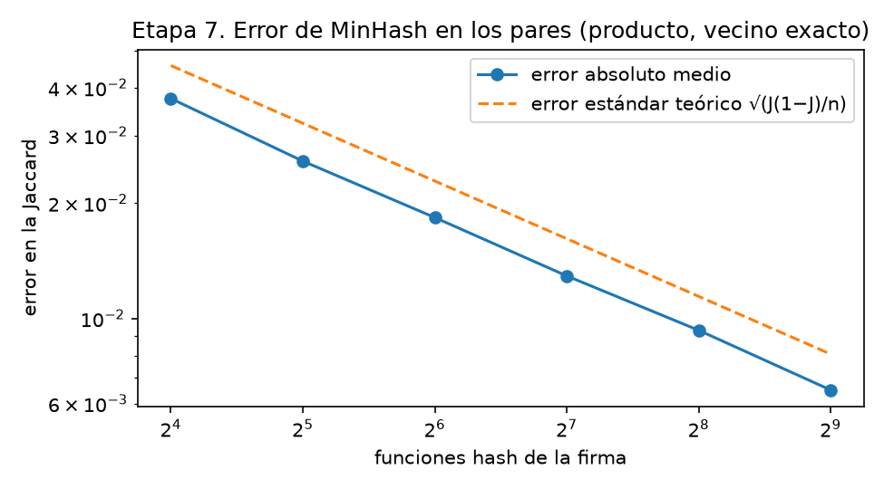
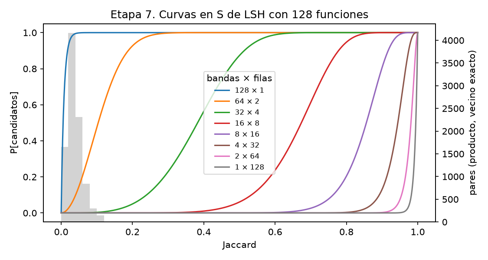
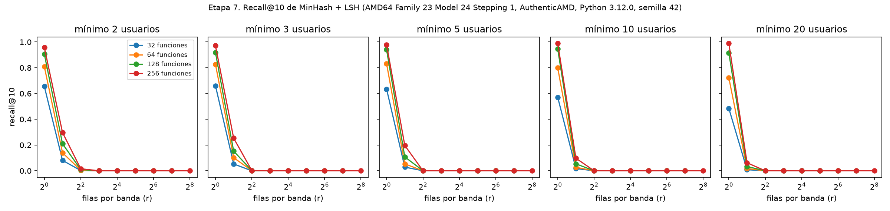
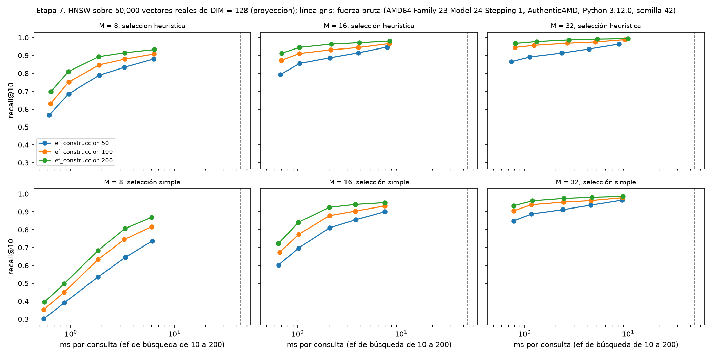
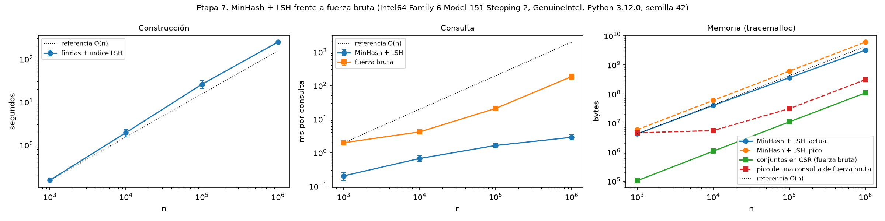
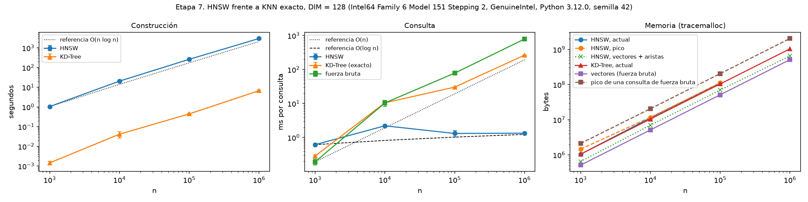
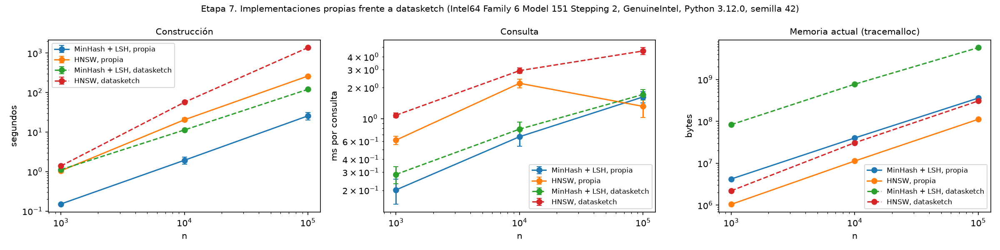

# Informe de la etapa 7

Proyecto EDA 2026-2 · Grupo 1 · Escenario B (comercio electrónico)

26 de octubre de 2026

## Resumen

La etapa 7 resuelve los productos relacionados del escenario B, que pide "generar productos similares y recomendaciones complementarias a partir de atributos y comportamiento de compra". Usa una familia de búsqueda aproximada para cada fuente que menciona el enunciado, las dos implementadas a mano. **MinHash + LSH** encuentra los productos que comparten usuarios, con la similitud de Jaccard entre sus conjuntos de usuarios. **HNSW** encuentra los productos con títulos, categoría y tienda parecidos, con la distancia entre vectores de atributos. La etapa procesó los 195 019 productos de la matriz usuario × producto de la etapa 3, sin los usuarios que la etapa 6 bloqueó por fraude.

| Familia | Pregunta | Complejidad | Resultado principal |
| --- | --- | --- | --- |
| MinHash + LSH | ¿Qué productos miran o compran los mismos usuarios? | Firmas O(nnz · n_hashes); índice O(b · n log n); consulta O(b + c · \|U\|) con c candidatos | Recall@10 de 0.979 frente a la fuerza bruta en los datos reales, verificando 55 de 75 953 productos por consulta; con 1M conjuntos, 65 veces más rápido que la fuerza bruta |
| HNSW | ¿Qué productos tienen atributos parecidos? | Construcción ≈ O(n log n); consulta ≈ O(log n), frente a O(n · d) de la fuerza bruta | Recall@10 de 0.946 frente al KNN exacto en los datos reales, calculando el 0.79 % de las distancias; con 1M vectores, 588 veces más rápido que la fuerza bruta y 198 veces más que el KD-Tree de la etapa 5 |

Cada parámetro se eligió con una grilla completa sobre los datos reales. Los experimentos de escala van de 1K a 1M con semilla 42 y comparan cada familia con su línea base exacta en tiempo, recall@K y memoria. También se comparan con la biblioteca `datasketch` como implementación de referencia. Con 10M no se mide: MinHash + LSH necesitaría unos 28 GB de memoria y HNSW unas 10 h de construcción. Para 10M se extrapolan las mediciones de 10K a 1M. La etapa reutiliza el `MinHeap` de la etapa 2, la `TablaHash` y la matriz CSR de la etapa 3 y el KNN exacto de la etapa 5.

## Contexto y datos

| Fuente | Contenido | Uso en la etapa |
| --- | --- | --- |
| `etapa_3/matriz_usuario_producto.npz` | Matriz CSR de 1 096 990 usuarios × 195 019 productos, con 2 169 111 interacciones del stream (vistas, carritos, compras, reseñas y devoluciones) | Su transpuesta da el conjunto de usuarios de cada producto |
| `etapa_3/catalogo.jsonl` y `AlmacenCatalogo` | Registro de cada producto en disco | Título, categoría de último nivel y tienda de los productos de la matriz |
| `etapa_6/alertas.jsonl` | Alertas con su decisión | Los 30 usuarios con alguna orden bloqueada se quitan de los conjuntos |

**Conjuntos de usuarios.** Cada producto p se representa con el conjunto U(p) de los usuarios que interactuaron con él, y la similitud entre dos productos es la de Jaccard, J(p, q) = |U(p) ∩ U(q)| / |U(p) ∪ U(q)|. Es la base de la recomendación "los clientes que vieron este producto también vieron" (Leskovec, Rajaraman y Ullman, 2020, cap. 3 y 9). Los conjuntos son chicos: la mediana es de 3 usuarios por producto, el percentil 99 de 124 y el máximo de 2 906. Con 2 usuarios, la Jaccard solo puede tomar unos pocos valores. Por eso se comparan los productos con al menos 5 usuarios (`MIN_USUARIOS = 5`). Son 75 953 productos, el 38.9 % de los que tienen algún usuario, pero concentran el 88.8 % de las interacciones. Los productos relacionados son muy poco similares en estos datos: la Jaccard de los 10 vecinos exactos tiene mediana 0.033 y percentil 90 de 0.067.

**Vectores de atributos.** El campo `category` del evento, que la etapa 1 reserva para la similitud, es la `main_category` del producto. En `Office_Products` tiene 35 valores, y el 65.2 % de los productos tiene el mismo, así que no distingue productos. Por eso los rasgos se toman del catálogo: las palabras del título, la categoría de último nivel (576 valores) y la tienda.

## Arquitectura

| Origen | Artefacto | Destino | Uso |
| --- | --- | --- | --- |
| Etapa 3 | `etapa_3/matriz_usuario_producto.npz` | Etapa 7 | Conjuntos de usuarios por producto |
| Etapa 3 | `etapa_3/catalogo.jsonl` | Etapa 7 | Rasgos de los vectores de atributos |
| Etapa 6 | `etapa_6/alertas.jsonl` | Etapa 7 | Usuarios bloqueados, que se excluyen de los conjuntos |
| Etapa 2 | `MinHeap` (código) | Etapa 7 | Candidatos y resultados de la búsqueda de HNSW |
| Etapa 3 | `TablaHash` (código) | Etapa 7 | Posición de cada producto en los índices |
| Etapa 5 | `knn_fuerza_bruta` y `KDTree` (código) | Etapa 7 | KNN exacto, líneas base de HNSW |
| Etapa 7 | `etapa_7/relacionados.parquet` | Etapa 9 | Hasta 10 productos relacionados por comportamiento, con su Jaccard exacta (uso previsto) |
| Etapa 7 | `etapa_7/similares.parquet` | Etapa 9 | 10 productos similares por atributos, con su distancia (uso previsto) |
| Etapa 7 | `etapa_7/vectores.npz` | Notebook de la etapa 7 | Vectores de atributos de norma 1 |
| Etapa 7 | `etapa_7/metricas.json` | Informe | Parámetros, tiempos, memoria y recall@K de la ejecución |

Las salidas quedan en `data/interim/<CATEGORIA>/etapa_7/`. Las columnas de `relacionados.parquet` y `similares.parquet` siguen las de `vecinos.parquet` de la etapa 5. El código está en `src/etapa_7/similarity.py` y el notebook en `notebooks/etapa7_similitud_aproximada.ipynb`.

## Selección de los algoritmos

- **MinHash + LSH y no SimHash.** El enunciado ofrece MinHash + LSH para Jaccard o SimHash para coseno y casi duplicados. La entrada por comportamiento es un conjunto sin pesos, el de los usuarios de cada producto, y la medida natural entre conjuntos es Jaccard. SimHash aproxima el coseno entre vectores con pesos y está pensado para detectar casi duplicados (Charikar, 2002).
- **HNSW y no IVF ni un árbol métrico.** El espacio de los vectores es euclidiano, así que no hace falta un M-Tree ni un VP-Tree, que sirven para cualquier métrica. HNSW es el método que cita el enunciado y no necesita entrenar centroides como IVF. Además, el experimento B de la etapa 5 mostró que desde d = 16 el KD-Tree evalúa prácticamente todos los puntos, así que en dimensión alta hace falta una búsqueda aproximada.

## Diseño

### MinHash

Si h ordena al azar a los usuarios, el mínimo de h sobre U(p) ∪ U(q) es un usuario al azar de la unión. Ese usuario pertenece a la intersección con probabilidad J(p, q), y solo en ese caso el mínimo sobre U(p) coincide con el mínimo sobre U(q). Por lo tanto, P[min h(U(p)) = min h(U(q))] = J(p, q) (Broder, 1997). La firma de un producto son los mínimos de n_hashes funciones independientes. La fracción de posiciones iguales entre dos firmas estima J sin sesgo, con error estándar √(J(1 − J) / n_hashes).

Una permutación al azar de 1.1 millones de usuarios por función no es práctica. En su lugar se usa la familia universal h_i(x) = (a_i·x + b_i) mod (2³¹ − 1) de Carter y Wegman (1979), con a_i y b_i elegidos con la semilla. Broder, Charikar, Frieze y Mitzenmacher (2000) estudian cuándo una familia así se comporta como permutaciones al azar. `MinHash.firmas` evalúa las funciones sobre todas las interacciones con numpy y toma el mínimo de cada producto con `np.minimum.reduceat`, en bloques de 8 funciones para acotar la memoria temporal.

En los pares (producto, vecino exacto), el error absoluto medio de la estimación es 0.0375 con 16 funciones, 0.0183 con 64 y 0.0093 con 256. Se reduce a la mitad cada vez que la firma se multiplica por 4, como predice 1/√n_hashes, y el sesgo medio es de 0.0001. Con J = 0.03, que es la similitud típica de estos datos, el error estándar con 256 funciones es 0.011, más de un tercio del valor. Por eso la etapa usa la firma solo para generar candidatos y los ordena con la Jaccard exacta.

### LSH por bandas

Comparar las firmas de todos los pares sigue costando O(productos²). LSH agrupa los productos de modo que los similares caigan juntos con alta probabilidad (Indyk y Motwani, 1998). Con MinHash, la firma se parte en b bandas de r filas, y dos productos son candidatos si coinciden en las r filas de al menos una banda. Para dos productos con Jaccard s, P[candidatos] = 1 − (1 − s^r)^b. Es una curva en S con punto de subida cerca de (1/b)^(1/r) (Leskovec, Rajaraman y Ullman, 2020, cap. 3).

`LSH` arma las cubetas de cada banda ordenando sus filas con `np.unique`, en lugar de usar una tabla hash. Los productos con los mismos r valores forman una cubeta, sin colisiones entre cubetas distintas. La consulta une los productos de las b cubetas del producto, y `relacionados_lsh` calcula la Jaccard exacta de cada candidato y devuelve los 10 mejores con Jaccard mayor que 0. Así, la respuesta nunca contiene un producto con una Jaccard mal estimada: el único error posible de LSH es dejar fuera un vecino.

Con la mediana de 0.033 en la Jaccard de los vecinos, solo sirve una fila por banda. Con 256 funciones, la partición 256 × 1 tiene umbral 0.0039, y la probabilidad media de que un vecino exacto sea candidato es 0.983. Con 128 × 2 el umbral sube a 0.088 y esa probabilidad baja a 0.188, y con 64 × 4 baja a 0.0007. Con r = 1, LSH queda solo con la amplificación OR entre bandas.

### Vectores de atributos

`MatrizTFIDF` construye el vector de cada producto en tres pasos.

1. **Hashing trick.** Cada rasgo va a la columna `hash_clave(rasgo) mod 2¹⁸`, con el CRC32 de la etapa 3, sin guardar un vocabulario (Weinberger et al., 2009).
2. **TF-IDF.** El peso de una columna es (1 + ln tf) · ln(n / df), que baja el peso de las palabras que aparecen en muchos productos (Salton y Buckley, 1988). Resultan 3 819 587 pesos, 19.6 por producto.
3. **Reducción a DIM = 128** con una proyección gaussiana aleatoria, que conserva aproximadamente las distancias (Johnson y Lindenstrauss, 1984), y normalización a norma 1. Entre vectores de norma 1, ‖x − y‖² = 2 − 2·cos(x, y), así que la distancia euclidiana ordena igual que el coseno.

Como alternativa a la proyección se implementó la SVD truncada (análisis semántico latente; Deerwester et al., 1990), con el algoritmo aleatorizado de Halko, Martinsson y Tropp (2011). Los productos por la matriz dispersa usan sus formatos CSR y CSC, sin scipy. La grilla 6.2 descartó la SVD.

### HNSW

Un grafo de mundo pequeño navegable conecta cada punto con puntos cercanos y con algunos lejanos, así que una búsqueda voraz llega rápido a la zona de la consulta (Malkov et al., 2014). HNSW separa esas aristas por escala en capas, como una skip list. Cada punto recibe un nivel máximo l = ⌊−ln(U) · mL⌋, con U uniforme y mL = 1/ln M, y cada capa tiene en promedio 1/M de los puntos de la anterior. La búsqueda baja de forma voraz desde la capa superior hasta la capa 0, que contiene todos los puntos (Malkov y Yashunin, 2020). La clase `HNSW` implementa los algoritmos del paper:

- **Búsqueda en una capa (algoritmo 2).** Los candidatos por expandir están en un `MinHeap` de la etapa 2, y los `ef` mejores resultados en otro `MinHeap` con la distancia negada, para que la raíz sea el peor. La búsqueda expande el candidato más cercano y se detiene cuando ese candidato está más lejos que el peor resultado. Las distancias a los vecinos nuevos de un nodo se calculan de una vez con numpy.
- **Inserción (algoritmo 1).** El punto nuevo baja de forma voraz hasta su nivel y, en cada capa desde ahí, busca `ef_construccion` candidatos y se conecta con M de ellos. Cada nodo admite M aristas por capa y 2·M en la capa 0. Si un vecino supera su máximo, se recortan sus aristas con la misma regla.
- **Selección de vecinos.** La selección simple (algoritmo 3) toma los M candidatos más cercanos. La heurística (algoritmo 4) acepta un candidato solo si está más cerca del punto nuevo que de todos los vecinos ya aceptados, lo que conserva aristas hacia regiones distintas.

### Complejidad

| Operación | Tiempo | Espacio |
| --- | --- | --- |
| Firmas MinHash de todos los productos | O(nnz · n_hashes) | O(productos · n_hashes) enteros de 32 bits |
| Índice LSH | O(b · n log n), por el ordenamiento de cada banda | O(b · n) enteros |
| Consulta LSH | O(b + c · \|U\|), con c candidatos de tamaño medio \|U\| | O(c) |
| Fuerza bruta de Jaccard, una consulta | O(nnz) | O(n_usuarios + nnz) temporal |
| Vectores TF-IDF y proyección | O(rasgos · DIM) | O(productos · DIM) |
| Construcción de HNSW | ≈ O(n log n), empírico en el paper | O(n · (DIM + M)) |
| Consulta de HNSW | ≈ O(log n), con O(ef · M) distancias por capa | O(ef) |
| Fuerza bruta de vectores, una consulta | O(n · DIM) | O(n · DIM) temporal |
| KD-Tree, una consulta | O(log n) en dimensión baja, O(n) en dimensión alta | O(n) |

### Casos de uso, límites y compromisos

- **MinHash + LSH.** Se usa para detectar documentos casi duplicados, que fue su uso original en AltaVista (Broder, 1997), para deduplicar datos y para generar candidatos de recomendación por co-ocurrencia. Solo estima Jaccard entre conjuntos sin pesos, así que no distingue una vista de una compra. Con similitudes bajas, el error relativo de la estimación es grande, y un vecino con Jaccard bajo el punto de subida de la curva puede no caer en ninguna cubeta común. El índice ocupa unos 2·b enteros por producto. El error baja como 1/√n_hashes, mientras que la memoria y el tiempo crecen como n_hashes. Bajar el punto de subida encuentra vecinos menos similares a costa de más candidatos por consulta.
- **HNSW.** Se usa para buscar vecinos de *embeddings* en recomendación, en búsqueda semántica y en bases de datos vectoriales. Está entre los métodos con mejor relación entre recall y consultas por segundo en ANN-Benchmarks (Aumüller, Bernhardsson y Faithfull, 2020). Guarda los vectores completos y de M a 2·M aristas por punto, así que ocupa más memoria que un índice comprimido como IVF con cuantización (Jégou, Douze y Schmid, 2011). No garantiza encontrar el vecino exacto, y borrar puntos no es directo. En Python puro la construcción es lenta. M y `ef_construccion` mejoran el grafo a costa de tiempo de construcción y memoria; `ef` sube el recall a costa del tiempo por consulta, y se puede ajustar sin reconstruir el índice.

## Elección de los parámetros

Cada parámetro se eligió comparando todas sus alternativas en una grilla completa sobre los datos reales, con 1 000 consultas por configuración (paso 6 del notebook). El recall@K es la fracción de los 10 vecinos exactos que aparece en la respuesta aproximada. Una consulta sin vecinos exactos con Jaccard mayor que 0 no entra en el promedio. Los resultados están en `results/etapa_7/grilla_conjuntos.csv`, `grilla_dimension.csv` y `grilla_hnsw_dim128_proyeccion.csv`.

### Parámetros de conjuntos

La grilla 6.1 combina el mínimo de usuarios ∈ {2, 3, 5, 10, 20}, el largo de la firma ∈ {32, 64, 128, 256} y todas las particiones bandas × filas de cada firma, en total 155 configuraciones. Con dos filas o más, el recall@10 no pasa de 0.30 en ninguna combinación, así que `FILAS = 1`. Con un mínimo de 5 usuarios y una fila por banda:

| Funciones | Recall@10 | ms por consulta | Candidatos | Firmas + índice | Construcción |
| --- | --- | --- | --- | --- | --- |
| 32 | 0.634 | 0.71 | 22 | 37 MB | 3.2 s |
| 64 | 0.832 | 1.01 | 35 | 73 MB | 6.5 s |
| 128 | 0.940 | 1.22 | 47 | 147 MB | 13.6 s |
| **256** | **0.979** | **1.54** | **55** | **293 MB** | **27.2 s** |

La fuerza bruta tarda 27.7 ms por consulta. Se eligió `N_HASHES = 256`, con `BANDAS = 256`, que sube el recall en 3.9 puntos frente a 128 a cambio de 0.3 ms más por consulta y el doble de memoria. El mínimo de usuarios decide la cobertura frente a la calidad de la referencia:

| Mínimo de usuarios | Productos | Interacciones cubiertas | Consultas con 10 vecinos de Jaccard > 0 | Recall@10 con 256 × 1 |
| --- | --- | --- | --- | --- |
| 2 | 147 916 | 97.8 % | 53.8 % | 0.957 |
| 3 | 111 240 | 94.4 % | 70.6 % | 0.971 |
| **5** | **75 953** | **88.8 %** | **83.5 %** | **0.979** |
| 10 | 44 521 | 79.1 % | 97.2 % | 0.989 |
| 20 | 24 556 | 66.4 % | 99.9 % | 0.989 |

Con 5 usuarios, el 83.5 % de las consultas tiene 10 vecinos y se conserva el 88.8 % de las interacciones. Los productos con menos de 5 usuarios reciben sus similares por atributos (HNSW).

### Parámetros de los vectores

La grilla 6.2 combina el método de reducción con DIM ∈ {16, 32, 64, 128, 256}. La referencia son los 10 vecinos por coseno exacto en TF-IDF, así que la grilla mide solo la pérdida de la reducción, sin el error de HNSW.

| DIM | Recall@10, proyección | Recall@10, SVD | Reducción, proyección | Reducción, SVD | Fuerza bruta por consulta | Memoria |
| --- | --- | --- | --- | --- | --- | --- |
| 16 | 0.099 | 0.173 | 0.8 s | 10.3 s | 31 ms | 12 MB |
| 32 | 0.231 | 0.224 | 1.7 s | 16.9 s | 55 ms | 25 MB |
| 64 | 0.416 | 0.260 | 3.5 s | 33.0 s | 111 ms | 50 MB |
| **128** | **0.568** | 0.295 | **8.0 s** | 66.3 s | **221 ms** | **100 MB** |
| 256 | 0.691 | 0.338 | 17.6 s | 132.7 s | 472 ms | 200 MB |

- **`REDUCCION = "proyeccion"`.** Desde DIM = 32, la SVD conserva menos vecinos que la proyección y tarda unas 8 veces más. La SVD conserva las direcciones de mayor varianza, que corresponden a las palabras frecuentes y las categorías grandes. Así descarta las palabras raras, como marcas y modelos, que son las que definen los vecinos más cercanos por coseno.
- **`DIM = 128`.** Gana 15 puntos de recall frente a 64 a costa del doble de tiempo por distancia. Pasar a 256 ganaría 12 puntos más con otro factor 2 en tiempo y memoria.

### Parámetros de HNSW

La grilla 6.3 combina M ∈ {8, 16, 32}, `ef_construccion` ∈ {50, 100, 200} y la selección de vecinos, y responde con cada índice las consultas con `ef` ∈ {10, 20, 50, 100, 200}. Se construyeron 18 índices sobre 50 000 vectores reales, que tardaron 81 minutos en total. Con `ef_construccion` = 100 y `ef` = 50:

| M | Recall@10, heurística | Recall@10, simple | ms por consulta (heurística) | Construcción (heurística) | Memoria del índice |
| --- | --- | --- | --- | --- | --- |
| 8 | 0.847 | 0.633 | 1.88 | 225 s | 28.2 MB |
| 16 | 0.931 | 0.878 | 2.09 | 258 s | 30.6 MB |
| **32** | **0.968** | 0.953 | **2.60** | **294 s** | **34.4 MB** |

- **`SELECCION = "heuristica"`.** Con los mismos parámetros, tiene más recall que la selección simple en casi todas las combinaciones, y la diferencia crece cuanto menor es M. Con pocas aristas por nodo, la selección simple conecta cada punto con vecinos de su misma zona densa y el grafo pierde las aristas hacia otras regiones.
- **`M = 32`.** Llega a 0.968 con 2.6 ms por consulta. Con M = 16, alcanzar 0.966 requiere `ef` = 200 y 7.7 ms por consulta.
- **`EF_CONSTRUCCION = 100`.** Con 200 el recall sube a 0.987, pero la construcción pasa de 294 a 583 s, y ese costo se multiplica en el índice de 1M del paso 9. Con 50 el recall baja a 0.913.
- **`EF_BUSQUEDA = 50`.** Con `ef` = 20 el recall es 0.956 con 1.24 ms, y con 50 es 0.968 con 2.60 ms, 17 veces menos que la fuerza bruta. Se eligió 50 para tener margen, porque con los 195 019 productos del paso 7 el recall baja respecto de esta muestra.

## Ejecución en el pipeline

La ejecución está en el paso 7 del notebook, con la función `ejecutar_etapa`, y sus cifras salen de `etapa_7/metricas.json`. Recorrió las dos familias en 2 049 s. La calidad se mide en 1 000 productos de la muestra, cuyas respuestas se comparan con la línea base exacta por fuerza bruta; el producto consultado se excluye de las dos respuestas.

| Medida | MinHash + LSH | HNSW |
| --- | --- | --- |
| Productos | 75 953 (al menos 5 usuarios) | 195 019 (todos los de la matriz) |
| Parámetros | 256 funciones, 256 × 1 | DIM 128 (proyección), M 32, `ef_construccion` 100, `ef` 50, heurística |
| Construcción | 26.1 s (firmas e índice) | 1 141 s, 5.8 ms por inserción |
| Memoria de la estructura | 293 MB | 128 MB (99.8 de vectores y 28.1 de aristas) |
| Recall@10 | 0.979 | 0.946 |
| Evaluado por consulta | 55 candidatos (0.07 % de los productos) | 1 543 distancias (0.79 % de los productos) |
| ms por consulta | 1.52 | 2.99 |
| ms por consulta, fuerza bruta | 28.4 | 197.7 |
| Veces más rápido | 19 | 66 |

- **MinHash + LSH.** El recall coincide con el de la grilla 6.1 y está cerca de la cota de 0.983 de la curva en S. De los 75 953 productos, 75 890 tienen al menos un relacionado; los 63 restantes no tienen ningún candidato con Jaccard mayor que 0.
- **HNSW.** Las capas tienen 195 019, 6 128, 191 y 10 nodos, cada una unas 32 veces menor que la anterior, como predice mL = 1/ln M. El índice tiene 7 033 854 aristas, 36 por nodo. El recall es 2.2 puntos menor que el 0.968 de la grilla con 50 000 vectores, la caída que se anticipó al elegir `ef` = 50.
- **Efecto de la exclusión de la etapa 6.** Los 30 usuarios bloqueados aparecen en 35 509 interacciones, 1 184 productos por usuario en promedio, frente a 1.98 en toda la matriz. Antes de la exclusión, 20 406 de los productos con al menos 5 usuarios (26.6 %) tienen interacciones suyas. En una muestra de 1 000 de esos productos, 40 quedan por debajo del mínimo, y 901 de los 960 restantes (93.9 %) cambian su lista de 10 relacionados, con 7.0 vecinos reemplazados en promedio. Sin la exclusión, 30 usuarios fraudulentos alterarían los productos relacionados de una cuarta parte de los productos comparados.
- **Las dos listas responden preguntas distintas.** Para una mina de portaminas Pentel Ain Stein, los similares por atributos son cinco variantes de la misma mina, a distancias de 0.75 a 0.86. Sus relacionados por comportamiento tienen Jaccard de 0.036 a 0.042. Incluyen otro portaminas Pentel, tintas para pluma estilográfica y un organizador de escritorio, que son complementarios.
- **Salidas.** `relacionados.parquet` tiene 710 592 filas de 75 890 productos (9.4 por producto, porque algunos tienen menos de 10 candidatos con Jaccard mayor que 0). `similares.parquet` tiene 1 950 190 filas, 10 por producto.

## Experimentos

Los experimentos están en el paso 9 del notebook y sus resultados en `results/etapa_7/escala_conjuntos_min5_h256_256x1.csv`, `escala_hnsw_d128_proyeccion_m32_efc100_ef50_heuristica.csv` y `referencia_min5_h256_256x1_d128_proyeccion_m32_efc100_ef50.csv`. Cada estructura se mide con los parámetros elegidos.

- **Datos.** Para alcanzar cada tamaño se remuestrean los datos reales, como en la etapa 5. Un conjunto sintético es el de un producto real al azar, con cada usuario reemplazado por otro al azar con probabilidad 0.05. Un vector sintético es un vector real al azar más un ruido normal de desviación 0.05 en cada coordenada, normalizado a norma 1. Con 1M elementos, cada conjunto real aparece unas 13 veces y cada vector real unas 5, y esas copias son sus vecinos más similares. Por eso el recall a esa escala es más fácil que en los datos reales, y la calidad se juzga con los pasos 6 y 7.
- **Repeticiones.** Las consultas se miden en 100 bloques en todos los tamaños. Los bloques son de 10 consultas, salvo los de las líneas base exactas con 1M, que son de 1 consulta, porque cada una cuesta O(n). Cada construcción se repite las veces que caben en 120 s, el mismo presupuesto por medición de la etapa 5, con un máximo de 100 y un mínimo de 1. El recall se mide en 200 consultas por tamaño.
- **Memoria.** Se mide con `tracemalloc` en una pasada aparte, sin medir tiempo. Para HNSW con 1M se reporta la memoria de la estructura (vectores y aristas), porque la pasada con `tracemalloc` costaría otra construcción de más de 50 minutos.
- **10M.** No se mide. Las firmas y el índice LSH de 10M conjuntos ocuparían unos 28 GB, con un pico de unos 60 GB, más que los 34 GB de la máquina, y la construcción de HNSW tardaría unas 10 h en Python. Las cifras de 10M de las tablas se extrapolan con la pendiente log-log de 10K a 1M.
- **Plataforma.** Windows 11, Intel64 Family 6 Model 151, 20 núcleos, 34.0 GB de RAM, Python 3.12.0, semilla 42. Las grillas y el paso 7 se midieron en Windows 10, AMD64 Family 23 Model 24, 8 núcleos, 32.1 GB de RAM y Python 3.12.0, así que sus tiempos no se comparan con los de esta sección.

### MinHash + LSH frente a la fuerza bruta

| n | Construcción (s) | Consulta LSH (ms) | Consulta fuerza bruta (ms) | Recall@10 | Candidatos | Memoria actual | Memoria pico |
| --- | --- | --- | --- | --- | --- | --- | --- |
| 1K | 0.151 ± 0.003 (100) | 0.20 ± 0.06 | 1.95 ± 0.07 | 0.933 | 0.9 | 4.2 MB | 5.9 MB |
| 10K | 1.93 ± 0.40 (69) | 0.67 ± 0.13 | 4.12 ± 0.14 | 0.948 | 9.9 | 40.1 MB | 59.7 MB |
| 100K | 25.7 ± 5.3 (5) | 1.63 ± 0.21 | 20.6 ± 2.0 | 0.988 | 78 | 358 MB | 605 MB |
| 1M | 245.7 (1) | 2.84 ± 0.50 | 183.5 ± 35.2 | 1.000 | 753 | 3.18 GB | 6.00 GB |
| 10M (extrapolado) | 2 927 | 6.2 | 1 113 | — | — | 28.4 GB | 60.4 GB |

- **Construcción.** La pendiente log-log es 1.05, coherente con O(nnz · n_hashes), porque nnz crece en proporción a n.
- **Consulta.** LSH tiene pendiente 0.32 desde 10K. Los candidatos crecen con n porque las copias de cada conjunto real caen en las mismas cubetas. La fuerza bruta tiene pendiente 0.82: cada consulta crea un arreglo de marcas con los 1 096 990 usuarios, un costo fijo de unos 2 ms que domina con 1K y 10K. Con 1M, LSH es 65 veces más rápido.
- **Memoria.** Las firmas ocupan 1 024 bytes por conjunto y el índice unos 2 160. Con 1M, la memoria actual es 30 veces la de los conjuntos en CSR (108 MB) que usa la fuerza bruta. El pico es de 1.4 a 1.9 veces la memoria actual por los temporales de las firmas y del ordenamiento de cada banda. Las pendientes son 0.95 y 1.00. En esta familia, lo que impide medir 10M es la memoria y no el tiempo.

### HNSW frente al KNN exacto

El `KDTree` de la etapa 5 se construye sobre los mismos vectores y se consulta con K + 1 vecinos, porque la consulta es un punto del conjunto.

| n | Construcción HNSW (s) | Construcción KD-Tree (s) | Consulta HNSW (ms) | Consulta KD-Tree (ms) | Consulta fuerza bruta (ms) | Recall@10 | Distancias por consulta | Memoria HNSW (actual) | Memoria HNSW (vectores + aristas) | Memoria KD-Tree |
| --- | --- | --- | --- | --- | --- | --- | --- | --- | --- | --- |
| 1K | 1.05 ± 0.08 (100) | 0.001 | 0.62 ± 0.06 | 0.29 ± 0.02 | 0.19 ± 0.04 | 1.000 | 812 | 1.0 MB | 0.65 MB | 1.0 MB |
| 10K | 20.5 ± 2.2 (6) | 0.04 | 2.21 ± 0.21 | 10.5 ± 0.5 | 10.4 ± 2.1 | 0.981 | 1 970 | 11.3 MB | 7.0 MB | 10.4 MB |
| 100K | 261.7 (1) | 0.44 | 1.31 ± 0.29 | 30.4 ± 0.7 | 78.2 ± 3.6 | 0.945 | 2 136 | 111.8 MB | 69.9 MB | 104 MB |
| 1M | 2 990.9 (1) | 6.70 | 1.34 ± 0.13 | 264.8 ± 4.8 | 788.1 ± 29.8 | 0.962 | 1 693 | — | 652 MB | 1.04 GB |
| 10M (extrapolado) | 36 829 (10.2 h) | — | — | 1 106 | 6 532 | — | — | 11.0 GB | 6.36 GB | — |

- **Construcción.** HNSW tiene pendiente 1.08, coherente con O(n log n). El costo por inserción pasa de 1.05 ms con 1K a 2.99 ms con 1M, un factor de 2.9, algo más que el factor 2 de ln n.
- **Consulta.** Desde 10K, HNSW calcula entre 1 693 y 2 136 distancias por consulta, casi constantes, y de 100K a 1M su tiempo pasa de 1.31 a 1.34 ms mientras n crece 10 veces. Con 10K tarda más que con 100K aunque calcula menos distancias. Como las distancias no dependen de la máquina, esa diferencia viene de la medición y no del algoritmo, y por ese punto su pendiente desde 10K (−0.11) no se interpreta. Con 1K, el KD-Tree y la fuerza bruta son más rápidos que HNSW; desde 10K, HNSW es el más rápido. Con 1M es 198 veces más rápido que el KD-Tree y 588 veces más que la fuerza bruta.
- **KD-Tree.** Evalúa el 100 % de los puntos en todos los tamaños, como anticipó el experimento B de la etapa 5 para d ≥ 16, y su pendiente es 0.70. Es más rápido que la fuerza bruta (pendiente 0.94) aunque evalúa los mismos puntos, porque `knn_fuerza_bruta` convierte los vectores a float64 en cada consulta: con 1M, una consulta de fuerza bruta tiene un pico de 2.05 GB, frente a unos 0.1 MB de una consulta de HNSW.
- **Memoria.** La estructura ocupa 512 bytes de vector y unos 140 de aristas por punto. `tracemalloc` mide 1.6 veces la estructura por las listas de Python de cada nodo, y el pico es casi igual a la memoria actual. Con la misma proporción, HNSW con 1M ocuparía unos 1.04 GB, lo mismo que el KD-Tree, que guarda una copia de los vectores en float64.

### Comparación con una implementación de referencia

Se compararon las dos familias con las de `datasketch` 1.6.5, una biblioteca en Python, con los mismos datos remuestreados, los mismos parámetros y el mismo protocolo de repeticiones (`results/etapa_7/referencia_*.csv`). `datasketch.MinHash` calcula cada firma a partir de un SHA-1 de cada usuario, y `MinHashLSH` recibe la misma partición 256 × 1 y guarda las cubetas en diccionarios. Sus candidatos se verifican con la misma Jaccard exacta. `datasketch.hnsw.HNSW` recibe los mismos M y `ef_construccion` y la misma distancia euclidiana, y se consulta con el mismo `ef`. La comparación llega a 100K, porque una sola construcción del HNSW de `datasketch` con 100K tarda 23 minutos. La tabla muestra los valores con 100K.

| Familia | Implementación | Construcción (s) | Consulta (ms) | Recall@10 | Memoria actual |
| --- | --- | --- | --- | --- | --- |
| MinHash + LSH | propia | 25.7 | 1.63 | 0.988 | 358 MB |
| MinHash + LSH | `datasketch` | 120.7 | 1.72 | 0.988 | 5.73 GB |
| HNSW | propia | 261.7 | 1.31 | 0.945 | 112 MB |
| HNSW | `datasketch` | 1 370.8 | 4.56 | 0.945 | 306 MB |

- **MinHash + LSH.** La implementación propia construye entre 4.7 y 7.4 veces más rápido y consulta entre 1.06 y 1.42 veces más rápido, con el mismo recall desde 10K. `datasketch` ocupa entre 16 y 20 veces más memoria, porque cada firma es un objeto con valores de 64 bits y su propia copia de las permutaciones, y las cubetas son 256 diccionarios de Python. Con 1K el recall difiere (0.933 frente a 0.901), porque las dos usan familias de hash distintas y solo 77 de las 200 consultas tienen vecinos.
- **HNSW.** La implementación propia construye entre 1.3 y 5.2 veces más rápido y consulta entre 1.3 y 3.5 veces más rápido, con el mismo recall con 1K y 100K y 0.981 frente a 0.984 con 10K. `datasketch` llama a la función de distancia en Python para cada par de puntos, mientras que la versión propia calcula las distancias a todos los vecinos nuevos de un nodo en una operación de numpy. Por eso la ventaja crece con n. `datasketch` ocupa entre 2.1 y 2.7 veces más memoria, porque guarda los vecinos de cada nodo en diccionarios con su distancia.

Otras implementaciones de referencia de estas familias, que no se compararon, son `hnswlib` (la implementación en C++ de los autores de HNSW), `IndexHNSWFlat` de FAISS y `MinHashLSH` de Apache Spark MLlib.

## Limitaciones y decisiones tomadas con los datos

### Decisiones tomadas con los datos

- **Una fila por banda.** El diseño habitual de LSH usa varias filas por banda para descartar los pares lejanos. En estos datos, los productos relacionados comparten pocos usuarios (Jaccard mediana de 0.033), y con dos filas o más el recall no pasa de 0.30. Con `FILAS = 1`, LSH queda solo con la amplificación OR entre bandas, y la precisión la aporta la verificación con la Jaccard exacta.
- **Rasgos del catálogo en lugar de `category`.** El campo que la etapa 1 reservó para la similitud tiene el mismo valor en el 65.2 % de los productos. Los vectores usan el título, la categoría de último nivel y la tienda.
- **Proyección aleatoria en lugar de SVD.** Se implementaron las dos, y la SVD conservó menos vecinos del coseno exacto desde DIM = 32 y tardó unas 8 veces más.
- **M = 32 en lugar de 16.** El módulo empezó con M = 16 como valor provisional. La grilla 6.3 mostró que M = 32 sube el recall de 0.931 a 0.968 con 0.5 ms más por consulta.
- **Exclusión de los usuarios bloqueados.** Treinta usuarios con 1 184 productos cada uno en promedio creaban similitudes entre productos sin relación. Quitarlos cambia la lista de relacionados del 93.9 % de los productos que tocaban.

### Limitaciones

- **10M no se mide.** La justificación y la extrapolación están en la sección de experimentos.
- **Recall a escala.** Los datos remuestreados contienen copias de cada elemento real, así que el recall de 100K y 1M es más fácil que el de los datos reales. La calidad se juzga con los 0.979 y 0.946 del paso 7.
- **La referencia de los vectores es el coseno sobre TF-IDF.** Esa referencia premia coincidir en palabras. Un método que encuentre productos parecidos por tema sin compartir palabras, como la SVD, no sale favorecido, y no hay otra verdad de referencia con qué medirlo.
- **Conjuntos sin pesos.** La Jaccard trata igual una vista que una compra. La matriz de la etapa 3 tiene pesos por tipo de evento, pero MinHash no los usa.
- **Productos con pocos usuarios.** Los 119 066 productos con menos de 5 usuarios no reciben relacionados por comportamiento, solo similares por atributos.
- **Python puro.** La construcción de HNSW tarda 3 ms por inserción con 1M en la Intel y 5.8 ms con los 195 019 productos en la AMD, lo que limita el tamaño que se puede medir.
- **Determinismo entre máquinas.** MinHash + LSH da los mismos resultados en las dos máquinas. En HNSW, las diferencias de redondeo de la proyección cambian unas pocas aristas: con la misma semilla, el índice del paso 7 tuvo 7 033 854 aristas en la AMD y 7 034 454 en la Intel, con recall de 0.9463 y 0.9464.

## Conclusiones

MinHash + LSH encuentra los productos relacionados por comportamiento con recall@10 de 0.979 en los datos reales, verificando 55 de 75 953 productos por consulta. Las firmas estiman la Jaccard sin sesgo y con el error que predice la teoría, pero en estos datos solo sirven para generar candidatos, porque la similitud típica es de 0.03. HNSW encuentra los productos similares por atributos con recall@10 de 0.946, calculando el 0.79 % de las distancias. Con dimensión 128 el KD-Tree de la etapa 5 evalúa todos los puntos, así que sin HNSW esta búsqueda costaría lo mismo que la fuerza bruta.

En los experimentos de escala, la construcción de MinHash + LSH crece como O(n) y la de HNSW como O(n log n), y las dos usan memoria O(n). Con 1M, MinHash + LSH responde 65 veces más rápido que la fuerza bruta, y HNSW 588 veces más rápido que la fuerza bruta y 198 veces más que el KD-Tree. Frente a `datasketch`, las implementaciones propias son entre 1.06 y 7.4 veces más rápidas, con el mismo recall y menos memoria. La etapa toma la matriz y el catálogo de la etapa 3, quita a los usuarios que bloqueó la etapa 6, y deja `relacionados.parquet` y `similares.parquet` para las recomendaciones de la etapa 9.

## Referencias

- Aumüller, M., Bernhardsson, E., y Faithfull, A. (2020). ANN-Benchmarks: A benchmarking tool for approximate nearest neighbor algorithms. *Information Systems*, 87, 101374.
- Broder, A. Z. (1997). On the resemblance and containment of documents. *Proceedings of the Compression and Complexity of Sequences*, 21–29. IEEE. https://doi.org/10.1109/SEQUEN.1997.666900
- Broder, A. Z., Charikar, M., Frieze, A. M., y Mitzenmacher, M. (2000). Min-wise independent permutations. *Journal of Computer and System Sciences*, 60(3), 630–659.
- Carter, J. L., y Wegman, M. N. (1979). Universal classes of hash functions. *Journal of Computer and System Sciences*, 18(2), 143–154.
- Charikar, M. (2002). Similarity estimation techniques from rounding algorithms. *Proceedings of the 34th Annual ACM Symposium on Theory of Computing*, 380–388. https://doi.org/10.1145/509907.509965
- Deerwester, S., Dumais, S. T., Furnas, G. W., Landauer, T. K., y Harshman, R. (1990). Indexing by latent semantic analysis. *Journal of the American Society for Information Science*, 41(6), 391–407.
- Halko, N., Martinsson, P.-G., y Tropp, J. A. (2011). Finding structure with randomness: Probabilistic algorithms for constructing approximate matrix decompositions. *SIAM Review*, 53(2), 217–288.
- Indyk, P., y Motwani, R. (1998). Approximate nearest neighbors: Towards removing the curse of dimensionality. *Proceedings of the 30th Annual ACM Symposium on Theory of Computing*, 604–613. https://doi.org/10.1145/276698.276876
- Jégou, H., Douze, M., y Schmid, C. (2011). Product quantization for nearest neighbor search. *IEEE Transactions on Pattern Analysis and Machine Intelligence*, 33(1), 117–128. https://doi.org/10.1109/TPAMI.2010.57
- Johnson, W. B., y Lindenstrauss, J. (1984). Extensions of Lipschitz mappings into a Hilbert space. *Contemporary Mathematics*, 26, 189–206.
- Leskovec, J., Rajaraman, A., y Ullman, J. D. (2020). *Mining of Massive Datasets* (3.ª ed.). Cambridge University Press. Cap. 3 y 9.
- Malkov, Y. A., Ponomarenko, A., Logvinov, A., y Krylov, V. (2014). Approximate nearest neighbor algorithm based on navigable small world graphs. *Information Systems*, 45, 61–68.
- Malkov, Y. A., y Yashunin, D. A. (2020). Efficient and robust approximate nearest neighbor search using hierarchical navigable small world graphs. *IEEE Transactions on Pattern Analysis and Machine Intelligence*, 42(4), 824–836. https://doi.org/10.1109/TPAMI.2018.2889473
- Salton, G., y Buckley, C. (1988). Term-weighting approaches in automatic text retrieval. *Information Processing & Management*, 24(5), 513–523.
- Weinberger, K., Dasgupta, A., Langford, J., Smola, A., y Attenberg, J. (2009). Feature hashing for large scale multitask learning. *Proceedings of the 26th International Conference on Machine Learning*, 1113–1120.
- Implementaciones de referencia: `datasketch` 1.6.5 (comparada en los experimentos; Zhu, E., https://github.com/ekzhu/datasketch), `hnswlib`, FAISS (`IndexHNSWFlat`) y Apache Spark MLlib (`MinHashLSH`).
