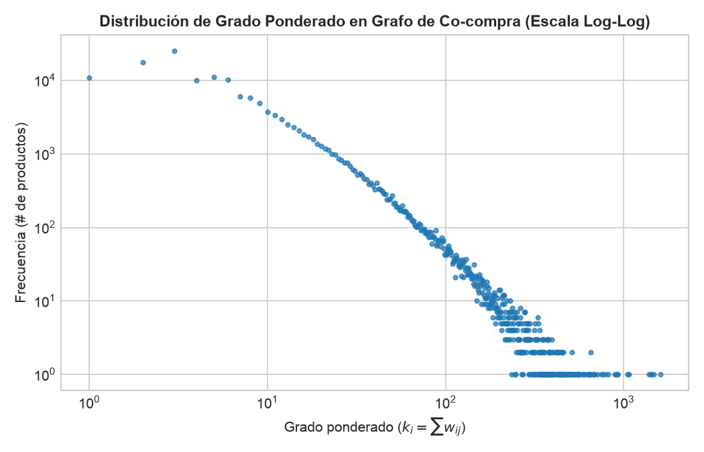
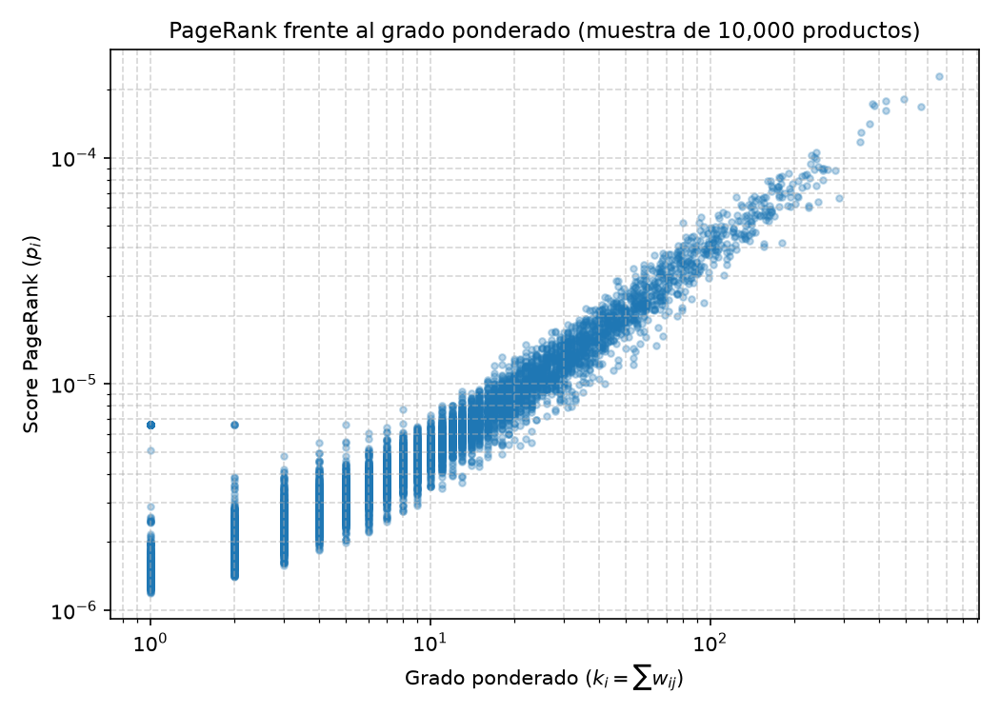
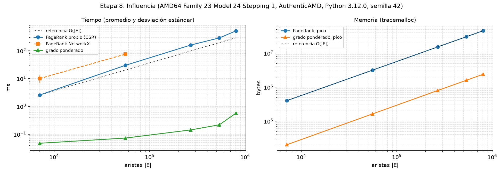
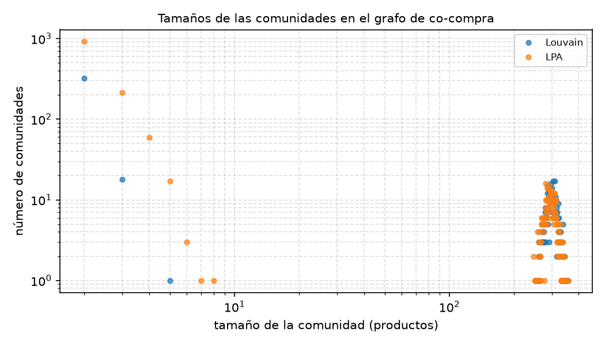
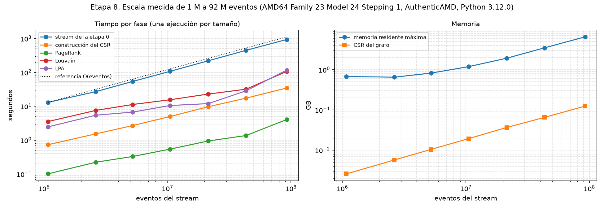
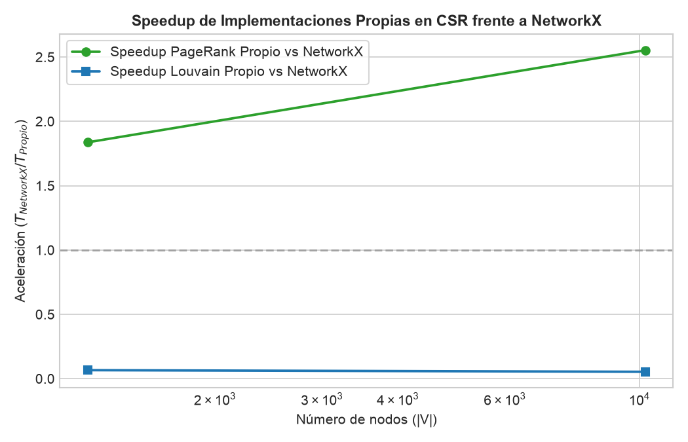

# Informe de la etapa 8

Proyecto EDA 2026-2 · Grupo 1 · Escenario B (comercio electrónico)

29 de octubre de 2026

## Resumen

La etapa 8 resuelve la co-compra del escenario B, que pide "identificar productos adquiridos conjuntamente, agrupaciones de consumo y productos influyentes para cross-selling". Construye el grafo de dominio que define el enunciado, con los productos como nodos y una arista ponderada entre los productos comprados en la misma orden, a partir del stream de la etapa 2 y sin las órdenes que bloqueó la etapa 6. El grafo se guarda en formato CSR y sobre él se implementan a mano las dos familias del bloque avanzado: **PageRank** para el ranking de influencia, frente al grado ponderado, y **Louvain** para las comunidades, frente a Label Propagation (LPA).

| Familia | Pregunta | Complejidad | Resultado principal |
| --- | --- | --- | --- |
| PageRank | ¿Qué productos son más influyentes en la red de co-compras? | O(\|V\| + \|E\|) por iteración y O(\|V\|) de memoria adicional | Converge en 25 iteraciones y tarda 520 ± 6 ms con 150 534 nodos y 805 587 aristas, de 2.5 a 3.9 veces menos que NetworkX. Tiene Spearman 0.956 con el grado ponderado, como se espera en un grafo no dirigido |
| Louvain | ¿Qué grupos de productos se compran juntos más de lo que predice el azar? | ≈ O(\|E\|) por pasada y O(\|V\| + \|E\|) de memoria | Q = 0.9979 en 14.3 s, con las mismas 841 comunidades en 10 semillas, que son exactamente las componentes conexas del grafo. En el grafo de co-reseñas reales, Q = 0.32 frente a 0.008 de LPA y pureza de categoría de 1.8 veces la del azar |

**Alcance del resultado.** Las co-compras del stream son sintéticas. El generador de la etapa 0 completa una parte de las órdenes con productos del mismo grupo `crc32(asin) % 500`, que no tiene relación con el producto. Por eso las comunidades del grafo de co-compra reproducen esos grupos y no temas del catálogo: su pureza de categoría, 0.067, es la misma que con etiquetas al azar. Para comprobar que los algoritmos encuentran estructura cuando la hay, se validan también sobre un grafo de co-reseñas construido con las 12.8 M reseñas reales del dataset.

Los parámetros se eligieron con grillas sobre los datos. Los experimentos de escala usan subgrafos de 1 235 a 150 534 nodos y el stream regenerado de 1 M a 92 M eventos, con semilla 42. Cada tiempo tiene las repeticiones que caben en 120 s, hasta 100, con promedio y desviación estándar, y la memoria se mide con `tracemalloc` en una pasada aparte. NetworkX 3.7 es la implementación de referencia, y la estabilidad de las comunidades se mide con NMI y ARI entre semillas.

## Contexto y datos

| Fuente | Contenido | Uso en la etapa |
| --- | --- | --- |
| `etapa2_eventos.jsonl` | Stream en el orden de servicio de la etapa 2, con 1 978 936 compras | Las compras se agrupan por `order_id`; cada orden con dos o más productos aporta aristas |
| `etapa_6/ordenes_bloqueadas.json` | 31 994 órdenes bloqueadas por la etapa 6 | Sus compras no entran al grafo |
| `etapa_3/catalogo.jsonl` y `AlmacenCatalogo` | Título, categoría y precio de cada producto | Inspección de los resultados y pureza de categoría |
| `data/raw/office_products.parquet` | Las 12 845 712 reseñas reales del dataset | Grafo de co-reseñas para validar los algoritmos |

**Grafo de co-compra.** Cada orden legítima con k ≥ 2 productos distintos suma 1 al peso de cada uno de sus k(k − 1)/2 pares. De las 1 303 414 órdenes legítimas, 324 550 tienen dos o más productos. El grafo resultante tiene 150 534 productos y 805 587 aristas, con suma de pesos 1 067 474, grado medio 10.70, grado máximo 279 (1 606 ponderado) y densidad 7.11 × 10⁻⁵. Todos sus productos tienen al menos una co-compra, así que no hay nodos colgantes.

**Origen de las co-compras.** El generador convierte cada reseña real en un recorrido de compra de su autor. A una parte de las órdenes les agrega de 1 a 3 productos vistos hace poco en el mismo grupo `crc32(asin) % 500` (`_productos_extra` en `src/etapa_0/generator.py`). Las aristas solo unen productos del mismo grupo, así que el grafo es una unión de 841 componentes densas sin aristas entre ellas, de hasta 356 productos. Las ráfagas de fraude del generador son órdenes de un solo producto.

**Grafo de co-reseñas.** Una arista u–v de peso w indica que w usuarios reseñaron v inmediatamente después de u. Sobre las 12.8 M reseñas tiene 579 547 productos y 4 733 125 aristas, y el 98.7 % de los nodos está en una sola componente. No cumple la definición del enunciado, que pide productos de la misma orden, ni pasa por el filtro de fraude de la etapa 6. Por eso el servicio de la etapa 9 sigue usando el grafo de co-compra (`FUENTE_COCOMPRA` en `src/etapa_9/service.py`), y el de co-reseñas solo valida los algoritmos (`src/etapa_8/grafo_resenas_reales.py`).

## Arquitectura

| Origen | Artefacto | Destino | Uso |
| --- | --- | --- | --- |
| Etapa 2 | `etapa2_eventos.jsonl` | Etapa 8 | Compras agrupadas por orden |
| Etapa 6 | `etapa_6/ordenes_bloqueadas.json` | Etapa 8 | Órdenes que no entran al grafo |
| Etapa 3 | `TablaHash` (código) | Etapa 8 | Posición de cada `parent_asin` en el CSR |
| Etapa 8 | `etapa_8/grafo_cocompra.npz` (5.8 MB) | Etapa 9 | Candidatos de co-compra y señal S_co del scoring |
| Etapa 8 | `etapa_8/pagerank.parquet` (4.8 MB) | Etapa 9 | Señal S_pr del scoring y del ranking de búsqueda |
| Etapa 8 | `etapa_8/comunidades.parquet` (1.8 MB) | Etapa 9 | Comunidad de Louvain y de LPA en la ficha del producto |
| Etapa 8 | `etapa_8/grafo_resenas.npz` | Etapa 9 | Fuente alternativa de co-compra en la evaluación con un objetivo real |
| Etapa 8 | `etapa_8/metricas.json` | Informe | Conteos, tiempos y parámetros de la ejecución |

Las salidas quedan en `data/interim/<CATEGORIA>/etapa_8/`. El código está en `src/etapa_8/`: `graph.py` (grafo y algoritmos), `benchmark.py` (grillas, escala, NetworkX, estabilidad y exclusión), `escala_stream.py` (escala medida sobre el stream) y `grafo_resenas_reales.py` (co-reseñas). El notebook es `notebooks/etapa8_grafo_dominio.ipynb`.

## Selección de los algoritmos

- **PageRank y no Personalized PageRank.** El enunciado admite los dos. La etapa 9 necesita una autoridad global por producto, independiente del ancla, porque la parte que depende del ancla ya la aportan la co-compra directa y las similitudes de la etapa 7. Personalized PageRank necesitaría una iteración de potencias por ancla, O(t · (|V| + |E|)) por consulta, o guardar un vector por producto. La línea base es el grado ponderado, el "ranking simple por grado o frecuencia" del enunciado.
- **Louvain y no Girvan-Newman ni Leiden.** Girvan-Newman quita una a una las aristas de mayor intermediación, con un costo de O(|E|² · |V|) en grafos sin pesos (Girvan y Newman, 2002), inviable con 805 587 aristas. Leiden (Traag, Waltman y van Eck, 2019) agrega a Louvain una fase de refinamiento que garantiza comunidades conectadas. La implementación propia obtiene esa garantía con un paso final que parte cada comunidad desconectada en sus componentes, en O(|V| + |E|) y sin bajar la modularidad, pero sin el refinamiento. LPA es la alternativa más simple que pide el enunciado.
- **CSR en NumPy y no una base de datos de grafos.** El grafo se construye una vez por lote y se recorre completo en cada iteración de PageRank y en cada pasada de Louvain. Un CSR en memoria guarda las 805 587 aristas en 19.6 MB, sin un servidor aparte como Neo4j. Un modelo ontológico como OWL sirve para razonar sobre clases y relaciones, no para rankear ni particionar un grafo ponderado.

## Diseño

### Grafo en CSR

`GrafoCoCompra` guarda el grafo no dirigido como una matriz simétrica en CSR. `indptr` (|V| + 1 enteros) marca dónde empiezan los vecinos de cada nodo en `indices` (2|E| enteros de 32 bits), y `data` tiene sus pesos (2|E| flotantes). En memoria ocupa 19.6 MB, unos 25 bytes por arista, sin un objeto de Python por arista, y en disco 5.8 MB. Una `TablaHash` de la etapa 3 traduce cada `parent_asin` a su posición, y los grados ponderados se calculan al cargar el grafo con `np.bincount` sobre `data`.

### PageRank

PageRank es la distribución estacionaria de un paseo aleatorio con reinicio (Page, Brin, Motwani y Winograd, 1999; Brin y Page, 1998). Con probabilidad α el caminante sigue una arista, elegida con probabilidad w_ij / k_i, y con probabilidad 1 − α salta a un nodo al azar. La iteración de potencias es

$$p_{t+1} = \alpha P^T p_t + \left( \alpha \frac{\sum_{j \in \text{colgantes}} p_t(j)}{n} + \frac{1 - \alpha}{n} \right) \mathbf{1}$$

y se detiene cuando ‖p_{t+1} − p_t‖₁ < ε. `pagerank` calcula Pᵀp sin construir la transpuesta: escala x_i = p_i / k_i, multiplica por `data` y acumula en los destinos `indices` con una sola llamada a `np.bincount`, en O(|V| + |E|). El error se contrae un factor α por iteración, así que bastan O(log(1/ε) / log(1/α)) iteraciones; con α = 0.85 y ε = 10⁻⁶ son 25.

**PageRank y grado en un grafo no dirigido.** Sin reinicio, π_i = k_i / 2m es una distribución estacionaria, porque (Pᵀπ)_j = Σ_i (w_ij / k_i) · (k_i / 2m) = k_j / 2m (Lovász, 1993). El reinicio solo aparta a PageRank en parte de esa distribución, así que en un grafo no dirigido ordena casi igual que el grado ponderado. En el grafo de co-compra el Spearman entre los dos es 0.956 y comparten 84 de los 100 primeros productos; en el de co-reseñas, el Spearman es 0.895.

### Louvain

La modularidad compara el peso de las aristas internas de cada comunidad con el que tendrían en un grafo al azar con los mismos grados (Newman y Girvan, 2004; Newman, 2006):

$$Q = \frac{1}{2m} \sum_{ij} \left( A_{ij} - \gamma \frac{k_i k_j}{2m} \right) \delta(c_i, c_j)$$

donde γ es la resolución; con γ = 1 es la modularidad original. Louvain la maximiza en dos fases (Blondel, Guillaume, Lambiotte y Lefebvre, 2008):

1. **Movimientos locales.** Cada nodo, en orden aleatorio, pasa a la comunidad vecina con mayor ganancia ΔQ = k_{i,in} / 2m − γ · k_i Σ_tot / 2m², si es positiva. k_{i,in} es el peso de sus aristas hacia la comunidad y Σ_tot la suma de los grados de la comunidad. Las pasadas se repiten hasta que la ganancia de una pasada es menor que 10⁻⁴.
2. **Contracción.** Cada comunidad pasa a ser un nodo, con sus aristas internas como un bucle y las aristas entre comunidades sumadas. La fase 1 se repite sobre el grafo nuevo, hasta 10 niveles.

La implementación guarda la adyacencia de cada nivel en diccionarios de Python. Al terminar, `dividir_comunidades_desconectadas` parte las comunidades internamente desconectadas en sus componentes.

### Label Propagation

Cada nodo empieza con su propia etiqueta. En cada iteración se visitan los nodos en orden aleatorio, y cada uno adopta la etiqueta con mayor peso entre sus vecinos, c_i ← argmax_c Σ_{j ∈ N(i), c_j = c} w_ij (Raghavan, Albert y Kumara, 2007). El algoritmo se detiene cuando ninguna etiqueta cambia o a las 30 iteraciones, y sus comunidades desconectadas también se parten en componentes.

### Estabilidad

Louvain y LPA dependen del orden de visita, así que se ejecutan con varias semillas y cada partición se compara con las demás con dos medidas que no dependen de los nombres de las comunidades:

- **NMI** (información mutua normalizada; Danon, Díaz-Guilera, Duch y Arenas, 2005): 2 · I(A; B) / (H(A) + H(B)). Vale 1 si las particiones son iguales y 0 si son independientes.
- **ARI** (índice de Rand ajustado; Hubert y Arabie, 1985): el acuerdo entre pares de nodos, corregido por azar. Vale 1 si las particiones son iguales y es cercano a 0 al azar.

`informacion_mutua_normalizada` e `indice_rand_ajustado` (`src/etapa_8/graph.py`) las calculan con la tabla de contingencia de las dos particiones.

### Complejidad

| Operación | Tiempo | Espacio |
| --- | --- | --- |
| Construcción del grafo | O(compras + Σ_o k_o²) para contar los pares de cada orden o, y O(\|E\| log d_máx) para ordenar las listas del CSR | O(\|V\| + \|E\|) |
| PageRank, una iteración | O(\|V\| + \|E\|) | O(\|V\|) |
| PageRank completo | O(t · (\|V\| + \|E\|)), con t = 25 iteraciones | O(\|V\|) |
| Grado ponderado | O(\|V\| + \|E\|), al cargar el grafo | O(\|V\|) |
| Louvain, una pasada de movimientos | O(\|E\|) | O(\|V\| + \|E\|) en diccionarios |
| Louvain completo | O(L · p · \|E\|), con L niveles y p pasadas por nivel; aquí L = 3 | O(\|V\| + \|E\|) |
| LPA, una iteración | O(\|E\|) | O(\|V\|) |
| Modularidad, componentes y división de comunidades | O(\|V\| + \|E\|) | O(\|V\|) |
| NMI y ARI de dos particiones | O(\|V\| log \|V\|) | O(\|V\|) |

### Casos de uso, límites y compromisos

- **PageRank.** Se creó para ordenar páginas web por la estructura de sus enlaces (Page et al., 1999). En recomendación se usa como prior de popularidad o de autoridad, y su versión personalizada sirve para recomendar desde un nodo semilla. En un grafo no dirigido casi repite el grado, los hubs concentran el ranking y se puede manipular con enlaces artificiales, como compras coordinadas; por eso el grafo excluye las órdenes bloqueadas. α equilibra profundidad y costo: un α mayor da más peso a la estructura y necesita más iteraciones (72 con α = 0.95). Frente al grado ponderado, que tarda 0.58 ms, PageRank tarda unas 900 veces más para un orden con Spearman 0.956.
- **Louvain.** Se usa para detectar comunidades en redes sociales, biológicas y de transacciones, y para segmentar catálogos o canastas. Maximiza la modularidad de forma voraz, así que llega a un óptimo local que depende del orden de visita. Tiene un límite de resolución: con γ = 1 puede no separar comunidades con menos de unas √(2m) aristas internas (Fortunato y Barthélemy, 2007). Puede dejar comunidades desconectadas (Traag et al., 2019), que aquí se parten. En un grafo formado por componentes densas, como este, la partición de máxima modularidad son las propias componentes. γ controla la granularidad, y guardar cada nivel en diccionarios cuesta unos 230 bytes por arista, 9 veces el CSR.
- **Label Propagation.** Es la opción para grafos muy grandes, por su costo de O(|E|) por iteración y su memoria baja, de unos 61 bytes por arista. No optimiza ninguna función, no tiene parámetro de resolución y su resultado depende del orden y de los desempates. En un grafo sin comunidades claras puede colapsar en una comunidad gigante: en el de co-reseñas, una sola comunidad reúne hasta 541 125 de los 579 547 nodos y la modularidad es 0.009.

## Elección de los parámetros

Las grillas se calcularon sobre los grafos completos (`results/etapa_8/grilla_alpha.csv`, `grilla_resolucion.csv` y `grilla_resolucion_resenas.csv`).

### Factor de amortiguamiento α

| α | Iteraciones | Score máximo | Score mínimo | Desviación estándar | Producto top 1 |
| --- | --- | --- | --- | --- | --- |
| 0.70 | 16 | 0.000339 | 2.12 × 10⁻⁶ | 9.26 × 10⁻⁶ | `B0BF98LWMZ` |
| 0.75 | 18 | 0.000359 | 1.81 × 10⁻⁶ | 9.90 × 10⁻⁶ | `B0BF98LWMZ` |
| 0.80 | 21 | 0.000378 | 1.50 × 10⁻⁶ | 1.06 × 10⁻⁵ | `B0BF98LWMZ` |
| **0.85** | **25** | **0.000396** | **1.19 × 10⁻⁶** | **1.12 × 10⁻⁵** | **`B0BF98LWMZ`** |
| 0.90 | 36 | 0.000415 | 8.77 × 10⁻⁷ | 1.19 × 10⁻⁵ | `B0BF98LWMZ` |
| 0.95 | 72 | 0.000433 | 5.70 × 10⁻⁷ | 1.26 × 10⁻⁵ | `B0BF98LWMZ` |

Se eligió α = 0.85, el valor de Brin y Page (1998). El producto top 1 es el mismo en toda la grilla, y subir α a 0.95 casi triplica las iteraciones sin cambiarlo.

### Resolución γ de Louvain

En el grafo de co-compra la resolución no cambia la partición. Con γ ∈ {0.5, 1, 2, 5, 10, 20}, Louvain devuelve siempre las 841 componentes conexas, de mediana 282 y máximo 356 productos, y solo baja la modularidad, de 0.9990 a 0.9584. En el grafo de co-reseñas sí la cambia:

| γ | Q con γ | Q con γ = 1 | Comunidades | Con 10 o más productos | Mayor comunidad | Pureza de categoría | Pureza al azar |
| --- | --- | --- | --- | --- | --- | --- | --- |
| **1** | **0.322** | **0.322** | **4 272** | **81** | **139 900** | **0.106** | **0.059** |
| 2 | 0.256 | 0.281 | 3 558 | 137 | 25 921 | 0.146 | 0.058 |
| 5 | 0.220 | 0.246 | 3 966 | 541 | 15 219 | 0.158 | 0.060 |
| 10 | 0.197 | 0.227 | 4 641 | 1 210 | 11 223 | 0.160 | 0.062 |
| 20 | 0.177 | 0.204 | 5 835 | 2 403 | 5 591 | 0.163 | 0.066 |

Se eligió γ = 1, la modularidad original. En el grafo de co-compra da lo mismo. En el de co-reseñas, subir γ parte la comunidad gigante y sube la pureza hasta 0.163, a costa de la modularidad. El servicio de la etapa 9 solo muestra la comunidad en la ficha del producto y no la usa en el scoring, así que γ no cambia las recomendaciones.

## Ejecución en el pipeline

`ejecutar_etapa` (paso 2 del notebook) construye el grafo, calcula PageRank y las comunidades y escribe las salidas en 99.0 s. Las cifras salen de `etapa_8/metricas.json`.

| Medida | Valor |
| --- | --- |
| Compras del stream | 1 978 936, de ellas 31 878 de órdenes bloqueadas |
| Órdenes legítimas / con dos o más productos | 1 303 414 / 324 550 |
| Nodos / aristas | 150 534 / 805 587 |
| Construcción del grafo | 69.5 s y 19.6 MB en memoria |
| PageRank | 25 iteraciones en 0.57 s |
| Louvain | 3 niveles en 15.1 s; Q = 0.9979 y 841 comunidades, ninguna desconectada |
| LPA | 11 iteraciones en 11.9 s; Q = 0.9959 y 1 712 comunidades, tras partir 6 desconectadas |

### Exclusión de las órdenes bloqueadas por la etapa 6

De las 31 994 órdenes bloqueadas, 31 878 tienen compras en el stream, y todas son de un solo producto. Ninguna habría aportado una arista: el grafo con la exclusión y sin ella tiene los mismos nodos, aristas y pesos (`results/etapa_8/exclusion_etapa6.csv`). La integración está en el código, pero con este generador no tiene efecto medible en el grafo. En la etapa 7 sí lo tiene: excluir a los 30 usuarios bloqueados cambia el 93.9 % de las listas de relacionados que tocaban.

### Productos más influyentes

PageRank y el grado ponderado tienen Spearman 0.956 y comparten 84 de los 100 primeros productos.

| Puesto | ASIN | PageRank | Grado ponderado | Producto | Categoría |
| --- | --- | --- | --- | --- | --- |
| 1 | `B0BF98LWMZ` | 0.000396 | 1 420 | Tóner compatible ColorKing TN436 | Toner Cartridges |
| 2 | `B0BN478RWJ` | 0.000392 | 1 606 | Impresora HP DeskJet 2755e | Inkjet Printers |
| 3 | `B087S2JRXY` | 0.000340 | 1 424 | Trituradora Amazon Basics de 15 hojas | Shredders |
| 4 | `B0B3MX7LVG` | 0.000337 | 1 471 | Cinta doble faz EZlifego | Mounting Tape |
| 5 | `B0BZ67T58M` | 0.000330 | 1 391 | Ruedas de repuesto para silla de oficina | Casters |
| 6 | `B09X5RYD9R` | 0.000295 | 751 | Resaltadores DIVERSEBEE | Highlighters |
| 7 | `B0C36Q7PM4` | 0.000294 | 1 052 | Papel multipropósito Amazon Basics | Copy & Multipurpose Paper |
| 8 | `B09PWTVGPW` | 0.000293 | 1 071 | Cinta doble faz Alientape | Mounting Tape |
| 9 | `B07GNNGXNK` | 0.000289 | 920 | Alfombrilla para silla Gorilla Grip | Carpet Chair Mats |
| 10 | `B082F417S1` | 0.000252 | 891 | Protector de escritorio de cuero | Mouse Pads |

El grado ponderado cuenta en cuántas órdenes de varios productos aparece cada producto, así que crece con sus ventas: 9 de estos 10 productos están entre los 10 más vendidos del panel de la etapa 9. Como esas órdenes se arman dentro de grupos de hash, los primeros puestos mezclan categorías sin relación entre sí. La impresora HP tiene el mayor grado ponderado y queda segunda, porque PageRank también pondera la autoridad de los vecinos.

### Comunidades y validación con co-reseñas reales

Louvain devuelve exactamente las 841 componentes conexas, con la misma modularidad que la partición por componentes (0.9979). LPA llega a 1 712 comunidades porque separa fragmentos de algunas componentes. La pureza de categoría de Louvain es 0.067, igual a la de la misma partición con las etiquetas permutadas al azar.

| Medida | Co-compra (generador) | Co-reseñas (reales) |
| --- | --- | --- |
| Nodos / aristas | 150 534 / 805 587 | 579 547 / 4 733 125 |
| Componentes conexas | 841 | 3 408, con el 98.7 % de los nodos en una |
| Modularidad de Louvain / LPA | 0.9979 / 0.9959 | 0.322 / 0.008 |
| Comunidades de Louvain | 841 | 4 272 |
| Pureza de categoría de Louvain / al azar | 0.067 / 0.067 | 0.106 / 0.059 |
| Aristas entre productos de la misma categoría / al azar | — | 0.111 / 0.015 |
| Spearman entre PageRank y grado | 0.956 | 0.895 |

Con una señal real, Louvain encuentra estructura temática: la pureza de sus comunidades es 1.8 veces la del azar, y sube a 0.163 con γ = 20. La comparación con LPA deja de ser trivial, porque LPA junta casi todo el grafo en una comunidad y su modularidad es 0.008.

## Experimentos

Los experimentos están en el paso 9 del notebook, con las funciones de `src/etapa_8/benchmark.py` y `escala_stream.py`, y sus resultados en `results/etapa_8/`.

- **Datos.** Los subgrafos de 1 000, 10 000, 50 000 y 100 000 nodos se forman uniendo componentes conexas completas elegidas con la semilla. Por eso quedan en 1 235, 10 222, 50 127 y 100 225 nodos y conservan el grado medio del grafo. Se agrega el grafo completo de 150 534 nodos. La escala medida regenera el stream de la etapa 0 con ventanas de 150 000 a las 12 845 712 reseñas del dataset y corre la etapa completa en un subproceso por tamaño, de 1 M a 92 M eventos.
- **Repeticiones.** La primera ejecución de cada medición fija cuántas repeticiones caben en 120 s, con un máximo de 100 y un mínimo de 1, el mismo presupuesto de las etapas 5 y 7. Las tablas dan el promedio ± la desviación estándar y, entre paréntesis, las repeticiones. La escala medida se ejecuta una vez por tamaño, porque el mayor tarda 20 minutos y su objetivo es comprobar que la etapa completa escala.
- **Memoria.** Se mide con `tracemalloc` en una pasada aparte, sin medir tiempo, porque el rastreo hace más lenta cada asignación. En la escala medida se reporta la memoria residente máxima de cada subproceso.
- **10 M.** El dataset completo da un grafo de 583 603 nodos, así que con estos datos no se pueden medir 10 M nodos. Esa escala se extrapola con las pendientes log-log.
- **Plataforma.** Windows 10, AMD64 Family 23 Model 24, 8 núcleos, 32.1 GB de RAM, Python 3.12.0, semilla 42.

### PageRank frente al grado ponderado

| Nodos | Aristas | PageRank (ms) | Grado ponderado (ms) | Memoria pico, PageRank | Memoria pico, grado |
| --- | --- | --- | --- | --- | --- |
| 1 235 | 7 059 | 2.57 ± 0.09 (100) | 0.047 ± 0.005 (100) | 0.38 MB | 0.02 MB |
| 10 222 | 55 884 | 30.0 ± 0.9 (100) | 0.073 ± 0.003 (100) | 3.0 MB | 0.16 MB |
| 50 127 | 269 450 | 160.2 ± 4.2 (100) | 0.143 ± 0.016 (100) | 14.7 MB | 0.77 MB |
| 100 225 | 537 698 | 289.7 ± 6.1 (100) | 0.219 ± 0.039 (100) | 29.3 MB | 1.53 MB |
| 150 534 | 805 587 | 520.0 ± 5.9 (100) | 0.578 ± 0.040 (100) | 43.9 MB | 2.30 MB |

- **Tiempo.** La pendiente log-log de PageRank es 1.09 frente a los nodos y 1.10 frente a las aristas, coherente con O(t · (|V| + |E|)). El grado ponderado tiene pendiente 0.45: en estos tamaños domina el costo fijo de la llamada, unos 0.05 ms, y no el recorrido del arreglo.
- **Memoria.** El pico de PageRank es de unos 57 bytes por arista, por los arreglos temporales de cada iteración, y el del grado, de 16 bytes por nodo.

### Louvain frente a LPA

| Nodos | Louvain (s) | LPA (s) | Q Louvain | Q LPA | Comunidades Louvain | Comunidades LPA | Memoria pico, Louvain | Memoria pico, LPA |
| --- | --- | --- | --- | --- | --- | --- | --- | --- |
| 1 235 | 0.066 ± 0.002 (100) | 0.046 ± 0.003 (100) | 0.7436 | 0.7421 | 6 | 19 | 1.5 MB | 0.4 MB |
| 10 222 | 0.81 ± 0.03 (100) | 0.52 ± 0.02 (100) | 0.9692 | 0.9677 | 48 | 100 | 12.1 MB | 3.3 MB |
| 50 127 | 3.52 ± 0.07 (35) | 2.16 ± 0.05 (55) | 0.9937 | 0.9916 | 276 | 577 | 59.7 MB | 15.7 MB |
| 100 225 | 11.83 ± 0.09 (10) | 5.67 ± 0.07 (21) | 0.9969 | 0.9947 | 562 | 1 156 | 119.3 MB | 31.3 MB |
| 150 534 | 14.31 ± 0.03 (8) | 11.17 ± 0.07 (10) | 0.9979 | 0.9959 | 841 | 1 712 | 176.4 MB | 46.9 MB |

- **Tiempo.** Las pendientes log-log son 1.13 para Louvain y 1.11 para LPA frente a los nodos, cerca de lo lineal. Desde 50 000 nodos caben de 8 a 55 repeticiones en el presupuesto; 100 repeticiones tardarían de 4 a 24 minutos por medición. La versión anterior de este experimento medía el tiempo con `tracemalloc` activo, que en la plataforma de esa medición multiplicaba por 22 el tiempo de Louvain (revisión técnica, punto 1.4).
- **Memoria.** Louvain usa unos 230 bytes por arista, 9 veces el CSR, por los diccionarios de adyacencia de cada nivel. LPA usa unos 61.
- **Calidad.** Louvain tiene más modularidad que LPA en todos los tamaños, pero la diferencia es pequeña porque el grafo es una unión de componentes densas.

### Estabilidad y tamaños de las comunidades

| Grafo | Algoritmo | Semillas | Comunidades | Modularidad | NMI media | ARI media | Mayor comunidad | Percentil 90 | Mediana | Segundos |
| --- | --- | --- | --- | --- | --- | --- | --- | --- | --- | --- |
| Co-compra | Louvain | 10 | 841 en todas | 0.9979 | 1.000 | 1.000 | 356 | 317 | 282 | 14.4 |
| Co-compra | LPA | 10 | 1 714 a 1 783 | 0.9955 ± 0.0004 | 0.997 | 0.993 | 356 | 302 | 2 | 8.7 |
| Co-reseñas | Louvain | 5 | 4 044 a 5 286 | 0.321 ± 0.002 | 0.499 | 0.475 | 119 667 a 148 613 | 4 | 2 | 295 |
| Co-reseñas | LPA | 5 | 16 243 a 17 876 | 0.009 ± 0.0003 | 0.934 | 0.928 | 537 386 a 541 125 | 3 | 2 | 84 |

- **Co-compra.** Louvain devuelve la misma partición con las 10 semillas, las componentes, y LPA varía poco, porque cada componente densa converge a una o pocas etiquetas. La mitad de las comunidades de LPA son pares de productos que separa de su componente, sin ninguna comunidad de un solo producto.
- **Co-reseñas.** Louvain cambia mucho entre semillas (NMI 0.499 y ARI 0.475) mientras la modularidad apenas varía (0.321 ± 0.002). Hay muchas particiones casi igual de buenas, un rasgo conocido de la maximización de modularidad en grafos reales (Good, de Montjoye y Clauset, 2010). LPA parece más estable, pero porque casi todo cae en una comunidad gigante.
- **Tamaños.** En co-compra los tamaños son los de las componentes. En co-reseñas la distribución es muy sesgada: el percentil 90 es de 3 o 4 productos y la mayor comunidad de Louvain tiene entre 119 667 y 148 613.

### Escala medida sobre el stream

| Reseñas | Eventos | Nodos | Aristas | Componentes | Mayor componente | PageRank (s) | Louvain (s) | LPA (s) | Memoria residente | Total (s) |
| --- | --- | --- | --- | --- | --- | --- | --- | --- | --- | --- |
| 150 000 | 1.08 M | 39 279 | 102 347 | 1 003 | 103 | 0.10 | 3.5 | 2.5 | 0.68 GB | 20 |
| 375 000 | 2.63 M | 68 489 | 232 089 | 931 | 167 | 0.22 | 7.6 | 5.5 | 0.65 GB | 42 |
| 750 000 | 5.23 M | 101 747 | 433 388 | 865 | 252 | 0.33 | 11.3 | 6.7 | 0.82 GB | 75 |
| 1 500 000 | 10.5 M | 151 026 | 815 051 | 836 | 356 | 0.55 | 15.6 | 10.6 | 1.19 GB | 140 |
| 3 000 000 | 21.4 M | 233 655 | 1 563 682 | 797 | 538 | 0.95 | 23.0 | 12.0 | 1.93 GB | 267 |
| 6 000 000 | 43.3 M | 342 310 | 2 802 528 | 767 | 776 | 1.37 | 31.9 | 28.6 | 3.49 GB | 528 |
| 12 845 712 | 92.4 M | 583 603 | 5 382 454 | 899 | 1 312 | 4.06 | 107.2 | 116.6 | 6.56 GB | 1 201 |

- **Compras con ASIN vacío.** El generador inyecta compras con `parent_asin = ""`, y la versión anterior las contaba como un nodo que unía 582 838 de los 583 653 nodos en una sola componente (revisión técnica, punto 1.3). Ahora se descartan, de 356 a 30 321 según el tamaño, y Louvain devuelve exactamente las componentes en todos los tamaños.
- **Tiempo.** El stream es lineal en los eventos (pendiente 0.97) y la construcción del CSR lo es en las aristas (0.97). PageRank, Louvain y LPA tienen pendientes de 0.87, 0.76 y 0.85 frente a las aristas, por debajo de 1 porque los tamaños pequeños cargan costos fijos. Con el dataset completo, la etapa tarda 20 minutos, 16 de ellos en regenerar el stream, con 6.6 GB de memoria residente.
- **Densidad.** Con más reseñas, las órdenes repiten los mismos productos y el grado medio pasa de 5.2 a 18.4.
- **Fraude.** A esta escala el filtro usa la verdad de referencia del generador, porque el detector de la etapa 6 no se recorre en cada tamaño.

### Extrapolación a 10 M nodos

| Medida | Nodos medidos | Pendiente log-log | Segundos extrapolados a 10 M nodos |
| --- | --- | --- | --- |
| PageRank, subgrafos | 1 235 a 150 534 | 1.09 | 49 |
| Louvain, subgrafos | 1 235 a 150 534 | 1.13 | 1 728 (29 min) |
| LPA, subgrafos | 1 235 a 150 534 | 1.11 | 959 (16 min) |
| PageRank, stream | 39 279 a 583 603 | 1.30 | 133 |
| Louvain, stream | 39 279 a 583 603 | 1.15 | 2 016 (34 min) |
| LPA, stream | 39 279 a 583 603 | 1.28 | 2 566 (43 min) |

La proyección desde el stream es mayor porque ahí las aristas crecen más rápido que los nodos. La versión anterior de este informe proyectaba 2.1 h para Louvain y 3.4 h para LPA, con tiempos medidos con `tracemalloc` activo.

### Comparación con NetworkX

NetworkX 3.7 (`nx.pagerank` y `nx.community.louvain_communities`; Hagberg, Schult y Swart, 2008) se midió con el mismo protocolo en los subgrafos de hasta 50 000 nodos (`results/etapa_8/referencia_networkx.csv`). Como los subgrafos unen componentes completas, el de 50 000 quedó en 50 127 nodos y fuera del límite, así que la comparación cubre los de 1 235 y 10 222 nodos.

| Nodos | PageRank propio (ms) | PageRank NetworkX (ms) | Razón | Louvain propio (s) | Louvain NetworkX (s) | Razón | Error máximo de PageRank | Modularidad, las dos | Comunidades, las dos |
| --- | --- | --- | --- | --- | --- | --- | --- | --- | --- |
| 1 235 | 2.57 | 10.0 ± 3.0 (100) | 3.9 | 0.066 | 0.084 ± 0.003 (100) | 1.28 | 5.8 × 10⁻⁵ | 0.7436 | 6 |
| 10 222 | 30.0 | 75.7 ± 2.1 (100) | 2.5 | 0.81 | 0.90 ± 0.01 (100) | 1.11 | 1.7 × 10⁻⁵ | 0.9692 | 48 |

- **Tiempo.** El PageRank propio es de 2.5 a 3.9 veces más rápido, porque recorre el CSR con NumPy y NetworkX guarda un diccionario por nodo y por arista. El Louvain propio es de 1.11 a 1.28 veces más rápido. La versión anterior de este informe decía que el PageRank propio era hasta 60 veces más rápido y el Louvain de NetworkX de 15 a 18 veces más rápido: lo primero era el calentamiento de la primera llamada y lo segundo, el `tracemalloc` activo.
- **Calidad.** Louvain da la misma modularidad y el mismo número de comunidades que NetworkX. El error máximo de PageRank viene del criterio de parada: NetworkX se detiene cuando la diferencia L1 entre iteraciones baja de N · 10⁻⁶, un criterio más laxo que el propio.
- **Otras implementaciones de referencia**, que no se compararon: igraph, en C (Csárdi y Nepusz, 2006), graph-tool, `leidenalg` para Leiden, `python-louvain` y cuGraph en GPU.

## Limitaciones y decisiones tomadas con los datos

### Decisiones tomadas con los datos

- **El servicio usa el grafo de co-compra.** Es el que define el enunciado y el único que pasa por el filtro de fraude. El de co-reseñas tiene estructura temática, pero queda como validación de los algoritmos y como fuente alternativa en la evaluación de la etapa 9.
- **Subgrafos con componentes completas.** Una versión anterior tomaba nodos al azar, y sus subgrafos casi no tenían aristas: la grilla de resolución daba 8 488 comunidades de mediana 1 para todo γ.
- **Comunidades conectadas.** Las comunidades desconectadas se parten en sus componentes, la garantía de Leiden, sin bajar la modularidad. En el grafo de co-compra Louvain no deja ninguna y LPA deja 6.
- **Tiempo sin `tracemalloc`.** El tiempo y la memoria se miden en pasadas separadas, como en las etapas 0 a 7.
- **Compras con ASIN vacío descartadas** en la escala medida, donde formaban un nodo central artificial.
- **α = 0.85 y γ = 1**, los valores estándar, porque las grillas no cambian el producto top 1 ni las comunidades del grafo de co-compra.

### Limitaciones

- **Co-compras sintéticas.** Las comunidades del grafo de co-compra son los grupos de hash del generador, con pureza de categoría igual al azar. La evidencia de estructura temática viene del grafo de co-reseñas. Generar las órdenes agrupando por `categoria_hoja` obligaría a reejecutar las etapas 0 a 9.
- **La exclusión de fraude no cambia el grafo**, porque las órdenes fraudulentas del generador tienen un solo producto.
- **PageRank casi repite el grado.** En un grafo no dirigido es lo que predice la teoría, y aquí cuesta 900 veces más que el grado ponderado.
- **Grafo estático.** El CSR no admite inserciones; el grafo se reconstruye por lote, en 69.5 s con el stream del pipeline.
- **10 M nodos no se miden**, porque el dataset completo llega a 583 603 nodos.
- **NetworkX solo se compara hasta 10 222 nodos.**
- **Python puro en Louvain y LPA.** Louvain guarda cada nivel en diccionarios, con unos 230 bytes por arista, y tarda 107 s con las 5.4 M aristas del dataset completo.

## Conclusiones

La etapa construye el grafo de co-compra que define el enunciado, con 150 534 productos y 805 587 aristas en un CSR de 19.6 MB. PageRank converge en 25 iteraciones y 520 ms, de 2.5 a 3.9 veces más rápido que NetworkX, y en este grafo no dirigido ordena casi igual que el grado ponderado (Spearman 0.956), que cuesta 900 veces menos. Louvain llega a Q = 0.9979, pero devuelve las 841 componentes conexas, porque el generador arma las órdenes de varios productos dentro de grupos de hash. Por eso sus comunidades no son temáticas y la comparación con LPA es casi trivial en este grafo.

Con las co-reseñas reales los mismos algoritmos sí encuentran estructura: las comunidades de Louvain tienen una pureza de categoría de 1.8 veces la del azar y una modularidad de 0.32, frente a 0.008 de LPA, que colapsa en una comunidad gigante. Louvain es estable entre semillas en el grafo de co-compra, y en el de co-reseñas encuentra particiones distintas con la misma modularidad. La etapa escala casi linealmente: con el dataset completo, 92.4 M eventos y 5.4 M aristas, tarda 20 minutos con 6.6 GB. Sus salidas alimentan a la etapa 9 con la autoridad S_pr, la co-compra S_co y la comunidad de cada producto.

## Referencias

- Blondel, V. D., Guillaume, J.-L., Lambiotte, R., y Lefebvre, E. (2008). Fast unfolding of communities in large networks. *Journal of Statistical Mechanics: Theory and Experiment*, 2008(10), P10008. https://doi.org/10.1088/1742-5468/2008/10/P10008
- Brin, S., y Page, L. (1998). The anatomy of a large-scale hypertextual Web search engine. *Computer Networks and ISDN Systems*, 30(1-7), 107–117. https://doi.org/10.1016/S0169-7552(98)00110-X
- Csárdi, G., y Nepusz, T. (2006). The igraph software package for complex network research. *InterJournal, Complex Systems*, 1695.
- Danon, L., Díaz-Guilera, A., Duch, J., y Arenas, A. (2005). Comparing community structure identification. *Journal of Statistical Mechanics: Theory and Experiment*, 2005(09), P09008.
- Fortunato, S., y Barthélemy, M. (2007). Resolution limit in community detection. *Proceedings of the National Academy of Sciences*, 104(1), 36–41.
- Girvan, M., y Newman, M. E. J. (2002). Community structure in social and biological networks. *Proceedings of the National Academy of Sciences*, 99(12), 7821–7826.
- Good, B. H., de Montjoye, Y.-A., y Clauset, A. (2010). Performance of modularity maximization in practical contexts. *Physical Review E*, 81(4), 046106.
- Hagberg, A. A., Schult, D. A., y Swart, P. J. (2008). Exploring network structure, dynamics, and function using NetworkX. *Proceedings of the 7th Python in Science Conference (SciPy 2008)*, 11–15.
- Hubert, L., y Arabie, P. (1985). Comparing partitions. *Journal of Classification*, 2(1), 193–218.
- Leskovec, J., Rajaraman, A., y Ullman, J. D. (2020). *Mining of Massive Datasets* (3.ª ed.). Cambridge University Press. Cap. 5 y 10.
- Lovász, L. (1993). Random walks on graphs: A survey. *Combinatorics, Paul Erdős is Eighty*, 2, 1–46.
- Newman, M. E. J. (2006). Modularity and community structure in networks. *Proceedings of the National Academy of Sciences*, 103(23), 8577–8582. https://doi.org/10.1073/pnas.0601602103
- Newman, M. E. J., y Girvan, M. (2004). Finding and evaluating community structure in networks. *Physical Review E*, 69(2), 026113.
- Page, L., Brin, S., Motwani, R., y Winograd, T. (1999). *The PageRank citation ranking: Bringing order to the Web* (Technical Report 1999-66). Stanford InfoLab.
- Raghavan, U. N., Albert, R., y Kumara, S. (2007). Near linear time algorithm to detect community structures in large-scale networks. *Physical Review E*, 76(3), 036106. https://doi.org/10.1103/PhysRevE.76.036106
- Traag, V. A., Waltman, L., y van Eck, N. J. (2019). From Louvain to Leiden: Guaranteeing well-connected communities. *Scientific Reports*, 9, 5233.
- Implementaciones de referencia: NetworkX 3.7 (comparada en los experimentos), igraph, graph-tool, `leidenalg`, `python-louvain` y cuGraph.
