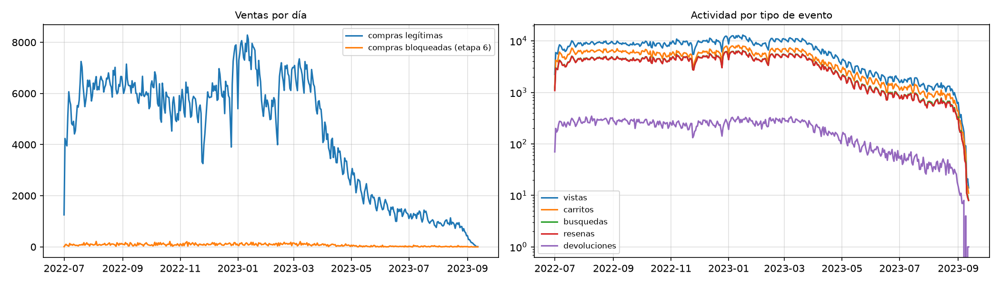
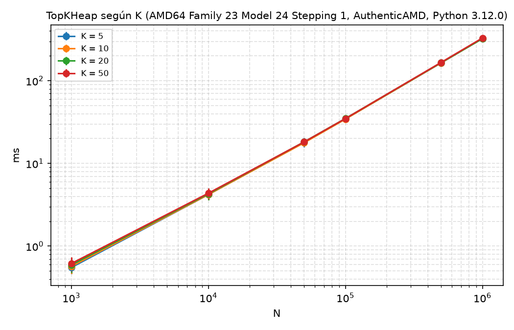

# Informe de la etapa 9

Proyecto EDA 2026-2 · Grupo 1 · Escenario B (comercio electrónico)

29 de octubre de 2026

## Resumen

La etapa 9 es el servicio del escenario B, que pide "proporcionar autocompletado, resultados ordenados por relevancia o popularidad, recomendaciones y panel de ventas, actividad y alertas". `ServicioEcommerce` carga las salidas de las etapas 2 a 8 y responde cada consulta con estructuras implementadas a mano: un **Trie radix** con caché Top-K para el autocompletado, con un modo difuso para los errores de tipeo; un **índice invertido** para la búsqueda; un **TopKHeap**, un MinHeap acotado, para elegir los K mejores candidatos; y un **scoring híbrido** que combina las señales de las etapas 7 y 8. Un dashboard en HTML (`visualizador/dashboard_etapa_9_servicio.html`) muestra las respuestas.

| Estructura | Consulta | Complejidad | Resultado principal |
| --- | --- | --- | --- |
| Trie radix con caché Top-K | Autocompletado | Consulta O(L + k); inserción O(L + h · M) | 585 983 términos en 831 377 nodos. La consulta tarda 4.3 µs en la mediana y no depende del número de términos (pendiente log-log de −0.01) |
| Autocompletado difuso (Damerau-OSA) | Autocompletado con errores de tipeo | Crece con los nodos que recorre dentro de la banda de distancia d | Con d = 1, 0.43 ms en la mediana y el prefijo correcto en el top 5 en el 89.7 % de las consultas con un error |
| Índice invertido | Búsqueda por texto | O(Σ df de los tokens de la consulta) | 710 468 productos y 11.8 M postings; 6.3 ms en la mediana, con corrección ortográfica por token |
| TopKHeap | Selección de los K mejores candidatos | O(N log K) en tiempo y O(K) en memoria | Supera a `sorted()` recién con 10⁶ candidatos (1.18 veces); `np.argpartition` es 26 veces más rápido |
| Scoring híbrido | Recomendación | O(c log K) con c candidatos por ancla | 1.4 ms en la mediana, con pesos 0.35 / 0.25 / 0.20 / 0.20 |

El servicio también filtra por rango de precio con el B+Tree de la etapa 4, recomienda en arranque en frío con el KD-Tree de la etapa 5, arma el panel de ventas y actividad con el stream de la etapa 2 y el estado de la etapa 3, y muestra las alertas de la etapa 6. La traza de un lote del stream a través de las diez etapas está en `notebooks/demo_pipeline.ipynb`. Los experimentos usan el protocolo de la etapa 8: cada tiempo tiene las repeticiones que caben en 120 s, hasta 100, con promedio y desviación estándar, y la memoria se mide con `tracemalloc` en una pasada aparte, con semilla 42.

**Alcance de las recomendaciones.** Las co-compras que usa la señal S_co son sintéticas: el generador de la etapa 0 completa una parte de las órdenes con productos del mismo grupo `crc32(asin) % 500`, sin relación con el producto (informe de la etapa 8). Por eso una recomendación junta productos parecidos al ancla, que aporta la similitud de la etapa 7, con productos de su grupo de hash, que aporta la co-compra. Esos últimos no son productos complementarios, y una calibración contra las co-compras mide al generador. Por esa razón el scoring también se evalúa con un objetivo real, la siguiente reseña de cada usuario.

## Contexto y datos

| Etapa | Artefacto | Uso en la etapa 9 |
| --- | --- | --- |
| 2 | `etapa2_eventos.jsonl` | Ventas y actividad por día del panel, en una pasada por el stream |
| 3 | `etapa_3/catalogo.jsonl` y `AlmacenCatalogo` | Ficha de cada producto y textos del Trie y del índice invertido |
| 3 | `etapa_3/estado_productos.parquet` | Stock y disponibilidad de los 195 019 productos con actividad, en la ficha, en cada recomendación y en el panel |
| 4 | `etapa_4/indice_precio.bpt` | Filtro por rango de precio de la recomendación y la búsqueda, sobre 336 415 productos con precio |
| 5 | `etapa_5/vectores.npz` | KD-Tree reconstruido para el arranque en frío, con los mismos 336 415 productos |
| 6 | `etapa_6/alertas.jsonl` y `ordenes_bloqueadas.json` | Centro de alertas y compras bloqueadas del panel |
| 7 | `etapa_7/similares.parquet` | Candidatos y señal S_sim (HNSW, 195 019 productos) |
| 7 | `etapa_7/relacionados.parquet` | Candidatos y señal S_rel (MinHash + LSH, 75 890 productos) |
| 8 | `grafo_cocompra.npz`, `pagerank.parquet` y `comunidades.parquet` | Candidatos y señal S_co, señal S_pr y comunidad del producto (150 534 productos) |

## Arquitectura

### Flujo del pipeline

Las etapas se conectan en lote por archivos: cada una lee la salida completa de las anteriores en `data/interim/<CATEGORIA>/` y escribe la suya.

```text
Etapa 0  Generador y ColaCircular con backpressure, sin descarte ──► etapa0_lotes.jsonl
   │
Etapa 1  Preprocesador: validación, normalización y deduplicación ──► etapa1_lotes.jsonl
   │
Etapa 2  ColaPrioridadEventos (MinHeap con aging) ──► etapa2_eventos.jsonl
   │
   ├──► Etapa 3  TablaHash, AlmacenCatalogo, caché LRU, estado y matriz usuario-producto
   │       ├──► Etapa 4  B+Tree de precios sobre el catálogo
   │       │       └──► Etapa 5  vectores de atributos y KD-Tree (catálogo, estado y B+Tree)
   │       └──► Etapa 7  MinHash + LSH sobre la matriz y HNSW sobre el catálogo
   ├──► Etapa 6  Bloom Filter y Count-Min Sketch ──► alertas y órdenes bloqueadas
   │       ├──► Etapa 7  sin los usuarios bloqueados
   │       └──► Etapa 8  sin las órdenes bloqueadas
   └──► Etapa 8  grafo de co-compra, PageRank y Louvain

Etapa 9  ServicioEcommerce ◄── etapa 2: ventas y actividad del panel
                           ◄── etapa 3: fichas, stock y disponibilidad
                           ◄── etapa 4: filtro por rango de precio
                           ◄── etapa 5: arranque en frío
                           ◄── etapa 6: alertas y compras bloqueadas
                           ◄── etapa 7: candidatos y señales S_sim y S_rel
                           ◄── etapa 8: candidatos, señales S_co y S_pr y comunidad
   └──► Trie radix, índice invertido, TopKHeap y scoring híbrido ──► dashboard
```

### Traza de un lote a través de las diez etapas

`notebooks/demo_pipeline.ipynb` toma 200 registros del stream que emitió la etapa 0 (posiciones 2 150 a 2 349) y sigue dos eventos. Las etapas 0, 1, 2, 3 y 6 corren en vivo con las estructuras reales, en el orden de servicio de la etapa 2. Las etapas 4, 5, 7 y 8 se consultan, porque sus índices se construyen con el catálogo o el stream completos, y la 9 carga el servicio. En las etapas en vivo la demo reproduce lo que guardó el pipeline completo: el evento que sale de la etapa 2 es idéntico, campo por campo, y la decisión de la etapa 6 coincide en los 11 eventos comparados.

| Etapa | Compra legítima `e000001981` (silla de oficina Hbada, orden de dos productos) | Compra de fraude `e000001899` (cuenta señalada) |
| --- | --- | --- |
| 0 · ColaCircular | Posición 2 199 del stream, micro-lote 4 | Posición 2 177, micro-lote 2 |
| 1 · Preprocesador | Válida y normalizada | Válida y normalizada |
| 2 · MinHeap | Clase 3 (estándar), atendida en el puesto 41 | Clase 3, atendida en el puesto 14 |
| 3 · TablaHash, LRU y estado | El stock baja de 12 a 11; al final del stream le quedan 7 unidades | El stock baja de 35 a 34, porque la etapa 3 cuenta la compra antes del filtro de fraude |
| 4 · B+Tree | La clave (249.99, `B08FMPDDVJ`) se encuentra leyendo 3 páginas | — |
| 5 · KD-Tree | Cinco sillas de la misma categoría como vecinas por atributos | — |
| 6 · Bloom Filter y CMS | Sin alerta | `bloquear`: la cuenta da positivo en el Bloom Filter y se confirma en la tabla exacta |
| 7 · MinHash + LSH y HNSW | La cinta de la misma orden es su primer relacionado; sus similares son otras sillas | La cuenta queda fuera de los conjuntos de usuarios |
| 8 · Grafo | La orden aporta la arista con la cinta, que suma 10 órdenes; PageRank en el puesto 2 352 | La orden queda fuera del grafo |
| 9 · Servicio | Recomendación: dos sillas Hbada y, tercera, la cinta de la misma orden | Alerta en el centro de monitoreo |

### Salidas de la etapa

| Artefacto | Contenido |
| --- | --- |
| `etapa_9/metricas.json` | Latencias p50 y p95 de cada consulta, tamaños de los índices y pesos del scoring |
| `etapa_9/demo_consultas.json` | Consultas precalculadas, panel de ventas y alertas |
| `visualizador/dashboard_etapa_9_servicio.html` | Dashboard con los dos archivos anteriores incrustados |

El código está en `src/etapa_9/`: `service.py` (estructuras y servicio), `dashboard.py` y `plantilla_dashboard.html` (dashboard), `benchmark.py` (experimentos de escala), `evaluacion_scoring.py` y `evaluacion_real.py` (calibración del scoring) y `analisis_campos_reales.py`. El notebook es `notebooks/etapa9_servicio_visualizacion.ipynb`.

## Diseño de las estructuras

### Trie radix con caché Top-K

Un Trie guarda las cadenas carácter a carácter, de modo que todos los términos con un mismo prefijo cuelgan del mismo nodo (Fredkin, 1960; Knuth, 1998, sec. 6.3). La versión radix comprime cada cadena de nodos con un solo hijo en una arista con una subcadena (Morrison, 1968). Con un carácter por nodo, el catálogo completo necesitaba 7.2 M nodos, el 90 % con un solo hijo, y unos 3.5 GB; la versión radix tiene 831 377 nodos con la misma semántica.

Cada nodo guarda una caché con los M = 10 términos de mayor frecuencia de su subárbol. Consultar un prefijo de longitud L desciende L caracteres y devuelve los k primeros de la caché, en O(L + k), sin recorrer el subárbol. Insertar un término cuesta O(L + h · M), porque actualiza la caché de los h nodos de su camino. El Trie del servicio indexa 585 983 términos: las tiendas, las categorías de último nivel y las cuatro primeras palabras de cada título, con un peso que crece con el PageRank del producto. La versión anterior se detenía a las 50 000 inserciones, que cubrían los primeros ~3 % de los productos, y quedaba con 46 818 términos.

**Autocompletado difuso.** Si la búsqueda exacta no llena las k sugerencias, el servicio busca términos a distancia de Damerau-Levenshtein restringida (OSA) d ≤ 1: inserciones, borrados, sustituciones y transposiciones de dos caracteres vecinos (Damerau, 1964; Levenshtein, 1966). Recorre el Trie en profundidad con una fila de programación dinámica por nodo, limitada a la banda |i − j| ≤ d de Ukkonen (1985), y poda una rama cuando el mínimo de su fila supera d.

### Índice invertido y corrección por token

La búsqueda usa un índice invertido sobre el título, la tienda y la categoría de los 710 468 productos con título, con sus 11 839 094 postings en formato CSR (Manning, Raghavan y Schütze, 2008, cap. 1 y 3; Zobel y Moffat, 2006). El score de un producto es 0.8 por la cobertura IDF de la consulta en su texto más 0.2 por su autoridad S_pr, y los K mejores se eligen con `np.argpartition`. Antes de buscar, cada token que no está en el vocabulario se corrige con el término más cercano de un Trie de vocabulario con los 53 341 tokens alfabéticos que aparecen en al menos 3 productos: "toner brtoher" se busca como "toner brother". La versión anterior puntuaba 0.5 + 0.5 · S_pr, con una relevancia constante, y "toner brother" devolvía portacarteles.

### TopKHeap

`TopKHeap` mantiene un MinHeap de a lo sumo K elementos cuya raíz es el peor de los K mejores (Cormen, Leiserson, Rivest y Stein, 2022, cap. 6). Un candidato con score menor o igual que la raíz se descarta en O(1); uno mayor la reemplaza en O(log K). El costo total es O(N log K) en tiempo y O(K) en memoria, frente a O(N log N) y O(N) de ordenar todo. Si los candidatos llegan en orden aleatorio, el número esperado de reemplazos es K · (H_N − H_K) ≈ K ln(N/K), así que casi todos se descartan en O(1).

### Scoring híbrido

Para un ancla q, los candidatos son sus vecinos HNSW, sus relacionados de MinHash + LSH y sus vecinos en el grafo de co-compra. Cada candidato p recibe

$$S(p \mid q) = w_{\text{sim}} S_{\text{sim}}(p, q) + w_{\text{rel}} S_{\text{rel}}(p, q) + w_{\text{pr}} \widetilde{S}_{\text{pr}}(p) + w_{\text{co}} S_{\text{co}}(p, q)$$

- **S_sim = max(0, 1 − d²/2)**, el coseno entre los vectores de atributos de la etapa 7. HNSW devuelve la distancia euclidiana d = √(2 − 2 cos) entre vectores de norma 1. La versión anterior usaba 1 − d, que vale 0 para todo coseno menor o igual que 0.5 (revisión técnica, punto 1.5).
- **S_rel**, la Jaccard entre los conjuntos de usuarios, de los relacionados de la etapa 7.
- **S̃_pr**, el PageRank de la etapa 8 en escala logarítmica, llevado a [0, 1] con el mínimo y el máximo del grafo. Dividido por el máximo, su mediana era 0.008.
- **S_co = w_pq / max_k w_qk**, el peso de la arista de co-compra dividido por el mayor peso del ancla.

Los pesos base son w_sim = 0.35, w_rel = 0.25, w_pr = 0.20 y w_co = 0.20. Si el ancla no tiene una señal, su peso se anula y los demás se renormalizan. Después del scoring, el ranking se reordena con (1 − λ) · S + λ · (1 − S̃_pr), con S llevado a [0, 1] dentro de los candidatos del ancla y λ = 0.3, para no recomendar siempre los productos más populares. El `TopKHeap` elige los K mejores. Con un filtro de precio, solo entran los candidatos del rango que devuelve el B+Tree de la etapa 4, en O(log_B n + r/B) lecturas de página. Si el ancla no tiene ninguna señal, como un producto que nunca apareció en el stream, la lista sale del KNN exacto por atributos dentro de su categoría con el KD-Tree de la etapa 5. Cada recomendación lleva el stock y la disponibilidad de la etapa 3.

### Panel de ventas y centro de alertas

El panel recorre una vez el stream de la etapa 2 y cuenta los eventos de cada día por tipo. Las compras de las órdenes bloqueadas por la etapa 6 se cuentan aparte y no suman ventas ni ingresos. El stock, los agotamientos y las ventas sin stock salen del estado de la etapa 3. El centro de alertas resume las decisiones de la etapa 6, `bloquear` y `revisar`, y mide la precisión de los bloqueos con la etiqueta `fraude_real` del generador.

### Complejidad

| Operación | Tiempo | Espacio |
| --- | --- | --- |
| Inserción en el Trie radix | O(L + h · M) | O(L) por término nuevo, más M entradas de caché por nodo |
| Autocompletado exacto | O(L + k) | O(k) |
| Autocompletado difuso con distancia d | O(n_v · (2d + 1)), con n_v nodos visitados antes de la poda | O(L) por nivel de la recursión |
| Búsqueda en el índice invertido | O(Σ_t df_t + C), con C productos candidatos | O(C) |
| TopKHeap | O(N log K) | O(K) |
| Recomendación | O(c log K), con c candidatos del ancla | O(c) |
| Filtro por precio | O(log_B n + r/B) lecturas de página para r productos | O(r) por rango en caché |
| Arranque en frío | KNN exacto en el KD-Tree de la categoría, ≈ O(log n) en dimensión 4 | O(k) |
| Panel de ventas | O(eventos del stream) | O(días + productos) |

## Elección de los parámetros

### Pesos, κ y normalización de PageRank

`evaluacion_scoring.py` calibra el scoring con una partición temporal. El 80 % más antiguo de las órdenes legítimas construye el grafo de entrenamiento, y para cada ancla con co-compras en el 20 % final el objetivo es recuperar en el Top-10 los productos con los que se compró en ese periodo. Los relacionados de MinHash se prueban en tres variantes: los de la etapa 7, que se calcularon con todos los eventos y tienen fuga; los recalculados solo con los eventos anteriores al corte; y sin ellos. Las anclas se parten en calibración y prueba, y la regla de adopción se fijó antes de medir: los pesos de una regresión logística con coeficientes no negativos reemplazan a los pesos base si en prueba mejoran Recall@10 y NDCG@10 en 5 % relativo o más sin perder más del 25 % de cobertura de catálogo.

| Modelo, con relacionados sin fuga | Pesos (sim, rel, pr, co) | Recall@10 | NDCG@10 | Cobertura de catálogo |
| --- | --- | --- | --- | --- |
| Solo similitud | 1, 0, 0, 0 | 0.0001 | 0.0001 | 0.762 |
| Solo relacionados | 0, 1, 0, 0 | 0.031 | 0.037 | 0.716 |
| Solo PageRank | 0, 0, 1, 0 | 0.097 | 0.125 | 0.598 |
| Solo co-compra | 0, 0, 0, 1 | 0.080 | 0.097 | 0.725 |
| **Híbrido con los pesos base** | **0.35, 0.25, 0.20, 0.20** | **0.063** | **0.073** | **0.687** |
| Logística no negativa | 0, 0, 0.93, 0.07 | 0.099 | 0.128 | 0.602 |

- **κ = 0 y normalización logarítmica.** La credibilidad κ de la co-compra no mejora el Recall@10 en ninguna variante, y la mejor normalización de PageRank es la logarítmica (la de percentiles con los relacionados con fuga). Con la normalización por el máximo, S_pr vale casi 0 salvo en los hubs.
- **Pesos.** La logística no negativa cumple la regla: +56 % de Recall@10 y +76 % de NDCG@10, con 12 % menos de cobertura. **Decisión declarada:** el servicio mantiene los pesos base. El objetivo de esta calibración es la pertenencia a los grupos de co-compra del generador, que no dependen de los atributos, como muestra el Recall@10 casi nulo de la similitud. Con el objetivo real de la sección siguiente, el híbrido con similitud supera a PageRank solo. Antes de corregir S_sim la regla no se cumplía (+4.6 % de Recall@10): la corrección bajó al híbrido de 0.094 a 0.063 de Recall@10, porque la similitud ahora pesa de verdad y no predice estos grupos.

### Fuente de co-compra y premio a la novedad

`evaluacion_real.py` evalúa con un objetivo real: corta las 12.8 M reseñas en el cuantil 0.9 de sus fechas y, para 80 000 usuarios con reseñas a los dos lados del corte, el ancla es su último producto antes del corte y el relevante, el primer producto distinto después. Las señales salen solo del periodo anterior al corte, y S_co y S_pr se prueban con tres fuentes de grafo: las co-reseñas reales, las co-compras sintéticas y la suma de las dos. Se mide HitRate@10, NDCG@10 (Järvelin y Kekäläinen, 2002), la cobertura de catálogo y el Gini de exposición, que vale 0 si todos los productos aparecen lo mismo en las listas y 1 si siempre aparecen los mismos.

| Fuente | Modelo | λ | HitRate@10 | NDCG@10 | Cobertura | Gini de exposición |
| --- | --- | --- | --- | --- | --- | --- |
| Co-reseñas | Solo similitud | 0 | 0.0059 | 0.0035 | 0.221 | 0.56 |
| Co-reseñas | Solo PageRank | 0 | 0.0046 | 0.0029 | 0.008 | 0.97 |
| Co-reseñas | Solo co-reseña | 0 | 0.0069 | 0.0041 | 0.176 | 0.70 |
| Co-reseñas | Híbrido con los pesos base | 0 | 0.0089 | 0.0049 | 0.127 | 0.75 |
| Co-reseñas | Híbrido con los pesos base | 0.3 | 0.0075 | 0.0045 | 0.185 | 0.64 |
| Co-reseñas | Logística no negativa | 0 | 0.0087 | 0.0048 | 0.064 | 0.84 |
| Co-compras sintéticas | Híbrido con los pesos base | 0 | 0.0054 | 0.0030 | 0.129 | 0.68 |
| Co-compras sintéticas | Híbrido con los pesos base | 0.3 | 0.0057 | 0.0033 | 0.178 | 0.60 |
| Las dos | Híbrido con los pesos base | 0.3 | 0.0060 | 0.0037 | 0.159 | 0.60 |

- **Fuente de co-compra.** La regla fijada antes de medir pide que una fuente mejore HitRate@10 y NDCG@10 en 5 % relativo o más frente a las co-compras sintéticas sin subir el Gini más de 0.05. La cumplen las co-reseñas (+32 % de HitRate, +35 % de NDCG y 0.04 más de Gini) y la suma de las dos fuentes, y la regla elige las co-reseñas. **Decisión declarada:** el servicio sigue con las co-compras sintéticas (`FUENTE_COCOMPRA`), porque el enunciado define el grafo como productos de la misma orden y solo esa fuente pasa por el filtro de fraude de la etapa 6.
- **λ = 0.3.** Con las co-compras sintéticas, el premio a la novedad sube el HitRate (de 0.0054 a 0.0057) y baja el Gini de 0.68 a 0.60. Con las co-reseñas cuesta un 15 % de HitRate.
- **Concentración de los datos reales.** El Gini de reseñas por producto es 0.838, y el 1 % de los productos reúne el 41.8 % de las reseñas. Con las co-reseñas, solo el 5 % de los relevantes aparece entre los candidatos del ancla, lo que acota el HitRate alcanzable.

### Otros parámetros

- **d = 1 en el autocompletado interactivo**, porque con d = 2 la mediana es 4.5 veces mayor (experimento 3).
- **Vocabulario de corrección con df ≥ 3**, para no corregir hacia tokens que aparecen en uno o dos productos.
- **Relevancia 0.8 y autoridad 0.2 en la búsqueda**, para que la coincidencia de texto mande y la autoridad desempate.
- **Stock bajo con 3 unidades o menos** en el panel, y **16 rangos de precio en caché**, para no recorrer las hojas del B+Tree en cada consulta repetida.

## Ejecución en el pipeline

`ejecutar_etapa` (paso 8 del notebook) carga el servicio, resuelve las consultas de demostración, calcula el panel, mide las latencias con repeticiones y escribe las salidas. Las cifras salen de `etapa_9/metricas.json`.

| Medida | Valor |
| --- | --- |
| Carga del servicio | 102.8 s |
| Trie radix | 585 983 términos y 831 377 nodos |
| Índice invertido | 710 468 productos, 336 422 tokens y 11 839 094 postings |
| Autocompletado exacto, p50 / p95 | 4.3 / 4.4 µs |
| Autocompletado difuso con d = 1, p50 / p95 | 2.9 / 3.6 ms |
| Búsqueda Top-K, p50 / p95 | 6.3 / 6.9 ms |
| Recomendación Top-K, p50 / p95 | 1.4 / 1.8 ms |
| Consulta de rango de precio | 290 ms |
| Panel de ventas | 58.3 s |

La latencia difusa del servicio es mayor que la del experimento 3 porque su Trie tiene el doble de términos, con frases más largas, y las consultas son otras.

### Recomendación para el producto de mayor PageRank

El ancla es el tóner compatible TN436 `B0BF98LWMZ`, el producto de mayor PageRank de la etapa 8.

| Puesto | Producto | Score | S_sim | S_rel | S_co | Precio |
| --- | --- | --- | --- | --- | --- | --- |
| 1 | Tóner compatible Cool Toner TN433 | 0.805 | 0.660 | 0 | 0 | $59.32 |
| 2 | Carrito plegable EasyGo | 0.792 | 0 | 0.024 | 1 | $70.63 |
| 3 | Tóner compatible v4ink TN-433 | 0.791 | 0.642 | 0 | 0 | $59.99 |
| 4 | Tóner compatible myCartridge | 0.790 | 0.654 | 0 | 0 | $65.90 |
| 5 | Tóner compatible E-Z Ink | 0.781 | 0.642 | 0 | 0 | $40.99 |
| 6 | Tóner compatible E-Z Ink | 0.779 | 0.621 | 0 | 0 | $67.99 |
| 7 | Tóner compatible E-Z Ink | 0.772 | 0.644 | 0 | 0 | $21.99 |
| 8 | Tóner compatible Valuetoner TN433 | 0.767 | 0.662 | 0 | 0 | — |

Siete de los ocho son tóneres parecidos al ancla, con S_sim de 0.62 a 0.66. El carrito plegable es el vecino de co-compra más fuerte del ancla (S_co = 1), un producto de su grupo de hash y no un complemento. Antes de corregir S_sim, la similitud valía 0 en los ocho resultados.

### Otras consultas

- **Filtro por precio.** Hasta el precio del ancla ($62.99) hay 281 274 productos; la primera consulta de ese rango lee 2 685 páginas del B+Tree en 568 ms, y las siguientes salen de la caché de rangos. Con el filtro quedan fuera el carrito y los tóneres más caros o sin precio, y la lista se completa con tóneres más baratos y con dos productos del grupo de hash del ancla, una tarjeta de cumpleaños y un escáner de diapositivas. La búsqueda "toner brother" con el mismo filtro devuelve cuatro tóneres y un tambor compatibles con Brother, de $34.39 a $62.99.
- **Arranque en frío.** El ejemplo es el producto sin señales de comportamiento con más calificaciones del catálogo, un libro de bolsillo catalogado como accesorio de libros (`B084TPDQRR`). No tiene vecinos HNSW, firma MinHash ni co-compras, así que su lista sale del KD-Tree de la etapa 5: ocho productos de su categoría a distancias de 2.35 a 3.04. Comparten un perfil parecido de precio, calificación y popularidad, no el tema: son en su mayoría fundas y ediciones de la Biblia.
- **Panel de ventas.** En 439 días se venden 1 947 058 unidades por $68.3 M, y 31 878 compras de órdenes bloqueadas quedan fuera de las ventas. Hay 2 963 552 vistas, 1 942 746 carritos y 85 195 devoluciones, el 4.4 % de las unidades. Al final del stream, 2 947 productos están agotados y 10 230 tienen 3 unidades o menos; hubo 60 212 agotamientos y 73 678 ventas sin stock. Los contadores de stock incluyen las compras fraudulentas, porque la etapa 3 se actualiza antes del filtro de la etapa 6.
- **Centro de alertas.** De las 47 710 alertas de la etapa 6, 41 532 son bloqueos y 6 178 quedan en revisión (decisión `revisar`). La precisión de los bloqueos es 1.000 por construcción: la etapa 6 solo bloquea las claves de la lista de señalados, y esa lista define el fraude del generador (informe de la etapa 6).



## Experimentos

Los experimentos están en el paso 9 del notebook, con las funciones de `src/etapa_9/benchmark.py`, y sus resultados en `results/etapa_9/`.

- **Datos.** El Trie se construye con 1 000 a 250 000 términos del catálogo real: tiendas, categorías, palabras y bigramas de los títulos. El Top-K usa N de 1 000 a 1 000 000 scores al azar, como floats de Python igual que en el servicio, con K ∈ {5, 10, 20, 50}; las líneas base se miden con K = 10. El difuso usa 300 consultas con un error de tipeo sintético.
- **Repeticiones.** Las de la etapa 8: la primera ejecución fija cuántas repeticiones caben en 120 s, entre 1 y 100. La latencia del Trie se mide en 100 bloques de 10 consultas. La tabla del difuso viene de la medición anterior, porque su código no cambió.
- **Memoria.** `tracemalloc` en una pasada aparte, sin medir tiempo.
- **Plataforma.** Windows 10, AMD64 Family 23 Model 24, 8 núcleos, 32.1 GB de RAM, Python 3.12.0, semilla 42.

### Escalabilidad del Trie

| Términos | Nodos radix | Construcción (ms) | Por inserción (µs) | Memoria pico | Consulta, media (µs) | Consulta, p95 (µs) |
| --- | --- | --- | --- | --- | --- | --- |
| 1 000 | 1 226 | 9.9 ± 1.0 (100) | 9.9 | 0.62 MB | 4.5 ± 0.5 | 6.2 |
| 10 000 | 12 206 | 120.3 ± 3.8 (100) | 12.0 | 6.1 MB | 4.2 ± 0.6 | 4.0 |
| 50 000 | 61 741 | 751 ± 12 (100) | 15.0 | 29.8 MB | 4.3 ± 0.6 | 4.2 |
| 100 000 | 124 397 | 1 612 ± 13 (71) | 16.1 | 59.5 MB | 4.2 ± 0.6 | 4.1 |
| 250 000 | 312 825 | 4 551 ± 74 (25) | 18.2 | 148.1 MB | 4.4 ± 1.5 | 6.0 |

- **Construcción.** La pendiente log-log es 1.11. El tiempo por inserción sube de 9.9 a 18.2 µs porque cada término actualiza la caché de más nodos a lo largo de su camino (el factor h · M).
- **Consulta.** No depende de N (pendiente −0.01): la media está entre 4.2 y 4.5 µs en todos los tamaños, lo esperado para O(L + k) con la caché.
- **Memoria.** Unos 620 bytes por término y 500 por nodo radix, por los diccionarios y las cachés de cada nodo en Python.


### TopKHeap frente al ordenamiento completo

| N | TopKHeap (ms) | `sorted()` (ms) | `heapq.nlargest` (ms) | `np.argpartition` (ms) | Razón `sorted()` / TopKHeap | Reemplazos en el heap (esperados) |
| --- | --- | --- | --- | --- | --- | --- |
| 1 000 | 0.57 ± 0.10 (100) | 0.22 ± 0.06 | 0.23 ± 0.03 | 0.10 ± 0.03 | 0.39 | 48 (46) |
| 10 000 | 4.2 ± 0.6 (100) | 1.9 ± 0.4 | 1.2 ± 0.2 | 0.13 ± 0.03 | 0.46 | 66 (69) |
| 50 000 | 17.8 ± 1.2 (100) | 10.3 ± 0.8 | 4.0 ± 0.7 | 0.34 ± 0.18 | 0.58 | 76 (85) |
| 100 000 | 34.4 ± 1.6 (100) | 23.6 ± 1.5 | 7.6 ± 0.9 | 0.43 ± 0.08 | 0.69 | 94 (92) |
| 500 000 | 164.8 ± 5.0 (100) | 155.2 ± 3.5 | 34.9 ± 2.9 | 4.1 ± 0.3 | 0.94 | 101 (108) |
| 1 000 000 | 323.7 ± 7.8 (100) | 381.7 ± 56.9 | 71.2 ± 7.5 | 12.3 ± 1.9 | 1.18 | 111 (115) |

Todas las líneas base tienen 100 repeticiones.

- **Pendientes.** 0.92 para `TopKHeap`, 1.08 para `sorted()`, 0.83 para `heapq.nlargest` y 0.70 para `np.argpartition`.
- **Frente a `sorted()`.** `TopKHeap` recién lo supera con 10⁶ scores. Por debajo de 500 000, el ordenamiento en C gana a pesar de su O(N log N), porque el heap paga una llamada de Python por elemento.
- **Frente a las versiones en C.** `heapq.nlargest`, el mismo algoritmo, tarda 71 ms con 10⁶, y `np.argpartition`, 12 ms, 26 veces menos que `TopKHeap`. Por eso la búsqueda, que tiene los scores en un arreglo, usa `np.argpartition`.
- **K y memoria.** Con 10⁶ scores el tiempo no cambia entre K = 5 y K = 50 (de 323 a 329 ms), y la memoria pico es O(K), de 1.6 a 10 KB. Los reemplazos coinciden con la esperanza K ln(N/K). `TopKHeap` se justifica en la recomendación por su memoria acotada y porque procesa los candidatos en flujo, no por velocidad.




### Autocompletado difuso

| Distancia | Términos | Latencia p50 | Latencia p95 | Latencia p99 | Prefijo original en el top 5 | Consultas sin resultado exacto |
| --- | --- | --- | --- | --- | --- | --- |
| d = 1 | 292 300 | 0.43 ms | 0.68 ms | 0.79 ms | 89.7 % | 94.0 % |
| d = 2 | 292 300 | 1.93 ms | 3.02 ms | 3.96 ms | 94.7 % | 95.7 % |

Sin el modo difuso, entre el 94 % y el 96 % de las consultas con un error de tipeo no tendrían ningún resultado. Con d = 2 el acierto sube 5 puntos, pero la mediana es 4.5 veces mayor.

## Dashboard

`src/etapa_9/dashboard.py` genera `visualizador/dashboard_etapa_9_servicio.html` desde `src/etapa_9/plantilla_dashboard.html`, con `demo_consultas.json` y `metricas.json` incrustados, así que se abre sin servidor. Tiene cinco pestañas:

- **Recomendación Top-K.** Un selector de productos del catálogo de demostración, la ficha del ancla y la tabla de recomendaciones con su fuente, sus señales y su stock, más un ejemplo con filtro por precio.
- **Autocompletado y búsqueda.** Sugerencias exactas y difusas y resultados de búsqueda precalculados.
- **Ventas y actividad.** Los indicadores del panel, las ventas por día y las tablas de productos, categorías y agotados.
- **Alertas de fraude.** Los bloqueos, las órdenes en revisión y una muestra de alertas.
- **Arquitectura y métricas.** Las diez etapas con sus estructuras y las latencias del servicio.

## Limitaciones y decisiones tomadas con los datos

### Decisiones tomadas con los datos

- **S_sim como coseno.** La conversión 1 − d²/2 reemplazó a 1 − d, que anulaba la similitud en la mayoría de los candidatos.
- **Pesos base mantenidos**, aunque la regla de adopción se cumplió, porque la calibración mide la pertenencia a los grupos del generador y el objetivo real favorece al híbrido.
- **Co-compras sintéticas como fuente**, aunque la regla eligió las co-reseñas, por la definición del enunciado y el filtro de fraude.
- **Trie radix sobre el catálogo completo**, en lugar de un Trie de un carácter por nodo sobre el 3 % del catálogo.
- **Índice invertido para la búsqueda**, en lugar de un score de relevancia constante.
- **d = 1, λ = 0.3, κ = 0 y PageRank en escala logarítmica**, por las mediciones de las secciones anteriores.

### Limitaciones

- **Co-compras sintéticas.** La señal S_co agrega a las recomendaciones productos del mismo grupo de hash, como el carrito plegable del tóner.
- **Stock con fraude.** Los contadores de stock del panel incluyen las compras fraudulentas, porque la etapa 3 se actualiza antes del filtro de la etapa 6.
- **TopKHeap en Python puro**, más lento que las alternativas en C en todos los tamaños.
- **HitRate bajo con el objetivo real**, de 0.009 en el mejor caso: la siguiente reseña de un usuario es difícil de predecir, y con las co-reseñas solo el 5 % de los relevantes está entre los candidatos.
- **Panel por lote.** Calcular el panel recorre el stream completo en 58 s.
- **Dashboard precalculado.** El HTML muestra consultas resueltas de antemano, no consulta el servicio en vivo.
- **Arranque en frío por atributos numéricos.** Los vecinos comparten categoría y perfil de precio y calificación, no el tema.
- **Productos sin precio.** No están en el B+Tree, así que nunca pasan un filtro por precio.

## Conclusiones

El servicio responde las consultas del escenario B con estructuras implementadas a mano. El Trie radix indexa los 585 983 términos del catálogo y responde en 4.3 µs, sin depender del número de términos, y su modo difuso encuentra el prefijo correcto en el 89.7 % de las consultas con un error de tipeo, en 0.43 ms. El índice invertido corrige y busca en 6.3 ms, y la recomendación híbrida tarda 1.4 ms. El `TopKHeap` cumple O(N log K) y memoria O(K), pero en Python puro solo supera a `sorted()` desde 10⁶ candidatos, y las versiones en C son más rápidas.

La etapa consume las salidas de las etapas 2 a 8: el stream para el panel, el estado y el catálogo de la etapa 3, el B+Tree de la etapa 4 para el filtro por precio, el KD-Tree de la etapa 5 para el arranque en frío, las alertas de la etapa 6 y las señales de las etapas 7 y 8. La traza de `notebooks/demo_pipeline.ipynb` muestra un lote real del stream atravesando las diez etapas hasta la recomendación y la alerta. Con S_sim corregido, las recomendaciones del tóner son tóneres parecidos, más un producto del grupo de hash que aporta la co-compra sintética. Por esa limitación, los pesos y la fuente del grafo se eligieron con decisiones declaradas y no con la calibración contra las co-compras.

## Referencias

- Cormen, T. H., Leiserson, C. E., Rivest, R. L., y Stein, C. (2022). *Introduction to Algorithms* (4.ª ed.). MIT Press. Cap. 6 (Heapsort y colas de prioridad).
- Damerau, F. J. (1964). A technique for computer detection and correction of spelling errors. *Communications of the ACM*, 7(3), 171–176.
- Fredkin, E. (1960). Trie memory. *Communications of the ACM*, 3(9), 490–499. https://doi.org/10.1145/367390.367400
- Järvelin, K., y Kekäläinen, J. (2002). Cumulated gain-based evaluation of IR techniques. *ACM Transactions on Information Systems*, 20(4), 422–446.
- Knuth, D. E. (1998). *The Art of Computer Programming, Volume 3: Sorting and Searching* (2.ª ed.). Addison-Wesley. Sec. 6.3 (Digital Searching).
- Levenshtein, V. I. (1966). Binary codes capable of correcting deletions, insertions, and reversals. *Soviet Physics Doklady*, 10(8), 707–710.
- Manning, C. D., Raghavan, P., y Schütze, H. (2008). *Introduction to Information Retrieval*. Cambridge University Press. Cap. 1 y 3.
- Morrison, D. R. (1968). PATRICIA: Practical algorithm to retrieve information coded in alphanumeric. *Journal of the ACM*, 15(4), 514–534.
- Sedgewick, R., y Wayne, K. (2011). *Algorithms* (4.ª ed.). Addison-Wesley. Sec. 5.2 (Tries).
- Ukkonen, E. (1985). Algorithms for approximate string matching. *Information and Control*, 64(1-3), 100–118.
- Zobel, J., y Moffat, A. (2006). Inverted files for text search engines. *ACM Computing Surveys*, 38(2), 6.
