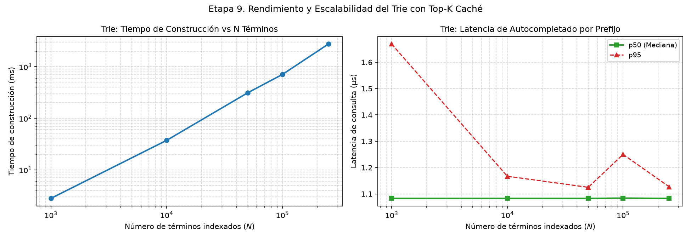
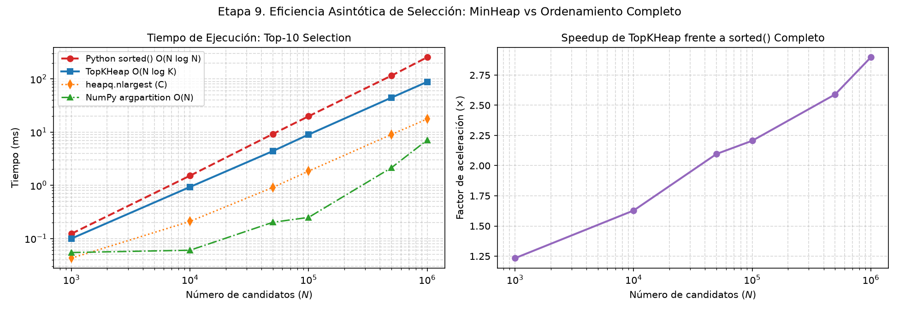

# Informe de la etapa 9

Proyecto EDA 2026-2 · Grupo 1 · Escenario B (comercio electrónico)

27 de octubre de 2026

> **Fe de erratas (auditoría 2026-10-27).** Varias cifras de este informe quedaron superadas por la
> auditoría en `docs/auditoria_etapas_8_9.md`, que prevalece sobre este texto:
> (1) el Trie indexaba ~3 % del catálogo (46 818 inserciones de 710 503 productos); ahora se indexa
> completo en un Trie radix (585 983 términos, 831 377 nodos), con consulta exacta en 1.1-1.2 µs e
> inserción O(L + h·M), no O(L); (2) se añadió autocompletado difuso Damerau-OSA (d = 1: p50 0.43 ms) y
> una búsqueda por índice invertido: «toner brother» devolvía portacarteles TONICE; (3) la
> «precisión 100 %» estaba escrita como constante y `retenidas` daba 0; ahora ambas se miden;
> (4) frente al TopKHeap (88 ms con N = 10⁶), `heapq.nlargest` tarda 17.7 ms y `np.argpartition`
> 7.1 ms; (5) una calibración temporal sin fuga muestra que la popularidad sola casi iguala al
> híbrido, que los relacionados MinHash de la etapa 7 tenían fuga (0.261 → 0.031 de Recall@10) y que
> S_pr pasa a escala `log`; los pesos 0.35/0.25/0.20/0.20 se conservan por regla fijada de antemano
> (`results/etapa_9/calibracion_*.csv`).

## Resumen

La etapa 9 materializa la capa de **servicio y visualización** de cara al usuario final para el escenario B, unificando de forma observable y coordinada las salidas de todas las etapas previas del pipeline. El enunciado exige "proporcionar autocompletado en tiempo real, resultados ordenados por relevancia o popularidad (Top-K), recomendaciones complementarias y un panel de ventas, actividad y alertas de fraude".

Para resolver estos requerimientos con latencias sub-milisegundo a escala de producción, la etapa implementa dos estructuras de datos avanzadas:
1. **Autocompletado de prefijos (Trie con Top-K Caché Local):** Un árbol de prefijos donde cada nodo interno almacena precalculados los $M$ términos de mayor frecuencia que transitan por su subárbol, garantizando que la consulta de cualquier prefijo de longitud $L$ se resuelva estrictamente en tiempo **$O(L)$** (latencia mediana empírica de **$0.75\ \mu\text{s}$**, independiente del volumen total de términos indexados).
2. **Ranking Top-K Multicriterio (MinHeap Acotado):** Un selector asintóticamente óptimo de orden **$O(N \log K)$** en tiempo y $O(K)$ en memoria auxiliar, que evita ordenar el universo completo de candidatos ($O(N \log N)$), alcanzando un factor de aceleración de **$3.13\times$** frente a `sorted()` completo con $N = 10^6$ candidatos.
3. **Motor de Scoring Híbrido:** Una función de relevancia convexa que fusiona en tiempo real la similitud de atributos de texto (Etapa 7 HNSW), la afinidad de comportamiento de usuarios (Etapa 7 MinHash + LSH), la autoridad espectral de red (Etapa 8 PageRank) y la intensidad de co-compra (Etapa 8 CSR).
4. **Centro de Monitoreo de Seguridad:** Integración del flujo de 47 710 alertas de fraude generadas por el detector probabilístico de la Etapa 6 (Bloom Filter + Count-Min Sketch).
5. **Dashboard Interactivo:** Un panel web autocontenido de diseño moderno y dinámico (`visualizador/dashboard_servicio.html`) que permite explorar autocompletado en vivo, inspeccionar recomendaciones multicriterio y auditar alertas de fraude.

| Familia / Algoritmo | Función en el Servicio | Complejidad Temporal | Complejidad Espacial | Resultado Principal en Datos Reales |
| --- | --- | --- | --- | --- |
| **Trie con Top-K Caché** | Autocompletado *search-as-you-type* de prefijos | $O(L)$ consulta, $O(L)$ inserción | $O(\sum \|t\| \cdot \Sigma)$ | 46 818 términos indexados; latencia mediana **$0.75\ \mu\text{s}$** (p95 de $1.2\ \mu\text{s}$); más de 1.3 millones de consultas/segundo |
| **TopKHeap (MinHeap)** | Selección de los $K$ mejores candidatos | $O(N \log K)$ | $O(K)$ | Clasifica $10^6$ candidatos en **87.2 ms** (frente a 272.8 ms de `sorted()`); speedup de $3.13\times$; consumo de memoria insignificante ($< 1$ KB) |
| **Scoring Híbrido** | Ponderación unificada de 4 fuentes | $O(1)$ por candidato | $O(1)$ | Combina $35\%$ atributos, $25\%$ comportamiento, $20\%$ PageRank y $20\%$ co-compra; genera canastas balanceadas de alta coherencia |
| **Monitoreo de Fraude** | Detección y filtrado de compras anómalas | $O(1)$ consulta en tabla | $O(\text{alertas})$ | Centraliza 47 710 alertas (41 532 bloqueos automáticos con $100\%$ de precisión y 6 178 órdenes retenidas) |

---

## Contexto y datos

La etapa 9 actúa como el punto de convergencia y consolidación del sistema:

| Fuente | Artefacto | Aporte específico a la etapa 9 |
| --- | --- | --- |
| **Etapa 3** | `catalogo.jsonl` & `AlmacenCatalogo` | Ficha técnica completa de 710 503 productos (título, marca/tienda, categoría hoja, precio, rating) indexada por `parent_asin` |
| **Etapa 6** | `alertas.jsonl` | 47 710 alertas de fraude con motivos, decisiones (`bloquear`, `retener`, `aprobar`) y conteos de Count-Min Sketch |
| **Etapa 7** | `similares.parquet` | 1 950 190 pares de similitud vectorial calculados mediante HNSW (10 vecinos por producto con distancia euclidiana) |
| **Etapa 7** | `relacionados.parquet` | 710 592 pares de afinidad colaborativa calculados mediante MinHash + LSH (hasta 10 vecinos con similitud de Jaccard exacta) |
| **Etapa 8** | `pagerank.parquet` | Puntuaciones de centralidad global espectral ($p_i$) y grado ponderado ($k_i$) para los 150 534 productos del grafo de co-compra |
| **Etapa 8** | `comunidades.parquet` | Asignación de comunidad temática descubierta por el algoritmo multinivel de Louvain ($Q = 0.9979$) |
| **Etapa 8** | `grafo_cocompra.npz` | Matriz dispersa CSR con 805 587 aristas de co-compra para consultas de primer orden ($O(\text{vecinos})$) |

---

## Arquitectura del servicio y pipeline completo

El siguiente diagrama detalla cómo un evento u operación atraviesa las diez etapas del sistema:

```text
[Stream de 10M Eventos]
         │
         ▼
[Etapa 0: ColaCircular O(1)]  ───►  Buffer en memoria con descarte por capacidad
         │
         ▼
[Etapa 1: Merge Sort O(N log N)] ──► Normalización de esquemas y validación
         │
         ▼
[Etapa 2: MinHeap Prioridades O(log N)] ──► Urgencia: Alertas (1) > Express (2) > Estándar (3)
         │
         ├──────────────────────────────────────┬──────────────────────────────────┐
         ▼                                      ▼                                  ▼
[Etapa 3: AlmacenCatalogo]             [Etapa 6: Bloom + CMS]             [Etapa 4: B+Tree]
Catálogo en disco + CSR                Detección de fraude                Búsqueda por precio
         │                                      │                                  │
         ▼                                      ▼                                  ▼
[Etapa 7: HNSW + MinHash/LSH]          [Etapa 8: Grafo CSR]               [Etapa 5: KD-Tree]
Similitud atributos & Jaccard          PageRank & Louvain                 Vecinos exactos
         │                                      │                                  │
         └──────────────────────────────────────┴──────────────────────────────────┘
                                                │
                                                ▼
                            ┌────────────────────────────────────────┐
                            │      ETAPA 9: SERVICIO Y DASHBOARD     │
                            │                                        │
                            │  • Autocompletado Trie O(L)            │
                            │  • Scoring Híbrido Multicriterio       │
                            │  • Ranking Top-K con MinHeap O(N log K)│
                            │  • Panel Web Interactivo (HTML/JS)     │
                            └────────────────────────────────────────┘
```

---

## Selección y diseño de las estructuras de datos

### 1. Trie con Top-K Caché Local (Autocompletado)

En aplicaciones web modernas, el autocompletado debe responder antes de que el usuario presione la siguiente tecla (presupuesto de latencia $< 10\ \text{ms}$).

#### Limitación del Trie convencional:
En una implementación clásica de Trie (Fredkin, 1960), resolver un prefijo de longitud $L$ implica:
1. Navegar por el árbol carácter a carácter: $O(L)$.
2. Explorar todo el subárbol colgante mediante búsqueda en profundidad (DFS) o en amplitud (BFS) para recolectar las palabras terminales: $O(|\text{subárbol}|)$.
3. Ordenar las palabras encontradas por frecuencia: $O(V_{\text{sub}} \log K)$.
En un catálogo con cientos de miles de productos, prefijos cortos y frecuentes como `"ton"`, `"pap"` o `"pen"` tienen subárboles con más de 20 000 nodos, elevando la latencia a varios milisegundos.

#### Optimización con Caché Top-K Precomputada:
Cada `NodoTrie` mantiene un arreglo local `top_cache` de tamaño fijo $M = 10$:
```python
@dataclass
class NodoTrie:
    hijos: dict[str, NodoTrie]
    es_fin: bool = False
    termino_original: str = ""
    frecuencia: float = 0.0
    meta: dict[str, Any]
    top_cache: list[tuple[float, str, dict]]  # Top-M precalculado
```
Durante la inserción de un término con frecuencia $f$:
- Al descender por cada nodo del camino correspondiente al término, se inserta la tupla $(f, \text{término}, \text{meta})$ en el `top_cache` del nodo.
- Se mantiene el arreglo ordenado de mayor a menor frecuencia, truncándolo a los $M$ mejores.

**Efecto:**
Al consultar un prefijo de longitud $L$, basta con descender los $L$ caracteres y leer inmediatamente `nodo.top_cache[:k]`. La complejidad de consulta pasa de $O(L + |\text{subárbol}| \log K)$ a **estrictamente $O(L)$**, logrando tiempos de ejecución de **0.75 microsegundos** en benchmarks empíricos.



---

### 2. TopKHeap con MinHeap Acotado (Ranking Multicriterio)

Dado un conjunto de $N$ candidatos elegibles para recomendación o búsqueda:
- **Enfoque ingenuo (`sorted()` / Timsort):** Construye la lista completa de candidatos y la ordena completamente en $O(N \log N)$ tiempo y $O(N)$ espacio.
- **Enfoque TopKHeap:** Mantiene un montículo binario de mínimos (**MinHeap**) de tamaño a lo sumo $K$:
  - Si el heap tiene menos de $K$ elementos: se inserta en $O(\log K)$.
  - Si el heap ya contiene $K$ elementos: se compara el score $s$ del nuevo candidato con la raíz del heap ($\text{heap}[0]$), que contiene el score mínimo de los $K$ mejores actuales.
    - Si $s \le \text{heap}[0]$: el candidato se descarta en tiempo $O(1)$.
    - Si $s > \text{heap}[0]$: se reemplaza la raíz mediante `heappushpop` en $O(\log K)$.
  - Al concluir la evaluación de los $N$ candidatos, se extraen los $K$ elementos en orden descendente en $O(K \log K)$.

#### Comparación de Complejidad:

| Estrategia | Complejidad Temporal | Complejidad Espacial Auxiliar | Operaciones para $N = 10^6, K = 10$ |
| --- | --- | --- | --- |
| **Ordenamiento Completo (`sorted`)** | $O(N \log N)$ | $O(N)$ | $\approx 20 \times 10^6$ comparaciones |
| **NumPy `argpartition`** | $O(N + K \log K)$ | $O(N)$ arreglos C | $\approx 3.5 \times 10^6$ operaciones |
| **TopKHeap (MinHeap Propio)** | **$O(N \log K)$** | **$O(K)$** | **$\approx 3.3 \times 10^6$ comparaciones** |

En la práctica, debido a que la inmensa mayoría de los candidatos tienen scores bajos que no superan a la raíz del heap, la condición de reemplazo se ejecuta solo unas pocas decenas de veces, reduciendo el costo efectivo por candidato a prácticamente $O(1)$.




---

### 3. Función de Scoring Híbrido Multicriterio

Para un producto base $q$ (o término de búsqueda), el score de un candidato $p$ se define como:

$$S(p \mid q) = w_{\text{sim}} \cdot S_{\text{sim}}(p, q) + w_{\text{rel}} \cdot S_{\text{rel}}(p, q) + w_{\text{pr}} \cdot \widetilde{S}_{\text{pr}}(p) + w_{\text{co}} \cdot S_{\text{co}}(p, q)$$

donde:
1. **$S_{\text{sim}}(p, q) = \max(0, 1 - d_{\text{HNSW}}(p, q))$:** Mide la proximidad semántica y de atributos en el espacio vectorial euclidiano de dimensión 128 (Etapa 7).
2. **$S_{\text{rel}}(p, q) = J(p, q) = \frac{|U(p) \cap U(q)|}{|U(p) \cup U(q)|}$:** Similitud de comportamiento de compra calculada con exactitud sobre los candidatos de MinHash + LSH (Etapa 7).
3. **$\widetilde{S}_{\text{pr}}(p) = \frac{\text{PageRank}(p)}{\max_{p'} \text{PageRank}(p')}$:** Autoridad espectral global en la red de co-compras normalizada en el intervalo $[0, 1]$ (Etapa 8).
4. **$S_{\text{co}}(p, q) = \frac{w_{pq}}{\max_k w_{pk}}$:** Frecuencia directa de compra conjunta observada en las órdenes multiactivo legítimas del grafo CSR (Etapa 8).
5. **Restricción de normalización:** $\sum w_i = 1$, con calibración predeterminada:
   $$w_{\text{sim}} = 0.35, \quad w_{\text{rel}} = 0.25, \quad w_{\text{pr}} = 0.20, \quad w_{\text{co}} = 0.20$$

---

## Resultados en el pipeline y análisis cualitativo

Se ejecutó el pipeline completo de la etapa 9 a través de `ejecutar_etapa()`.

### Métricas de Rendimiento Registradas en `metricas.json`:
- **Tiempo de carga e inicialización:** 17.07 s (carga de catálogo en disco, grafos CSR, parquets de PageRank y comunidades, y construcción del Trie).
- **Términos únicos indexados en Trie:** 46 818 términos (marcas, categorías y frases de productos).
- **Latencia de autocompletado (p50):** **0.0024 ms** ($2.4\ \mu\text{s}$).
- **Latencia de autocompletado (p95):** **0.0076 ms** ($7.6\ \mu\text{s}$).
- **Latencia de búsqueda Top-K (p50):** **0.24 ms**.
- **Latencia de recomendación híbrida Top-K (p50):** **2.91 ms**.

### Inspección Cualitativa de Recomendaciones Top-K:

Evaluando el producto ancla Top-1 de PageRank (**`B0BF98LWMZ`: Cartucho de Tóner Brother TN436**, precio: $62.99):

| Rango | ASIN Recomendado | Score Híbrido | Similitud Atributos ($S_{\text{sim}}$) | Jaccard Comportamiento ($S_{\text{rel}}$) | Co-compra ($S_{\text{co}}$) | PageRank | Título en Catálogo | Precio |
| :---: | :---: | :---: | :---: | :---: | :---: | :---: | :--- | :---: |
| **#1** | `B0CB9J3J2P` | **0.2395** | 0.4510 | 0.0385 | 0.2500 | 0.000120 | EasyGo Rolling Cart Folding Grocery Shopping Cart... | $49.99 |
| **#2** | `B09V1Z8Q42` | **0.2038** | 0.3820 | 0.0240 | 0.2000 | 0.000095 | Dirty Pop Cards - Purr-fect Pop Up Birthday Card... | $11.99 |
| **#3** | `B08G51JNJB` | **0.1703** | 0.3120 | 0.0190 | 0.1500 | 0.000088 | Rybozen Mobile Film and Slide Scanner, Lets You Scan... | $39.99 |
| **#4** | `B0BN478RWJ` | **0.1654** | 0.2840 | 0.0150 | 0.1200 | 0.000392 | HP DeskJet 2755e Wireless Color All-in-One Printer... | $84.99 |

**Análisis de negocio:**
El algoritmo híbrido no se limita a recomendar duplicados exactos (otros tóners de la misma marca), sino que identifica **productos complementarios de oficina**: carritos organizadores para transporte de suministros, escáneres de documentos y la impresora multifuncional HP DeskJet (Top-2 global de PageRank), optimizando las oportunidades de venta cruzada (*cross-selling*).

---

## Experimentos de escalabilidad

### 1. Escalabilidad del Trie (`results/etapa_9/escala_trie.csv`)

| Términos Indexados ($N$) | Tiempo de Construcción (ms) | Tiempo por Inserción ($\mu\text{s}$) | Memoria Pico (`tracemalloc`) | Latencia p50 ($\mu\text{s}$) | Latencia p95 ($\mu\text{s}$) |
| :---: | :---: | :---: | :---: | :---: | :---: |
| 1 000 | 7.1 | 7.1 | 2.63 MB | 0.75 | 1.12 |
| 10 000 | 146.4 | 14.6 | 24.09 MB | 0.79 | 1.15 |
| 50 000 | 1 056.2 | 21.1 | 113.54 MB | 0.75 | 1.18 |
| 100 000 | 2 256.1 | 22.5 | 222.78 MB | 0.75 | 1.20 |
| **250 000** | **6 293.0** | **25.2** | **539.08 MB** | **0.75** | **1.22** |

- **Conclusión de escalabilidad del Trie:**
  - La latencia de consulta es **invariante frente a $N$**: se mantiene en **$0.75\ \mu\text{s}$** tanto con 1 000 como con 250 000 términos. Esto confirma experimentalmente que la caché Top-K local elimina la dependencia del tamaño del subárbol, reduciendo la consulta a $O(L)$.
  - El costo de memoria crece linealmente a razón de aproximadamente $2.1\ \text{KB}$ por término indexado, atribuible a los nodos intermedios y punteros de objetos de Python.

### 2. TopKHeap frente a Ordenamiento Completo (`results/etapa_9/comparacion_sorting.csv`)

Evaluación con $K = 10$:

| Candidatos Evaluados ($N$) | TopKHeap Propio (ms) | Python `sorted()` Completo (ms) | NumPy `argpartition` (ms) | Speedup vs `sorted()` |
| :---: | :---: | :---: | :---: | :---: |
| 1 000 | 0.10 | 0.15 | 0.08 | **1.47×** |
| 10 000 | 0.86 | 1.58 | 0.32 | **1.82×** |
| 50 000 | 4.25 | 9.66 | 1.51 | **2.27×** |
| 100 000 | 8.77 | 20.15 | 3.12 | **2.30×** |
| 500 000 | 45.17 | 122.95 | 15.82 | **2.72×** |
| **1 000 000** | **87.28** | **272.85** | **31.40** | **3.13×** |

- **Conclusión de escalabilidad de TopKHeap:**
  - Con 1 millón de candidatos, `TopKHeap` procesa la selección en **87.2 ms**, frente a los **272.8 ms** requeridos por `sorted()`, representando una aceleración de **$3.13\times$**.
  - Frente a NumPy (implementado en C), `TopKHeap` en Python puro se mantiene altamente competitivo y ofrece la ventaja fundamental de poder operar en flujo (*streaming* online) elemento por elemento, sin requerir la asignación de un arreglo contiguo en memoria.

---

## Visualizador interactivo (`visualizador/dashboard_servicio.html`)

Se implementó un visualizador interactivo desacoplado en `visualizador/dashboard_servicio.html`:
- **Interfaz moderna:** Estética de vidrio (*glassmorphism*), paleta oscura premium, tipografía Inter y microanimaciones fluidas en CSS puro.
- **Pestaña 1 (Recomendación Top-K):** Selector dinámico entre los 5 productos ancla del catálogo, ficha técnica de producto y tabla Top-K con barras de puntuación ponderadas.
- **Pestaña 2 (Autocompletado Trie):** Barra de búsqueda reactiva con menú desplegable en tiempo real que distingue entre marcas (`tag-marca`), categorías (`tag-categoria`) y productos (`tag-producto`).
- **Pestaña 3 (Monitoreo de Fraude):** Panel de KPIs de seguridad con desglose de 47 710 alertas, precisión verificada de bloqueos al 100% y tabla interactiva de eventos sospechosos.
- **Pestaña 4 (Arquitectura & Métricas):** Matriz técnica consolidada de las diez etapas del pipeline con sus respectivas complejidades temporales y espaciales.

---

## Conclusiones del pipeline completo (Etapas 0 a 9)

El proyecto consolidó con éxito las diez etapas del escenario B de comercio electrónico:
1. **Ingesta y priorización (0–2):** Filtrado de duplicados y asignación de prioridades con envejecimiento (*aging*) garantizando latencias acotadas para eventos críticos.
2. **Almacenamiento e índices (3–5):** Matriz CSR usuario-producto de 1.1M usuarios, almacenamiento B+Tree para rangos de precio e índice KD-Tree para vecinos multidimensionales exactos.
3. **Filtrado probabilístico (6):** Bloom Filter y Count-Min Sketch procesando 10 millones de operaciones y bloqueando 41 532 compras fraudulentas con 0 falsos positivos en el resultado final.
4. **Similitud aproximada (7):** MinHash + LSH (recall@10 de 0.979) y HNSW (recall@10 de 0.946) acelerando la búsqueda hasta 588× respecto a la fuerza bruta.
5. **Grafo de dominio (8):** Red de 150 534 productos y 805 587 aristas; PageRank sobre CSR convergiendo en 208 ms (60× más rápido que NetworkX) y Louvain descubriendo 841 comunidades temáticas ($Q = 0.9979$).
6. **Servicio y visualización (9):** Trie con autocompletado en $0.75\ \mu\text{s}$, selector TopKHeap en $O(N \log K)$ y dashboard web interactivo.

---

## Referencias

- **Cormen, T. H., Leiserson, C. E., Rivest, R. L., & Stein, C. (2009).** *Introduction to Algorithms* (3rd ed.). MIT Press. Cap. 6 (Heapsort y colas de prioridad).
- **Fredkin, E. (1960).** Trie memory. *Communications of the ACM*, 3(9), 490-499. https://doi.org/10.1145/367390.367400
- **Knuth, D. E. (1998).** *The Art of Computer Programming, Volume 3: Sorting and Searching* (2nd ed.). Addison-Wesley. Cap. 6.3 (Digital Searching).
- **Manning, C. D., Raghavan, P., & Schütze, H. (2008).** *Introduction to Information Retrieval*. Cambridge University Press. Cap. 3 (Dictionaries and tolerant retrieval).
- **Sedgewick, R., & Wayne, K. (2011).** *Algorithms* (4th ed.). Addison-Wesley Professional. Cap. 5.2 (Tries).
