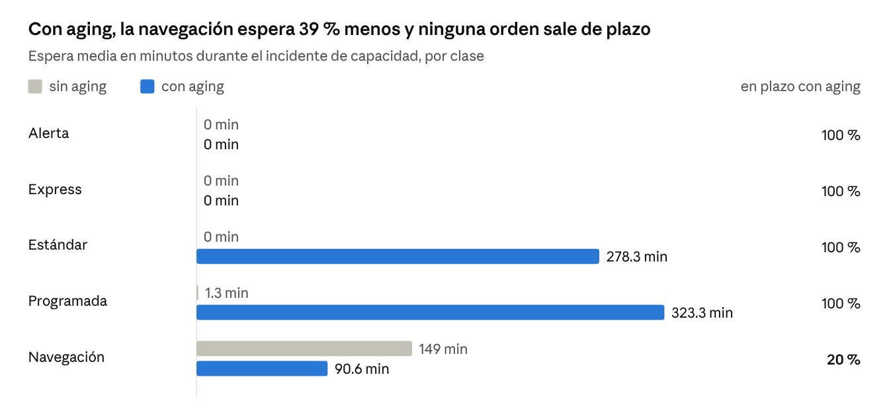

# Informe de las etapas 0, 1 y 2

Proyecto EDA 2026-2 · Grupo 1 · Escenario B (comercio electrónico)

18 de octubre de 2026

## Resumen

Las etapas 0, 1 y 2 convierten un stream crudo de eventos de comercio electrónico en una secuencia limpia y priorizada. Sobre 20 000 reseñas reales de Amazon Reviews 2023 se generaron 134 277 registros, de los que salieron 127 170 eventos limpios en orden de atención.

| Etapa | Función | Estructura propia | Complejidad | Resultado principal |
| --- | --- | --- | --- | --- |
| 0. Ingesta y buffer | Recibir el stream y entregarlo en micro-lotes | Cola FIFO circular de capacidad fija | O(1) por operación | Pendiente log-log de 0.97 y 8 bytes por elemento; ningún evento perdido con backpressure |
| 1. Preprocesamiento | Validar, normalizar, deduplicar y ordenar | Merge sort y búsqueda binaria | O(b log b) por lote, O(log w) por búsqueda | 1 291 de 1 291 rechazos y 5 816 duplicados detectados; inversiones temporales del 38 % al 0.21 % |
| 2. Cola con prioridades | Atender primero lo urgente | Min-heap binario con aging | O(log n) por operación, heapify O(n) | Alertas y órdenes express sin espera durante un incidente; espera media de la navegación un 39 % menor con aging |

Todas las estructuras evaluadas se implementaron a mano y se compararon con alternativas de la biblioteca estándar en tamaños de 1K a 10M, con semilla 42.

## Contexto y datos

El escenario B pide un stream de búsquedas, vistas, carritos, compras, devoluciones, reseñas y alertas de pago. Ningún dataset público trae ese stream completo, así que se usó Amazon Reviews 2023 (McAuley-Lab, Hugging Face) como base real y se generó sintéticamente el componente de stream, como recomienda el enunciado.

### Dataset

Para el desarrollo se usó la categoría `All_Beauty`, con 701 528 reseñas (311.5 MB) y 112 590 productos (203.1 MB). La categoría `Video_Games` queda reservada para el experimento final. Los archivos JSONL se descargan con `hf_hub_download`, porque `datasets` 5.x ya no admite el script de carga del repositorio, y se leen línea por línea con un generador de Python.

La lectura como stream es una decisión medida. Se comparó un generador de Python con una lista en memoria al recorrer de 1K a 200K reseñas.

*Fuente: `notebooks/etapa0_ingesta_buffer.ipynb`, 1K a 200K reseñas de `All_Beauty`, promedio de 5 repeticiones en los tiempos.*

| Medida con 200K reseñas | Lista | Generador |
| --- | --- | --- |
| Memoria pico | 70.5 MB | 0.08 MB |
| Tiempo hasta el primer registro | 912 ms | 0.15 ms |
| Tiempo total de recorrido | 0.92 s | 0.90 s |

- **Memoria.** Con la lista la memoria crece en proporción a n, unos 350 bytes por reseña, es decir, O(n). Con el generador se mantiene cerca de 0.07 MB en todos los tamaños, es decir, O(1). Con 200K reseñas la lista usa unas 890 veces más memoria.
- **Latencia.** La lista entrega el primer registro solo después de leer todo el archivo, y esa espera crece de 6 ms a 912 ms. El generador lo entrega en unos 0.15 ms sin importar el tamaño. En un stream que no termina, la lista nunca entregaría el primer registro.
- **Tiempo total.** Las dos formas tardan lo mismo en recorrer todas las reseñas, porque hacen el mismo trabajo de lectura y conversión de JSON. El ahorro de memoria no tiene costo en velocidad.

El análisis del dataset encontró tres problemas que condicionan el diseño.

- El precio falta en el 84.3 % de los productos.
- Las reseñas no están ordenadas por tiempo. En una muestra de 20 000, el timestamp retrocede en el 60 % de los pares consecutivos y las fechas van de 2002 a 2023.
- `bought_together` casi siempre es nulo, por lo que el grafo de co-compra necesita órdenes simuladas.

### Generador sintético

Cada reseña real se convierte en un recorrido de compra `search → view → cart → purchase → review → return`. Del dataset se conservan el usuario, el producto, la calificación y si la compra fue verificada. El precio, la categoría y el texto de búsqueda se toman del catálogo, con un precio sintético estable cuando falta.

Como las reseñas no tienen orden temporal, el generador usa un reloj de reproducción. Cada reseña recibe una hora sintética creciente, con intervalos exponenciales de 2 s en promedio, y su recorrido ocurre en los 30 minutos anteriores. Cada evento llega con un retraso de red simulado, y el generador lo entrega en orden de llegada.

| Ruido inyectado | Probabilidad | Etapa que lo trata |
| --- | --- | --- |
| Duplicado exacto | 3 % por evento | 1 |
| Duplicado casi exacto (otro `event_id`, `ts` ±0.4 s, formato distinto) | 1.5 % por evento | 1 |
| Registro malformado (seis tipos de error) | 1 % por evento | 1 |
| Llegada tardía de 30 s a 5 min | 5 % por evento | 1 |
| Ráfaga de fraude con cuenta, tarjeta y dispositivo señalados | 0.2 % por reseña | 2 y 6 |
| Alerta de pago | 30 % de las compras fraudulentas, 0.3 % de las legítimas | 2 y 6 |

El 25 % de las órdenes incluye de 1 a 3 productos adicionales del mismo grupo sintético, para que el grafo de la etapa 8 tenga comunidades. El generador cuenta cada inyección, y esos conteos son la verdad de referencia con la que se verifica la etapa 1.

## Arquitectura

Cada etapa entrega su salida a la siguiente a través de archivos en `data/interim/`. La etapa 0 también exporta las listas de cuentas, tarjetas y dispositivos señalados para el Bloom Filter de la etapa 6.

## Etapa 0. Ingesta y buffer

La etapa 0 recibe el stream en un buffer FIFO de capacidad fija y lo entrega a la etapa 1 en micro-lotes. El buffer desacopla la velocidad del generador de la del preprocesamiento, y su capacidad acotada permite aplicar backpressure.

### Diseño

- **Estructura.** `ColaCircular` guarda los elementos en un arreglo de capacidad fija con dos datos de control, `inicio` y `tam`. El final se calcula como `(inicio + tam) % capacidad`, así que encolar y desencolar cuestan O(1) sin mover elementos. La memoria es O(capacidad) y se reserva una sola vez.
- **Alternativa propia.** `ColaEnlazada` también cuesta O(1) por operación y no tiene límite de capacidad. Se usa para la cola de rechazados de la etapa 1, que no debe perder elementos.
- **Concurrencia.** El productor corre en un hilo y el consumidor en el hilo principal. Comparten el buffer protegido por un candado y dos variables de condición.
- **Backpressure.** Si el buffer está lleno, el productor se bloquea hasta que el consumidor libere espacio. No se descartan eventos, porque perder compras o alertas de fraude no es aceptable en el escenario B, y la memoria queda acotada.
- **Micro-lotes.** Un lote se cierra al llegar a 500 eventos o al pasar 50 ms, lo que ocurra primero. El tamaño aprovecha la ordenación por lote de la etapa 1, y el tiempo acota la latencia cuando el stream es lento.

### Resultados

Con 10 000 reseñas (64 105 eventos) y capacidad de 2 000, un consumidor lento de 40 ms por lote bloqueó al productor 125 veces, durante 4.34 s en total. Los dos escenarios, rápido y lento, entregaron exactamente los mismos 64 105 eventos. Con un productor de poco tráfico, los lotes se cerraron por tiempo y ningún evento esperó más de 52 ms.

| Estructura | Pendiente log-log | Tiempo por operación a 1M | Memoria por elemento |
| --- | --- | --- | --- |
| `ColaCircular` (propia) | 0.97 | 197 ns | 8 B |
| `ColaEnlazada` (propia) | 0.97 | 204 ns | 48 B |
| `collections.deque` (C) | 0.96 | 41 ns | 8 B |
| `list.pop(0)` | 1.80 | 4 453 ns a 100K | 8 B |

Las tres colas O(1) mantienen un tiempo por operación casi constante de 1K a 10M. `list.pop(0)` crece de 110 a 4 450 ns por operación entre 1K y 100K, lo que confirma su costo O(n). `deque` es unas 4 veces más rápida porque está escrita en C; la diferencia es un factor constante. Se eligió `ColaCircular` porque cuesta O(1), usa la sexta parte de la memoria de la lista enlazada y su capacidad fija permite el backpressure.

## Etapa 1. Preprocesamiento por lotes

La etapa 1 convierte cada micro-lote de registros crudos en eventos que cumplen el esquema, tienen un formato único, no están repetidos y están ordenados por tiempo. La deduplicación es exacta. La probabilística con Bloom Filter corresponde a la etapa 6, y las dos no se solapan.

### Diseño

1. **Validar y normalizar** en un solo recorrido. Cada campo tiene una regla, y los registros inválidos pasan a una `ColaEnlazada` de rechazados con su motivo. Se convierte `ts` de milisegundos a segundos, el precio de texto (`$19.99`, `19,99`) a número, la categoría a forma canónica (`all_beauty`) y la búsqueda a minúsculas.
2. **Ordenar el lote por `(clave, ts)`** con merge sort propio y recorrerlo una vez. La clave es `(event_type, user_id, parent_asin, order_id, query)` y no incluye `event_id`. Dos eventos son duplicados si comparten clave y sus `ts` difieren 1 s o menos. Tras ordenar, los duplicados quedan juntos, así que el costo es O(b log b) en lugar de O(b²).
3. **Buscar duplicados de lotes anteriores** en una ventana, que es un arreglo ordenado con las claves de los últimos 600 s. La búsqueda binaria propia cuesta O(log w) por evento, y la ventana se actualiza una vez por lote con una mezcla lineal, en O(w + b).
4. **Reordenar el lote por `ts`** con merge sort, que es estable y conserva el orden de los eventos con el mismo `ts`.

Merge sort se eligió porque garantiza O(n log n) también en el peor caso y es estable. Quicksort puede degradarse a O(n²) con datos casi ordenados, que es como llegan los lotes. Un `set()` es más rápido para deduplicar, pero solo detecta claves idénticas y no admite la tolerancia de tiempo que requieren los reintentos.

### Verificación contra lo inyectado

| Concepto | Inyectado en la etapa 0 | Detectado en la etapa 1 |
| --- | --- | --- |
| Registros rechazados | 1 291 | 1 291 |
| Duplicados exactos | 3 824 | 3 818 |
| Duplicados casi exactos | 1 907 | 1 998 |

Los rechazos coinciden por motivo. Los 85 duplicados detectados de más son pares de eventos legítimos con la misma clave a menos de 1 s, el 0.07 % de los eventos. De ellos, 76 son vistas repetidas del mismo producto, equivalentes a un doble clic, y 10 son reseñas reales de variantes del mismo `parent_asin`. Del total, 200 duplicados se detectaron entre lotes gracias a la ventana. Las inversiones de orden temporal bajaron del 38 % al 0.21 %; las que quedan son eventos que llegaron después de cerrarse su lote.

### Experimentos

| Experimento | Método | Pendiente log-log | Esperado |
| --- | --- | --- | --- |
| Ordenación | `merge_sort` (propio) | 1.08 | n log n |
| Ordenación | `sorted()` (C) | 1.10 | n log n |
| Búsqueda de 1 000 valores | Búsqueda binaria (propia) | 0.14 | log n |
| Búsqueda de 1 000 valores | Búsqueda lineal | 0.96 | n |
| Deduplicación | `merge_sort` y recorrido (propio) | 1.09 | n log n |
| Deduplicación | `set()` (C) | 1.09 | n |

A 100K la búsqueda binaria resolvió cada consulta en 2.4 µs, frente a 1 880 µs de la lineal. `set()` deduplicó unas 17 veces más rápido que ordenar y recorrer, y usó 56 bytes por elemento frente a 81. En la etapa ese costo es pequeño porque cada lote tiene unos 500 eventos, y log₂ 500 ≈ 9. El paso más costoso medido fue validar y normalizar, seguido de la reconstrucción de la ventana, y no los ordenamientos.

## Etapa 2. Cola con prioridades

La etapa 2 decide en qué orden se atienden los eventos limpios cuando la capacidad de servicio es limitada. Usa un min-heap binario propio sobre un arreglo, con `push` y `pop` en O(log n) y `heapify` de Floyd en O(n).

### Clases, plazos y clave

| Clase | Eventos | Plazo |
| --- | --- | --- |
| 1 | Alerta de pago | 5 min |
| 2 | Compra express | 2 h |
| 3 | Compra estándar y devolución | 24 h |
| 4 | Compra programada | 72 h |
| 5 | Búsqueda, vista, carrito y reseña | 30 min |

La clave del heap es `(clase, deadline, seq)`, donde el deadline es el `ts` del evento más el plazo de su clase y `seq` es el orden de inserción. Dentro de una clase sale primero el que vence antes, y en un empate total sale el que entró antes, así que la cola es estable. La navegación es el 80.4 % de la carga y las clases 1 a 4 suman unos 95 eventos por lote.

### Aging

El aging sube una clase a cada evento por cada 15 minutos de espera, sin pasar de la clase 3. Las claves de un heap no se pueden cambiar en su lugar, así que cada 5 lotes se recalcula la clase efectiva de todas las entradas y se reconstruye el heap con `heapify`, en O(n). Ese costo, repartido entre 5 lotes, es menor que el de insertar y extraer cada lote.

El límite en la clase 3 protege las clases con plazos cortos. Las clases 3 y 4 tienen 24 h y 72 h de plazo, y el aging solo usa esa holgura.

### Incidente de capacidad

Se simuló una caída de capacidad de 600 a 100 eventos por ciclo durante 100 ciclos, unas 4.5 horas del stream. Llegan unos 473 eventos por ciclo.

*Fuente: `notebooks/etapa2_cola_prioridades.ipynb`, incidente de 100 ciclos, 127 170 eventos.*

Con aging, la espera media de la navegación baja un 39 % y su espera máxima de 241 a 195 min, sin que ninguna orden salga de plazo. Solo el 20 % de la navegación cumple su plazo con o sin aging, porque durante el incidente falta capacidad. Una política de orden decide quién espera, pero no reduce la espera total.

### Experimentos

| Experimento | Método | Pendiente log-log | Esperado |
| --- | --- | --- | --- |
| n push y n pop | `MinHeap` (propio) | 1.12 | n log n |
| n push y n pop | `heapq` (C) | 1.22 | n log n |
| n push y n pop | Lista ordenada con `insort` y `pop(0)` | 1.70 | n² |
| Construcción, claves decrecientes | n `push` (propio) | 1.07 | n log n |
| Construcción, claves decrecientes | `heapify` de Floyd (propio) | 1.05 | n |

A 100K la lista ordenada ya es 4 veces más lenta que `MinHeap`, y la diferencia crece con n. `heapq` es 5 veces más rápido a 1K pero solo 2 veces a 10M, porque con millones de elementos domina el acceso a memoria. En el peor caso, construir con `push` costó 4.4 veces más que con `heapify` a 10M. Las tres estructuras usan unos 8 bytes por elemento.

## Integración y verificación

Las tres etapas están implementadas en notebooks reproducibles y en módulos de `src/` que producen exactamente los mismos resultados. Con 20 000 reseñas, ambos generan los mismos 134 277 registros en el mismo orden y las mismas métricas de la etapa 1.

| Artefacto | Contenido |
| --- | --- |
| `notebooks/etapa0_ingesta_buffer.ipynb` | Generador, colas, backpressure, micro-lotes y experimentos |
| `notebooks/etapa1_preprocesamiento.ipynb` | Validación, merge sort, deduplicación, verificación y experimentos |
| `notebooks/etapa2_cola_prioridades.ipynb` | Min-heap, aging, simulación de incidente y experimentos |
| `src/` | `events.py`, `generator.py`, `stage0_queue.py`, `stage1_preprocess.py`, `stage2_heap.py` y `trace.py` |
| `tests/test_heap.py` | 14 tests de la propiedad de heap; todos pasan |
| `visualizador/pipeline.html` | Animación de 200 eventos por las tres etapas |
| `results/` | CSV y gráficas de todos los experimentos |

Cada etapa entrega su salida a la siguiente en `data/interim/`. La etapa 2 deja los eventos en orden de servicio, con `priority` y `deadline`, para las etapas 3, 6 y 8. Su salida incluye 179 alertas de pago, de las cuales 130 usan una tarjeta señalada y 49 son falsas alarmas que la etapa 6 debe verificar. También incluye 3 847 órdenes con más de un producto para el grafo de co-compra.

### Traza y visualizador

`src/trace.py` hace pasar 200 eventos por las implementaciones reales y registra 1 205 pasos. En cada paso guarda las ranuras de la `ColaCircular`, el arreglo del `MinHeap` y la clave de cada nodo. El visualizador dibuja esas fotos en un solo archivo HTML, con el heap como árbol y una verificación de la propiedad de heap en las 386 fotos, sin ninguna violación. La memoria se mide con `tracemalloc` en una pasada aparte, para no mezclar la memoria de la propia traza con la del pipeline.

### Condiciones de los experimentos

Los tamaños fueron 1K, 10K, 100K, 1M y 10M, con 100 repeticiones para 1K y 10K, 20 para 100K, 5 para 1M y de 1 a 3 para 10M. Las estructuras O(n) por operación se midieron solo hasta 100K. Durante cada medición se desactivó el recolector de basura. La plataforma fue Windows 11, Intel64 Family 6 Model 158, 12 núcleos lógicos, 17 GB de RAM y Python 3.11.1, con semilla 42.

## Limitaciones y decisiones corregidas

Tres decisiones de diseño se corrigieron después de medir, y cuatro limitaciones quedan documentadas.

### Decisiones corregidas

| Decisión inicial | Lo que mostró la medición | Corrección |
| --- | --- | --- |
| Aging hasta la clase 2 | La navegación envejecida, con deadline de 30 min, adelantaba a las compras express, con deadline de 2 h; la mitad de ellas salió de plazo en el incidente | Aging limitado a la clase 3 |
| Plazo de 1 min para alertas | Cada lote cubre unos 168 s del stream, y el 60 % de las alertas aparecía fuera de plazo con espera cero | Plazo de 5 min, acorde con la resolución de la simulación |
| Comparar n `push` con `heapify` usando claves aleatorias | En el caso promedio n `push` también es lineal y no se distinguía de `heapify` | Se agregó el peor caso, con claves decrecientes |

### Limitaciones

- **Tolerancia de deduplicación.** La tolerancia de 1 s fusiona pares legítimos muy cercanos, el 0.07 % de los eventos. Agregar `asin` al registro y a la clave evitaría fusionar reseñas de variantes del mismo producto.
- **Orden temporal entre lotes.** La etapa 1 ordena dentro de cada lote. Un orden total requeriría retener eventos durante el retraso máximo, a costa de latencia.
- **Horas sintéticas.** El reloj de reproducción reemplaza los timestamps originales de las reseñas, que no tienen orden temporal. Las ventanas de tiempo de las etapas siguientes trabajan sobre esas horas sintéticas.
- **Escala.** Los experimentos de estructuras llegan a 10M, pero el pipeline completo se ejecutó con 20 000 reseñas de `All_Beauty`. La corrida con `Video_Games` queda pendiente.

## Conclusiones

1. Las tres estructuras propias cumplen su complejidad teórica en las mediciones de 1K a 10M. La cola circular mantiene O(1) por operación, merge sort O(n log n), la búsqueda binaria O(log n) y el heap O(log n) por operación.
2. Las alternativas de la biblioteca estándar escritas en C son más rápidas por un factor constante de 2 a 20, pero ninguna cambia el orden de complejidad. Las alternativas con peor orden, como `list.pop(0)`, la lista ordenada y la búsqueda lineal, se alejan cada vez más al crecer n.
3. Las decisiones de diseño responden a requisitos del escenario y no solo a la velocidad. El backpressure evita perder eventos, ordenar y recorrer admite la tolerancia de tiempo de los reintentos, y el límite del aging protege las órdenes urgentes.
4. La verificación contra el ruido inyectado confirma la etapa 1 con exactitud en los rechazos y con un error del 0.07 % en la deduplicación, explicado por pares legítimos dentro de la tolerancia.
5. La salida de la etapa 2 es una entrada real para las etapas siguientes. Entrega eventos priorizados con alertas para la etapa 6 y órdenes multiproducto para el grafo de la etapa 8.

## Referencias

- Bloom, B. H. (1970). Space/time trade-offs in hash coding with allowable errors. *Communications of the ACM*, 13(7), 422–426.
- Cormen, T. H., Leiserson, C. E., Rivest, R. L., y Stein, C. (2022). *Introduction to Algorithms* (4.ª ed.). MIT Press. Caps. 2, 6 y 10.
- Floyd, R. W. (1964). Algorithm 245: Treesort 3. *Communications of the ACM*, 7(12), 701.
- Hou, Y., Li, J., He, Z., Yan, A., Chen, X., y McAuley, J. (2024). Bridging language and items for retrieval and recommendation. *arXiv:2403.03952*. Dataset Amazon Reviews 2023.
- Leskovec, J., Rajaraman, A., y Ullman, J. D. (2020). *Mining of Massive Datasets* (3.ª ed.). Cambridge University Press. Cap. 4.
- Williams, J. W. J. (1964). Algorithm 232: Heapsort. *Communications of the ACM*, 7(6), 347–348.
