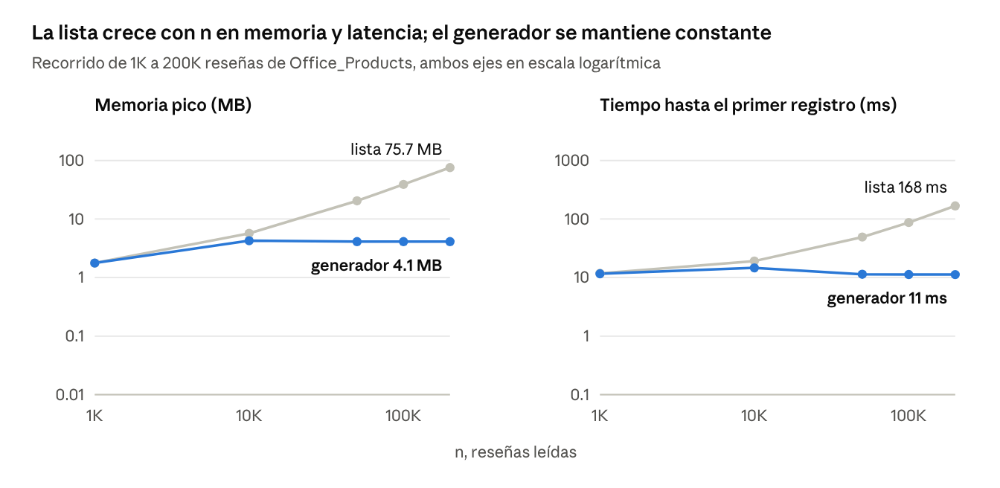
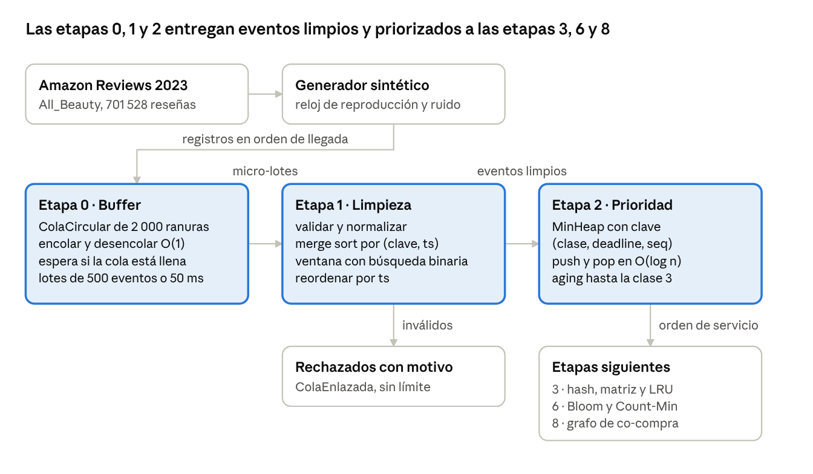

# Informe de las etapas 0, 1 y 2

Proyecto EDA 2026-2 · Grupo 1 · Escenario B (comercio electrónico)

20 de octubre de 2026

## Resumen

Las etapas 0, 1 y 2 convierten un stream crudo de eventos de comercio electrónico en una secuencia limpia y priorizada. Las últimas 1 500 000 reseñas reales de la categoría `Office_Products` de Amazon Reviews 2023 generaron un stream de 10 512 167 registros, del que salieron 9 940 617 eventos limpios en orden de atención.

| Etapa | Función | Estructura propia | Complejidad | Resultado principal |
| --- | --- | --- | --- | --- |
| 0. Ingesta y buffer | Recibir el stream y entregarlo en micro-lotes | Cola FIFO circular de capacidad fija | O(1) por operación | Pendiente log-log de 0.95 y 8 bytes por elemento; ningún evento perdido de 10.5 millones con backpressure |
| 1. Preprocesamiento | Validar, normalizar, deduplicar y ordenar | Merge sort y búsqueda binaria | O(b log b) por lote, O(log w) por búsqueda | 98 781 de 98 781 rechazos esperados; desorden del 4.62 % al 0.26 %, sin desorden dentro de los lotes |
| 2. Cola con prioridades | Atender primero lo urgente | Min-heap binario con aging | O(log n) por operación, heapify O(n) | Alertas y compras express dentro de plazo durante un incidente; espera media de la navegación afectada un 18 % menor con aging |

Todas las estructuras evaluadas se implementaron a mano y se compararon con alternativas de la biblioteca estándar en tamaños de 1K a 10M, con semilla 42. Las tres etapas procesan el stream completo con memoria acotada: el buffer nunca supera 2 000 eventos y la ventana de claves de la etapa 1 llega a 683 entradas.

## Contexto y datos

El escenario B pide un stream de 10 millones de búsquedas, vistas, carritos, compras, devoluciones, reseñas y alertas de pago. Ningún dataset público trae ese stream completo, así que se usó Amazon Reviews 2023 (McAuley-Lab) como base real y se generó sintéticamente el componente de stream, como recomienda el enunciado.

### Dataset

Se usa la categoría `Office_Products`. El notebook `00-download-data.ipynb` descarga las reseñas y los metadatos, asigna el tipo de cada columna y ordena las 12 845 712 reseñas por `timestamp` con ordenamiento externo. El resultado son dos archivos Parquet, uno de reseñas (unos 1.5 GB) y otro de 710 503 productos (unos 505 MB).

Las reseñas se leen con `ParquetFile.iter_batches`, en bloques de 10 000 filas y solo con las columnas necesarias, y un generador de Python las entrega una a la vez. El pipeline usa una **ventana reciente**, formada por las últimas 1 500 000 reseñas del archivo. Son un bloque continuo de las reseñas más recientes, así que conservan el orden temporal real. Con los metadatos del Parquet se calcula en qué grupo de filas empieza la ventana, y solo se leen 9 de los 65 grupos del archivo. El generador produce unos 7 registros por reseña, así que la ventana da un stream de unos 10.5 millones de eventos.

La lectura como stream es una decisión medida. Se comparó el generador con una lista en memoria al recorrer de 1K a 200K reseñas.

*Fuente: `notebooks/etapa0_ingesta_buffer.ipynb`, 1K a 200K reseñas de `Office_Products`, promedio de 5 repeticiones en los tiempos.*

- **Memoria.** Con la lista, la memoria pico crece en proporción a n, unos 370 bytes por reseña, es decir, O(n). Con el generador se mantiene entre 4.1 y 4.3 MB, el tamaño de un bloque, es decir, O(1). Con 200K reseñas la lista usa 18 veces más memoria, y la diferencia crece con n.
- **Latencia.** La lista entrega el primer registro solo después de leer todas las reseñas, así que esa espera crece con n, hasta 168 ms con 200K. El generador lo entrega tras leer el primer bloque, en 11 a 15 ms, sin importar el tamaño.
- **Tiempo total.** Recorrer las 200K reseñas tomó 0.17 s con el generador y 0.18 s con la lista. El ahorro de memoria no tiene costo en velocidad.

El análisis de los datos encontró tres características que condicionan el diseño.

- El precio viene como texto mezclado. Es nulo en el 59.7 % de los productos, 3 784 productos tienen un guion (`"—"`) y 606 un texto como `"from 14.99"`.
- Las reseñas vienen ordenadas por tiempo, así que cada recorrido de compra se puede anclar al timestamp real de su reseña.
- `bought_together` casi siempre es nulo, por lo que el grafo de co-compra necesita órdenes simuladas.

### Generador sintético

Cada reseña real se convierte en un recorrido de compra `search → view → cart → purchase → review → return`. Del dataset se conservan el usuario, el producto, la calificación, el timestamp y si la compra fue verificada. El precio crudo, la categoría y el texto de búsqueda se toman del catálogo. El precio pasa sin limpiar a la etapa 1 y solo se reemplaza por uno sintético cuando es nulo.

El recorrido ocurre en los 30 minutos previos al timestamp real de la reseña. El generador entrega los eventos en orden de llegada con **desorden controlado**. Un evento normal llega en su propio `ts`, y el 5 % llega con un retraso aleatorio de hasta 120 s, reproducible con la semilla. Sin eventos tardíos, el stream sale ordenado por tiempo. En la ejecución completa llegaron tarde 502 881 de 10 062 954 eventos, el 5.0 %.

El retraso máximo de 120 s es menor que la duración de un lote en tiempo del stream (mediana de 1 114 s y mínimo de 442 s) y que la ventana de deduplicación de la etapa 1 (600 s). Así, un evento tardío cae como mucho en el lote siguiente y su reenvío todavía se detecta.

| Ruido inyectado | Probabilidad | Etapa que lo trata |
| --- | --- | --- |
| Duplicado exacto | 3 % por evento | 1 |
| Duplicado casi exacto (otro `event_id`, `ts` ±0.4 s, formato distinto) | 1.5 % por evento | 1 |
| Registro malformado (seis tipos de error) | 1 % por evento | 1 |
| Llegada tardía de hasta 120 s | 5 % por evento | 1 |
| Ráfaga de fraude con cuenta, tarjeta y dispositivo señalados | 0.2 % por reseña | 2 y 6 |
| Alerta de pago | 30 % de las compras fraudulentas, 0.3 % de las legítimas | 2 y 6 |

El 25 % de las órdenes incluye de 1 a 3 productos adicionales del mismo grupo sintético, para que el grafo de la etapa 8 tenga comunidades. El generador cuenta cada inyección, y esos conteos son la verdad de referencia con la que se verifica la etapa 1.

## Arquitectura

Cada etapa entrega su salida a la siguiente a través de archivos en `data/interim/<CATEGORIA>/`. La categoría, las rutas y los parámetros del experimento están en un solo lugar, `src/config.py`. La etapa 0 también exporta las listas de cuentas, tarjetas y dispositivos señalados para el Bloom Filter de la etapa 6.

## Etapa 0. Ingesta y buffer

La etapa 0 recibe el stream en un buffer FIFO de capacidad fija y lo entrega a la etapa 1 en micro-lotes. El buffer desacopla la velocidad del generador de la del preprocesamiento, y su capacidad acotada permite aplicar backpressure.

### Diseño

- **Estructura.** `ColaCircular` guarda los elementos en un arreglo de capacidad fija con dos datos de control, `inicio` y `tam`. El final se calcula como `(inicio + tam) % capacidad`, así que encolar y desencolar cuestan O(1) sin mover elementos. La memoria es O(capacidad) y se reserva una sola vez.
- **Alternativa propia.** `ColaEnlazada` también cuesta O(1) por operación y no tiene límite de capacidad. Se usa para la cola de rechazados de la etapa 1, que no debe perder elementos.
- **Concurrencia.** El productor corre en un hilo y el consumidor en el hilo principal. Comparten el buffer protegido por un candado y dos variables de condición.
- **Backpressure.** Si el buffer está lleno, el productor se bloquea hasta que el consumidor libere espacio. No se descartan eventos, porque perder compras o alertas de fraude no es aceptable en el escenario B, y la memoria queda acotada.
- **Micro-lotes.** Un lote se cierra al llegar a 500 eventos o al pasar 50 ms, lo que ocurra primero. El tamaño aprovecha la ordenación por lote de la etapa 1, y el tiempo acota la latencia cuando el stream es lento.

### Resultados

La ejecución completa entregó los 10 512 167 eventos en 21 025 micro-lotes, sin perder ninguno, en 205 s. El productor se bloqueó 17 452 veces, 52 s en total, porque escribir cada lote en JSON es más lento que generar los eventos: el backpressure actuó también con el consumidor real.

En una demostración con 10 000 reseñas (71 535 eventos) y capacidad de 2 000, un consumidor lento de 40 ms por lote bloqueó al productor 139 veces, durante 4.69 s en total, y entregó exactamente los mismos eventos que un consumidor rápido. Con un productor de poco tráfico, los lotes se cerraron por tiempo y ningún evento esperó más de 52 ms.

| Estructura | Pendiente log-log | Tiempo por operación a 1M | Memoria por elemento |
| --- | --- | --- | --- |
| `ColaCircular` (propia) | 0.95 | 321 ns | 8 B |
| `ColaEnlazada` (propia) | 0.95 | 294 ns | 48 B |
| `collections.deque` (C) | 0.95 | 59 ns | 8 B |
| `list.pop(0)` | 1.76 | 4 466 ns a 100K | 8 B |

Las tres colas O(1) mantienen un tiempo por operación casi constante de 1K a 10M. `list.pop(0)` crece de 137 a 4 466 ns por operación entre 1K y 100K, lo que confirma su costo O(n). `deque` es unas 5 veces más rápida porque está escrita en C; la diferencia es un factor constante. Se eligió `ColaCircular` porque cuesta O(1), usa la sexta parte de la memoria de la lista enlazada y su capacidad fija permite el backpressure.

## Etapa 1. Preprocesamiento por lotes

La etapa 1 convierte cada micro-lote de registros crudos en eventos que cumplen el esquema, tienen un formato único, no están repetidos y están ordenados por tiempo. La deduplicación es exacta. La probabilística con Bloom Filter corresponde a la etapa 6, y las dos no se solapan.

### Diseño

1. **Validar y normalizar** en un solo recorrido. Cada campo tiene una regla, y los registros inválidos pasan a una `ColaEnlazada` de rechazados con su motivo. Se convierte `ts` de milisegundos a segundos, la categoría a forma canónica (`office_products`) y la búsqueda a minúsculas. El precio llega como texto crudo del catálogo y se toma su primer número: `$19.99`, `19,99`, `1,299.00` y `from $12.50` se convierten a número, y `—` queda sin precio. Una coma seguida de dos dígitos al final es decimal; cualquier otra coma separa miles. Una compra sin precio o con precio de 0 o menos se rechaza como `precio_invalido`.
2. **Ordenar el lote por `(clave, ts)`** con merge sort propio y recorrerlo una vez. La clave es `(event_type, user_id, parent_asin, order_id, query)` y no incluye `event_id`. Dos eventos son duplicados si comparten clave y sus `ts` difieren 1 s o menos. Tras ordenar, los duplicados quedan juntos, así que el costo es O(b log b) en lugar de O(b²).
3. **Buscar duplicados de lotes anteriores** en una ventana, que es un arreglo ordenado con las claves de los últimos 600 s. La búsqueda binaria propia cuesta O(log w) por evento, y la ventana se actualiza una vez por lote con una mezcla lineal, en O(w + b).
4. **Reordenar el lote por `ts`** con merge sort, que es estable y conserva el orden de los eventos con el mismo `ts`.

Merge sort se eligió porque garantiza O(n log n) también en el peor caso y es estable. Quicksort puede degradarse a O(n²) con datos casi ordenados, que es como llegan los lotes. Un `set()` es más rápido para deduplicar, pero solo detecta claves idénticas y no admite la tolerancia de tiempo que requieren los reintentos.

Cada lote limpio se escribe en el archivo de salida en cuanto sale de la etapa, así que la memoria no crece con el número de eventos.

### Verificación contra lo inyectado

Con el stream completo (10 512 167 registros), la etapa 1 se comparó con los conteos del generador. La columna Esperado ajusta lo inyectado por los casos que la etapa debe tratar de otra forma.

| Concepto | Inyectado | Esperado | Detectado |
| --- | --- | --- | --- |
| Registros rechazados | 100 629 | 98 781 | 98 781 |
| Duplicados exactos | 299 972 | 299 951 | 299 288 |
| Duplicados casi exactos | 149 241 | 149 233 | 173 481 |

Los rechazos coinciden por motivo. Lo esperado incluye 663 compras de productos con precio `—` o 0 en el catálogo, que se rechazan con razón, y descuenta las búsquedas con producto vacío, que siguen siendo válidas. En los duplicados, el exceso neto de 23 585 coincide, salvo 90, con 23 675 pares legítimos con la misma clave a 1 s o menos, el 0.24 % de los eventos. De ellos, 17 415 son reseñas reales de variantes del mismo `parent_asin` con el mismo timestamp, y 6 221 son vistas repetidas, equivalentes a un doble clic. Los 663 exactos de menos son copias de un evento que ya había quedado unido a otro legítimo, y se cuentan como casi exactas. Del total, 2 282 duplicados se detectaron entre lotes gracias a la ventana, que llegó a 683 entradas.

### Desorden temporal

Un evento está fuera de orden si su `ts` es menor que el de uno entregado antes. Si ese evento es del mismo lote, el desorden es dentro del lote; si es de un lote anterior, es entre lotes.

| Momento | Fuera de orden | Dentro del lote | Entre lotes |
| --- | --- | --- | --- |
| Al entrar a la etapa 1 | 4.62 % | 457 358 | 26 852 |
| Al salir de la etapa 1 | 0.26 % | 0 | 25 380 |

La etapa elimina todo el desorden dentro del lote. Queda el que viene de eventos tardíos que llegaron después de cerrarse su lote.

### Experimentos

| Experimento | Método | Pendiente log-log | Esperado |
| --- | --- | --- | --- |
| Ordenación | `merge_sort` (propio) | 1.07 | n log n |
| Ordenación | `sorted()` (C) | 1.10 | n log n |
| Búsqueda de 1 000 valores | Búsqueda binaria (propia) | 0.11 | log n |
| Búsqueda de 1 000 valores | Búsqueda lineal | 1.00 | n |
| Deduplicación | `merge_sort` y recorrido (propio) | 1.10 | n log n |
| Deduplicación | `set()` (C) | 1.11 | n |

A 100K la búsqueda binaria resolvió cada consulta en 4.0 µs, frente a 2 800 µs de la lineal. `set()` deduplicó unas 16 veces más rápido que ordenar y recorrer a 1M, y usó 56 bytes por elemento frente a 81. En la etapa ese costo es pequeño porque cada lote tiene unos 500 eventos, y log₂ 500 ≈ 9. Por lote, validar y normalizar tomó 3.3 ms, ordenar y deduplicar 2.0 ms, la ventana 1.6 ms y reordenar 1.1 ms; los 21 025 lotes se procesaron en 169 s, unos 62 000 registros por segundo.

## Etapa 2. Cola con prioridades

La etapa 2 decide en qué orden se atienden los eventos limpios cuando la capacidad de servicio es limitada. Usa un min-heap binario propio sobre un arreglo, con `push` y `pop` en O(log n) y `heapify` de Floyd en O(n).

### Clases, plazos y clave

| Clase | Eventos | Plazo |
| --- | --- | --- |
| 1 | Alerta de pago | 5 min |
| 2 | Compra express | 2 h |
| 3 | Compra estándar y devolución | 24 h |
| 4 | Compra programada | 72 h |
| 5 | Búsqueda, vista, carrito y reseña | 30 min |

La clave del heap es `(clase, deadline, seq)`, donde el deadline es el `ts` del evento más el plazo de su clase y `seq` es el orden de inserción. Dentro de una clase sale primero el que vence antes, y en un empate total sale el que entró antes, así que la cola es estable. La navegación es el 79 % de la carga, y las clases 1 a 4 suman unos 3.3 eventos por minuto en promedio.

### Aging

El aging sube una clase a cada evento por cada 15 minutos de espera, sin pasar de la clase 3. Las claves de un heap no se pueden cambiar en su lugar, así que cada 5 minutos se recalcula la clase efectiva de todas las entradas y se reconstruye el heap con `heapify`, en O(n). Ese costo, repartido entre 5 minutos de servicio, es menor que el de insertar y extraer los eventos de esos minutos.

El límite en la clase 3 protege las clases con plazos cortos. Las clases 3 y 4 tienen 24 h y 72 h de plazo, y el aging solo usa esa holgura.

### Simulación del servicio

La simulación avanza un minuto del stream por ciclo. En cada minuto entran al heap los eventos de ese minuto, cada 5 minutos se aplica el aging y al final del minuto se extraen tantos eventos como permita la capacidad. Con los timestamps reales cada lote de 500 eventos cubre unos 19 minutos del stream, así que un ciclo por lote no puede medir el plazo de 5 minutos de las alertas. Con ciclos de 1 minuto la resolución es menor que todos los plazos.

Los 9 940 617 eventos no se cargan en memoria. Cada escenario vuelve a leer el archivo de la etapa 1 desde el inicio, así que todos reciben los mismos eventos, y en memoria solo quedan el heap y una fila numérica por evento atendido.

Los eventos cubren 438 días del stream. Llegan 15.8 eventos por minuto en promedio, con un máximo de 97. Con la capacidad normal de 107 eventos por minuto, un 10 % sobre ese máximo, todas las clases esperan un minuto o menos y se atienden al 100 % dentro de plazo.

### Incidente de capacidad

Se simuló una caída de la capacidad a 5 eventos por minuto durante 4 horas, ubicada en las 4 horas con más llegadas del stream. En esas horas llegan 52 eventos por minuto, y 11.2 por minuto son de las clases 1 a 4, frente a 3.3 en promedio: la capacidad del incidente no alcanza ni para lo urgente. El heap llega a 11 353 eventos y tarda 2.8 horas en vaciarse después del incidente.

Fuera del incidente todo se atiende en menos de un minuto, así que la comparación se hace sobre los **eventos afectados**: los 19 338 que entran al heap desde el inicio del incidente hasta que el heap se vacía, el 0.19 % del stream.

*Fuente: `notebooks/etapa2_cola_prioridades.ipynb`, incidente de 4 h a 5 eventos por minuto, 19 338 eventos afectados de 9 940 617.*

Las alertas y las compras express se atienden en menos de 2 minutos con y sin aging, porque son pocas y la prioridad por clase las atiende primero. Con aging, la espera media de la navegación afectada baja un 18 %, de 146.5 a 119.9 minutos, y su p95 de 244.2 a 215.4. El costo lo pagan las compras estándar y programadas, que siguen al 100 % dentro de plazo gracias a sus plazos de 24 h y 72 h. Solo el 8 % de la navegación afectada cumple su plazo de 30 minutos en los dos escenarios: una política de orden decide quién espera, pero no reduce la espera total. En todo el stream, el 99.8 % de la navegación y el 100 % de las demás clases se atienden dentro de plazo.

### Experimentos

| Experimento | Método | Pendiente log-log | Esperado |
| --- | --- | --- | --- |
| n push y n pop | `MinHeap` (propio) | 1.09 | n log n |
| n push y n pop | `heapq` (C) | 1.19 | n log n |
| n push y n pop | Lista ordenada con `insort` y `pop(0)` | 1.71 | n² |
| Construcción, claves decrecientes | n `push` (propio) | 1.06 | n log n |
| Construcción, claves decrecientes | `heapify` de Floyd (propio) | 1.02 | n |

A 100K la lista ordenada ya es 4 veces más lenta que `MinHeap`, y la diferencia crece con n. `heapq` es 5.6 veces más rápido a 1K pero solo 2.2 veces a 10M, porque con millones de elementos domina el acceso a memoria. En el peor caso, construir con `push` costó 4.7 veces más que con `heapify` a 10M. Las tres estructuras usan entre 8 y 9 bytes por elemento.

## Integración y verificación

Las tres etapas están implementadas en módulos de `src/` y en notebooks reproducibles que importan esos módulos. La categoría, las rutas, la semilla y el tamaño de la ventana se cambian en un solo lugar, `src/config.py`. Los notebooks se entregan ejecutados, con sus salidas y gráficas.

| Artefacto | Contenido |
| --- | --- |
| `notebooks/00-download-data.ipynb` | Descarga de reseñas y catálogo de `Office_Products` en Parquet |
| `notebooks/etapa0_ingesta_buffer.ipynb` | Lectura del dataset, generador, colas, backpressure y micro-lotes |
| `notebooks/etapa1_preprocesamiento.ipynb` | Validación, merge sort, deduplicación, verificación y desorden temporal |
| `notebooks/etapa2_cola_prioridades.ipynb` | Min-heap, aging, simulación por minutos e incidente |
| `notebooks/experimentos_complejidad.ipynb` | Experimentos de complejidad de las tres etapas, de 1K a 10M |
| `src/` | `config.py`, `events.py`, `generator.py`, `stage0_queue.py`, `stage1_preprocess.py`, `metricas.py`, `stage2_heap.py` y `trace.py` |
| `tests/` | 45 tests del heap, la normalización de precios y el generador; todos pasan |
| `visualizador/pipeline.html` | Animación de 200 eventos por las tres etapas |
| `results/` | CSV y gráficas de todos los experimentos |

Cada etapa entrega su salida a la siguiente en `data/interim/Office_Products/`. La etapa 2 deja los eventos en orden de servicio, con `priority` y `deadline`, para las etapas 3, 6 y 8. Su salida incluye 15 018 alertas de pago, de las cuales 11 099 usan una tarjeta señalada y 3 919 son falsas alarmas que la etapa 6 debe verificar. También incluye 324 550 órdenes con más de un producto, de 1 335 292 en total, para el grafo de co-compra.

### Traza y visualizador

`src/trace.py` hace pasar 200 eventos por las implementaciones reales y registra 1 193 pasos. En cada paso guarda las ranuras de la `ColaCircular`, el arreglo del `MinHeap` y la clave de cada nodo. El visualizador dibuja esas fotos en un solo archivo HTML, con el heap como árbol y una verificación de la propiedad de heap en las 376 fotos, sin ninguna violación. La traza se generó con una ventana anterior de 2 500 000 reseñas; ilustra el funcionamiento de las estructuras, que no depende del tamaño de la ventana. La memoria se mide con `tracemalloc` en una pasada aparte, para no mezclar la memoria de la propia traza con la del pipeline.

### Condiciones de los experimentos

El pipeline se ejecutó con las 1 500 000 reseñas de la ventana reciente de `Office_Products` y semilla 42. Las tres etapas tardaron unos 24 minutos en total. Los tamaños de los experimentos de estructuras fueron 1K, 10K, 100K, 1M y 10M, con 100 repeticiones para 1K y 10K, 20 para 100K, 5 para 1M y de 1 a 3 para 10M. Las estructuras O(n) por operación se midieron solo hasta 100K. Durante cada medición se desactivó el recolector de basura. La plataforma fue Windows 11, Intel64 Family 6 Model 158, 12 núcleos lógicos, 17 GB de RAM y Python 3.12.3.

## Limitaciones y decisiones corregidas

Siete decisiones se corrigieron después de medir, y cuatro limitaciones quedan documentadas.

### Decisiones corregidas

| Decisión inicial | Lo que mostró la medición | Corrección |
| --- | --- | --- |
| Aging hasta la clase 2 | La navegación envejecida, con deadline de 30 min, adelantaba a las compras express, con deadline de 2 h; la mitad de ellas salió de plazo en el incidente | Aging limitado a la clase 3 |
| Plazo de 1 min para alertas | Con la simulación por lotes, el 60 % de las alertas aparecía fuera de plazo con espera cero | Plazo de 5 min |
| Simulación del servicio lote por lote | Con los timestamps reales cada lote cubre unos 19 min del stream: solo el 30 % de las alertas aparecía en plazo y el aging subía de clase a casi todo en cada pasada | Simulación por minutos del stream, con aging cada 5 minutos |
| Porcentaje en plazo redondeado antes de multiplicar por 100 | Todos los porcentajes en plazo eran múltiplos de 10 | Se redondea después de multiplicar |
| Comparar n `push` con `heapify` usando claves aleatorias | En el caso promedio n `push` también es lineal y no se distinguía de `heapify` | Se agregó el peor caso, con claves decrecientes |
| Desarrollo con 50 000 reseñas y eventos guardados en listas | Las etapas 1 y 2 guardaban todos los eventos en memoria, lo que no cabe en los 17 GB de RAM con 10 millones de eventos | Ventana única de 1 500 000 reseñas; las etapas escriben y leen los eventos por archivo, lote por lote |
| Resumir el incidente sobre todo el stream | Con 438 días de stream, el promedio diluía el incidente: la navegación esperaba 0.8 min con y sin aging | Resumen sobre los eventos afectados por el incidente |

### Limitaciones

- **Tolerancia de deduplicación.** La tolerancia de 1 s fusiona pares legítimos muy cercanos, el 0.24 % de los eventos. La mayoría son reseñas de variantes del mismo producto con el mismo timestamp. Agregar `asin` al registro y a la clave evitaría fusionarlas.
- **Orden temporal entre lotes.** La etapa 1 ordena dentro de cada lote, y al salir queda un 0.26 % de eventos fuera de orden entre lotes. Un orden total requeriría retener eventos durante el retraso máximo, a costa de latencia.
- **Tiempo del stream acelerado.** La etapa 0 reproduce el stream más rápido que el tiempo real, así que los plazos y la capacidad de la etapa 2 se miden en minutos del stream y no del reloj de la máquina.
- **Archivos intermedios.** Las etapas se conectan por archivos JSON de 3.3 a 3.6 GB. Leerlos y escribirlos toma casi la mitad del tiempo de la etapa 1 (158 de 328 s). En un pipeline en línea las etapas se pasarían los lotes directamente.

## Conclusiones

1. Las tres estructuras propias cumplen su complejidad teórica en las mediciones de 1K a 10M. La cola circular mantiene O(1) por operación, merge sort O(n log n), la búsqueda binaria O(log n) y el heap O(log n) por operación.
2. Las alternativas de la biblioteca estándar escritas en C son más rápidas por un factor constante de 2 a 30, pero ninguna cambia el orden de complejidad. Las alternativas con peor orden, como `list.pop(0)`, la lista ordenada y la búsqueda lineal, se alejan cada vez más al crecer n.
3. Las decisiones de diseño responden a requisitos del escenario y no solo a la velocidad. El backpressure evita perder eventos, ordenar y recorrer admite la tolerancia de tiempo de los reintentos, y el límite del aging protege las órdenes urgentes.
4. La verificación contra el ruido inyectado confirma la etapa 1 con exactitud en los rechazos y con un error del 0.24 % en la deduplicación, explicado por pares legítimos dentro de la tolerancia. El desorden temporal baja del 4.62 % al 0.26 %.
5. Las tres etapas procesan el stream completo de 10.5 millones de eventos con memoria acotada, y la salida de la etapa 2 es una entrada real para las etapas siguientes: 15 018 alertas para la etapa 6 y 324 550 órdenes multiproducto para el grafo de la etapa 8.

## Referencias

- Bloom, B. H. (1970). Space/time trade-offs in hash coding with allowable errors. *Communications of the ACM*, 13(7), 422–426.
- Cormen, T. H., Leiserson, C. E., Rivest, R. L., y Stein, C. (2022). *Introduction to Algorithms* (4.ª ed.). MIT Press. Caps. 2, 6 y 10.
- Floyd, R. W. (1964). Algorithm 245: Treesort 3. *Communications of the ACM*, 7(12), 701.
- Hou, Y., Li, J., He, Z., Yan, A., Chen, X., y McAuley, J. (2024). Bridging language and items for retrieval and recommendation. *arXiv:2403.03952*. Dataset Amazon Reviews 2023.
- Leskovec, J., Rajaraman, A., y Ullman, J. D. (2020). *Mining of Massive Datasets* (3.ª ed.). Cambridge University Press. Cap. 4.
- Williams, J. W. J. (1964). Algorithm 232: Heapsort. *Communications of the ACM*, 7(6), 347–348.
