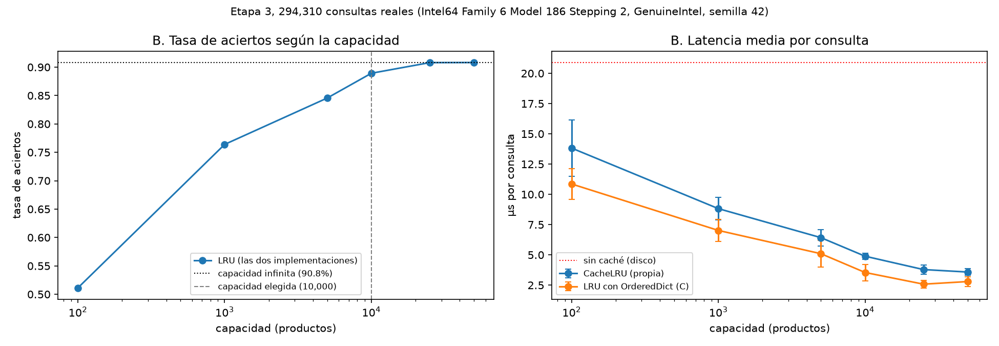
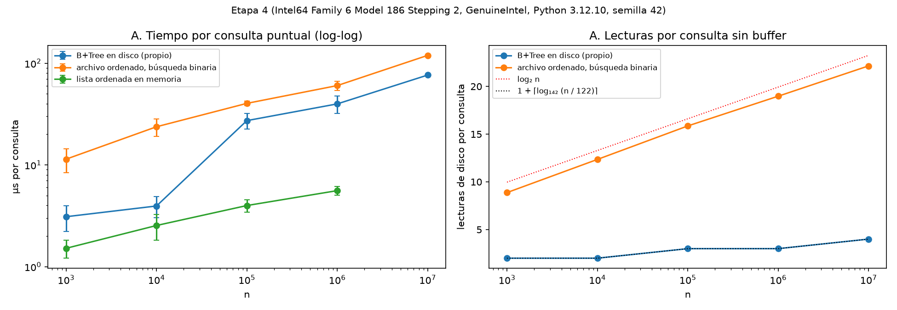
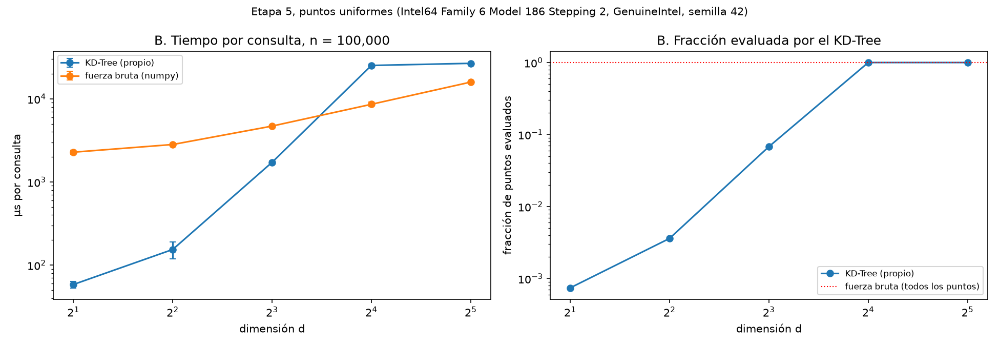

# Informe de las etapas 3, 4 y 5

Proyecto EDA 2026-2 · Grupo 1 · Escenario B (comercio electrónico)

20 de octubre de 2026

## Resumen

Las etapas 3, 4 y 5 resuelven la consulta de productos del escenario B. La etapa 3 responde consultas puntuales con baja latencia y mantiene el estado de cada producto a partir del stream. La etapa 4 responde consultas por rango de precio con un índice en disco. La etapa 5 responde consultas sobre varios atributos a la vez y produce los vecinos exactos de cada producto. En modo desarrollo, las etapas procesaron los 343 887 eventos que entrega la etapa 2 sobre el catálogo de 710 503 productos de `Office_Products`.

| Etapa | Función | Estructura propia | Complejidad | Resultado principal |
| --- | --- | --- | --- | --- |
| 3. Almacenamiento, lookup y caché | Consultar productos por `parent_asin`, actualizar su estado y registrar interacciones | Tabla hash con direccionamiento abierto, caché LRU y matriz dispersa (DOK y CSR) | O(1) esperado por operación | Sondeo medio de 2.048 posiciones frente a 2.051 teóricas; 88.9 % de aciertos en la caché y latencia 4.3 veces menor que sin caché |
| 4. Indexación principal | Consultar productos por rango de precio | B+Tree en disco con páginas de 4 KB y buffer pool | O(log_B n) lecturas por búsqueda, O(log_B n + k / B) por rango | 4 lecturas de página por búsqueda a 10M, frente a 22 de la búsqueda binaria en un archivo ordenado |
| 5. Índice multidimensional y KNN exacto | Encontrar productos similares y filtrar por varios atributos | KD-Tree con corte por la mediana | ≈ O(log n) por consulta en dimensión baja | 0.2 ms por consulta a 10M puntos, 1 800 veces menos que la fuerza bruta; mismas distancias que la fuerza bruta en 2 000 consultas reales |

Todas las estructuras evaluadas se implementaron a mano y se compararon con alternativas exactas o de la biblioteca estándar en tamaños de 1K a 10M, con semilla 42. Las etapas reutilizan estructuras de las etapas anteriores. La etapa 4 ordena con el merge sort de la etapa 1, y la etapa 5 mantiene sus candidatos en el min-heap de la etapa 2.

## Contexto y datos

El escenario B pide "recuperar con baja latencia datos de productos, categorías, precios y disponibilidad, tanto en consultas puntuales como por rango", y "generar productos similares [...] a partir de atributos y comportamiento de compra". Las etapas 3 a 5 usan dos fuentes.

- **Stream.** `data/interim/<CATEGORIA>/etapa2_eventos.jsonl`, con los 343 887 eventos limpios en el orden de servicio de la etapa 2. De ellos, 294 310 tienen producto y 49 577 son búsquedas.
- **Catálogo.** `data/raw/meta_office_products.parquet`, con 710 503 productos. El análisis de la etapa 0 encontró que el precio es nulo en el 59.7 % de los productos y que `bought_together` está vacío en todos.

El dataset no trae inventario. La disponibilidad se obtiene de un stock sintético por producto, entre 5 y 50 unidades, calculado con CRC32 del `parent_asin` para que sea estable entre ejecuciones.

## Arquitectura

| Origen | Artefacto | Destino | Uso |
| --- | --- | --- | --- |
| Etapa 2 | `etapa2_eventos.jsonl` | Etapa 3 | Stream que actualiza la caché, el estado de los productos y la matriz |
| Etapa 3 | `etapa3_catalogo.jsonl` | Etapas 4, 5 y 9 | Catálogo en disco con el precio convertido a número |
| Etapa 3 | `etapa3_estado_productos.parquet` | Etapas 4, 5 y 9 | Contadores, stock, disponibilidad y precio observado en el stream |
| Etapa 3 | `etapa3_matriz_usuario_producto.npz` | Etapas 7 y 9 | Matriz CSR de interacciones usuario × producto |
| Etapa 4 | `etapa4_indice_precio.bpt` | Etapas 5 y 9 | Índice de precios en disco |
| Etapa 5 | `etapa5_vectores.npz` | Etapa 7 | Vectores normalizados de los productos |
| Etapa 5 | `etapa5_vecinos.parquet` | Etapas 7 y 9 | 10 vecinos exactos por producto con actividad |

Todos los artefactos están en `data/interim/<CATEGORIA>/`. El código está en `src/stage3_storage.py`, `src/stage4_bplustree.py` y `src/stage5_kdtree.py`, y cada etapa tiene un notebook que lo importa y documenta sus experimentos.

## Etapa 3. Almacenamiento, lookup y caché

La etapa 3 recibe cada evento de la etapa 2, consulta su producto a través de una caché, actualiza el estado dinámico del producto y suma el peso del evento en una matriz de interacciones.

### Diseño

- **Tabla hash.** Direccionamiento abierto con sondeo lineal (Cormen et al., 2022) sobre dos arreglos paralelos de claves y valores. La función hash es CRC32, porque el `hash()` de Python cambia entre ejecuciones para los textos. Las eliminaciones dejan una lápida para no cortar las secuencias de sondeo. Cuando las posiciones usadas superan el 70 % de la capacidad, la tabla se reconstruye, y su capacidad se duplica si las claves vivas lo justifican. Con factor de carga α, una búsqueda exitosa revisa en promedio ½ (1 + 1 / (1 − α)) posiciones (Knuth, 1998).
- **Catálogo en disco.** Los 710 503 registros se escriben en un archivo de 303 MB, un JSON por línea, con el precio convertido por la función `normalizar_precio` de la etapa 1. En memoria queda solo el índice hash `parent_asin` → `(offset, largo)`, y cada consulta lee el registro con un `seek`.
- **Caché LRU.** Una tabla hash propia da acceso O(1) al nodo de cada producto, y una lista doblemente enlazada con dos centinelas mantiene el orden de uso. Consulta, inserción y desalojo cuestan O(1). La capacidad es de 10 000 productos.
- **Estado del producto.** Para cada producto con actividad se guardan vistas, carritos, compras, devoluciones, reseñas, stock y precio observado. Una compra descuenta stock, una devolución lo repone y un producto agotado se repone 48 horas después de agotarse. El precio observado cubre a los productos sin precio en el catálogo.
- **Matriz dispersa.** Cada evento suma un peso en la celda (usuario, producto), con 1 para una vista, 2 para un carrito, 4 para una compra, 1 para una reseña y −4 para una devolución. Durante el stream la matriz se guarda como diccionario de claves (DOK) sobre la tabla hash propia, con clave entera `fila << 32 | columna`. Al cerrar se convierte a CSR, que ocupa O(filas + nnz) y da acceso a la fila de un usuario en O(1) más su número de elementos.

### Ejecución sobre el stream

| Medida | Valor |
| --- | --- |
| Índice del catálogo | 1 048 576 posiciones, factor de carga 0.678, sondeo medio 2.048 (teórico 2.051) |
| Consultas a la caché | 294 310, con 261 718 aciertos (88.9 %) y 32 592 fallos |
| Lecturas en disco | 32 592, igual al número de fallos |
| Productos con estado | 27 034, con 197 reposiciones de stock |
| Matriz | 45 275 usuarios × 27 034 productos, 74 472 celdas no nulas |
| Tiempo y memoria | 2.6 s (unos 8 µs por evento) y 33 MB de pico sin el índice del catálogo |

La ejecución se verificó con tres igualdades. Aciertos más fallos es igual al número de eventos con producto, las lecturas en disco son iguales a los fallos y la suma de la matriz es igual a la suma de los pesos de los eventos (564 858).

### Experimentos

| Experimento | Método | Pendiente log-log | Esperado |
| --- | --- | --- | --- |
| Construcción con n claves | `TablaHash` (propia) | 1.01 | n |
| Construcción con n claves | `dict` (C) | 1.15 | n |
| Consulta | `TablaHash` (propia) | 0.08 | 1 |
| Consulta | `dict` (C) | 0.21 | 1 |
| Consulta | Búsqueda lineal | 0.97 | n |
| Construcción de la matriz con n interacciones | DOK propia | 0.99 | n |
| Construcción de la matriz con n interacciones | DOK con `dict` (C) | 1.02 | n |
| Conversión a CSR | Propia | 1.08 | nnz log nnz |

La consulta en `TablaHash` pasa de 0.9 µs a 1K a 2.0 µs a 10M. A 1M la búsqueda lineal tarda 24.7 ms por consulta, unas 12 000 veces más. `dict` es entre 8 y 18 veces más rápido en la construcción por estar escrito en C, con el mismo orden de complejidad. Al terminar la construcción `TablaHash` ocupa entre 62 y 95 bytes por clave y `dict` entre 47 y 66, y el pico es mayor en las dos porque durante cada reconstrucción conviven los arreglos viejos y los nuevos.

La caché se evaluó con la secuencia real de 294 310 consultas.

*Fuente: `notebooks/etapa3_almacenamiento_cache.ipynb`, 294 310 consultas reales, 5 repeticiones.*

| Capacidad | Tasa de aciertos | Latencia media (`CacheLRU`) |
| --- | --- | --- |
| Sin caché | 0 % | 20.9 µs |
| 100 | 51.1 % | 13.8 µs |
| 1 000 | 76.4 % | 8.8 µs |
| 10 000 | 88.9 % | 4.9 µs |
| 25 000 | 90.8 % | 3.8 µs |

La cota superior es 90.8 %, porque la primera consulta de cada uno de los 27 034 productos siempre es un fallo. Con 10 000 productos la caché alcanza el 98 % de esa cota con el 37 % de los productos distintos. La LRU con `OrderedDict` es 1.4 veces más rápida que la propia con la misma tasa de aciertos.

Para medir la matriz hasta 10M se generaron interacciones sintéticas que reproducen cuatro proporciones del stream real. Son un usuario por cada 6.5 interacciones, 3.94 interacciones por celda, productos con distribución de Zipf de exponente 1.0 sobre el catálogo y la frecuencia real de cada tipo de evento. Con 10M interacciones la matriz tiene 1 233 512 × 342 050 celdas y 2 441 285 no nulas. La CSR ocupa 39 MB, frente a 3.4 TB de la matriz densa. La densidad del stream real (6 × 10⁻⁵) queda entre las de los datos sintéticos de 100K y 1M.

## Etapa 4. Indexación principal

La etapa 4 indexa los productos por precio en un B+Tree almacenado en disco. La tabla hash de la etapa 3 no conserva el orden de las claves y no responde rangos.

### Diseño

- **Archivo de páginas.** El B+Tree es la variante del B-tree de Bayer y McCreight (1972) que guarda todas las entradas en las hojas. El árbol vive en un archivo dividido en páginas de 4 096 bytes, y cada nodo ocupa una página. Una hoja guarda hasta 136 entradas `(precio, parent_asin, offset, largo)` y el número de la hoja siguiente. Un nodo interno guarda hasta 157 claves separadoras. La página 0 es la cabecera.
- **Clave y valor.** La clave es `(precio, parent_asin)`, porque muchos productos comparten precio y las claves deben ser únicas. El valor es la posición del registro en el catálogo en disco de la etapa 3.
- **Búsqueda y rango.** Una búsqueda desciende de la raíz a la hoja con búsqueda binaria en cada nodo y lee una página por nivel. Un rango desciende hasta la primera hoja y recorre las hojas enlazadas.
- **Inserción.** Una hoja llena se divide en dos y su primera clave sube al padre. Si el padre se llena también se divide, y si se divide la raíz el árbol crece un nivel.
- **Carga masiva.** Con las entradas ordenadas, las hojas se escriben de izquierda a derecha al 90 % de su capacidad y luego se construye cada nivel interno. Cada página se escribe una vez, en O(n).
- **Buffer pool.** Las páginas leídas se guardan en la `CacheLRU` de la etapa 3, con capacidad para 256 páginas. Las escrituras van directo al disco.
- **Eliminación.** Se quita la entrada de su hoja sin fusionar nodos, porque el índice de precios casi no recibe eliminaciones.

### Construcción y actualización

Las 282 534 entradas con precio del catálogo se ordenaron con el merge sort de la etapa 1 y se cargaron con la carga masiva en 5.6 s. El árbol quedó con altura 3, que es la mínima posible, 2 335 páginas (9.6 MB) y hojas al 89.7 % de ocupación. Después se insertaron uno a uno los 7 394 productos sin precio en el catálogo cuyo precio observó la etapa 3 en el stream. Cada inserción costó 62 µs, se crearon 139 páginas por divisiones y la altura no cambió.

### Consultas

Una búsqueda puntual con el buffer vacío leyó 3 páginas. Las consultas por rango leyeron aproximadamente la altura más los resultados divididos por las 122 entradas de cada hoja.

| Rango de precio | Resultados | Páginas leídas |
| --- | --- | --- |
| [9.99, 9.99] | 11 215 | 93 |
| [10, 12] | 24 891 | 203 |
| [10, 20] | 95 896 | 577 |
| [100, 200] | 11 403 | 96 |
| [1 000, 50 000] | 820 | 8 |

Combinado con la etapa 3, el rango de 10 a 12 dólares tiene 24 891 productos, de los que 24 879 están disponibles.

### Experimentos

*Fuente: `notebooks/etapa4_indexacion_bplustree.ipynb`, 1K a 10M entradas, 1 000 consultas por repetición.*

| n | Lecturas B+Tree | Lecturas archivo ordenado | µs B+Tree | µs archivo ordenado |
| --- | --- | --- | --- | --- |
| 1K | 2 | 8.9 | 3.1 | 11.4 |
| 100K | 3 | 15.9 | 27.3 | 40.3 |
| 10M | 4 | 22.2 | 76.5 | 119.5 |

Sin buffer, el B+Tree leyó exactamente una página por nivel y el archivo ordenado leyó log₂ n registros. A 10M el B+Tree hizo 5.5 veces menos lecturas y fue 1.6 veces más rápido. La diferencia en tiempo es menor que en lecturas porque la caché de páginas del sistema operativo abarata las lecturas de los dos métodos.

| Experimento | Método | Resultado |
| --- | --- | --- |
| Rango con n = 1M | B+Tree | 0.19 ms con k = 10, frente a 37 ms del recorrido completo; pendiente 0.88 en k entre 1K y 100K |
| Rango con n = 1M | Recorrido completo | 32 ms con k = 100 000, igual que el B+Tree (36 ms) |
| Construcción | Carga masiva | Pendiente 0.96, 1 µs y 0.008 páginas escritas por entrada, ocupación del 89.7 % |
| Construcción | Inserciones en orden aleatorio | Pendiente 1.18, de 20 a 60 µs y 1.02 páginas escritas por entrada, ocupación del 68.7 % |
| Tamaño de página | 256 B a 16 KB con n = 1M | Altura de 7 a 3; tiempo mínimo con 1 KB (65 µs), 94 µs con 4 KB |
| Memoria | B+Tree frente a lista ordenada | 7 MB constantes desde 100K frente a 228 MB con 1M |

La ocupación de 68.7 % con inserciones aleatorias coincide con el ln 2 ≈ 69.3 % que predice Yao (1978). Con rangos que cubren el 10 % de los datos, el índice deja de ser ventajoso frente al recorrido completo. Se mantienen las páginas de 4 KB porque coinciden con la página del sistema operativo y el bloque de un SSD, y dan altura 3 hasta unos 2.8 millones de entradas. Con páginas de 8 KB o más el tiempo se duplica, porque en Python decodificar una página grande cuesta más que leerla de la caché del sistema operativo.

## Etapa 5. Índice multidimensional y KNN exacto

La etapa 5 representa cada producto con precio como un punto de 4 dimensiones y responde consultas de vecinos más cercanos y de rango sobre todos los atributos a la vez.

### Diseño

- **Vectores.** Se recorre el B+Tree de la etapa 4, se lee cada registro del catálogo y se agrega la actividad registrada por la etapa 3. Los atributos son log(1 + precio), la calificación promedio, log(1 + número de calificaciones) y log(1 + actividad en el stream). Cada uno se normaliza con z-score, porque sin esa normalización el número de calificaciones pesaría casi el triple que la calificación en la distancia euclidiana.
- **Elección del KD-Tree.** Los datos son puntos, la dimensión es baja y el conjunto es casi estático. El R-Tree está pensado para objetos con extensión y para inserciones frecuentes (Guttman, 1984). El KD-Tree poda bien en dimensión baja (Friedman, Bentley y Finkel, 1977). Samet (2006) compara las dos familias de estructuras.
- **Construcción.** El KD-Tree es un árbol binario de búsqueda sobre puntos de d dimensiones (Bentley, 1975). Cada nodo divide su región por la mediana de la dimensión de mayor dispersión, obtenida con `np.argpartition` en O(m). El árbol queda balanceado y se construye en O(n log n). Las hojas guardan hasta 32 puntos contiguos, y la distancia a todos ellos se calcula con una operación de numpy.
- **KNN.** Un recorrido en profundidad visita primero el lado del hiperplano donde está la consulta y descarta un subárbol si la distancia a su región no mejora al peor de los k candidatos. Los candidatos se guardan en el `MinHeap` de la etapa 2 con la distancia negada, para consultar el peor en O(1). Un filtro opcional restringe los vecinos a la categoría de último nivel del producto.
- **Rango.** Se desciende por los lados del hiperplano que cortan la caja pedida.
- **Línea base.** KNN por fuerza bruta con numpy, en O(n·d) por consulta.

### Resultados

El índice tiene 289 928 productos de 603 categorías, de los que 26 757 tuvieron actividad en el stream. El KD-Tree tiene 32 695 nodos y altura 15, que corresponde a las 14 divisiones por la mitad que llevan a hojas de 32 puntos o menos más el nivel de las hojas. Se construyó en 1.5 s.

En 1 000 productos elegidos al azar, con y sin filtro de categoría, el KD-Tree devolvió las mismas distancias que la fuerza bruta en las 2 000 consultas. La consulta por caja "precio entre 10 y 20 dólares, calificación de al menos 4.5 y al menos 1 000 calificaciones" devolvió 4 126 productos tras evaluar 7 659 puntos, en 4.5 ms. El B+Tree de la etapa 4 más un filtro obtuvo los mismos productos en 226 ms, porque primero recupera los 95 896 productos del rango de precio.

### Experimentos

| Experimento | Método | Pendiente log-log | Esperado |
| --- | --- | --- | --- |
| KNN según n, d = 4 | KD-Tree (propio) | 0.05 | log n |
| KNN según n, d = 4 | Fuerza bruta (numpy) | 1.03 | n |
| Construcción | KD-Tree (propio) | 1.07 | n log n |
| KNN según k, n = 1M | KD-Tree (propio) | 0.75 | Creciente con k |
| KNN según k, n = 1M | Fuerza bruta (numpy) | 0.00 | Constante |

Los experimentos según n y según k usan los vectores reales remuestreados con ruido hasta 10M. A 10M el KD-Tree responde en 207 µs y evalúa unos 400 puntos por consulta, mientras que la fuerza bruta tarda 371 ms. Con 1K puntos la fuerza bruta es 3 veces más rápida, porque numpy calcula 1 000 distancias en C más rápido de lo que Python recorre el árbol, y el punto de cruce está cerca de 10K.

*Fuente: `notebooks/etapa5_kdtree_knn.ipynb`, 100 000 puntos uniformes, 5 repeticiones de 100 consultas.*

| Dimensión | Fracción evaluada por el KD-Tree | µs KD-Tree | µs fuerza bruta |
| --- | --- | --- | --- |
| 2 | 0.07 % | 58 | 2 281 |
| 4 | 0.36 % | 154 | 2 822 |
| 8 | 6.8 % | 1 723 | 4 700 |
| 16 | 100 % | 25 232 | 8 600 |
| 32 | 100 % | 26 757 | 15 915 |

Desde d = 16 la poda no descarta ninguna región y el KD-Tree evalúa todos los puntos, como describen Weber, Schek y Blott (1998). Este resultado justifica que la etapa 7 use búsqueda aproximada para vectores de dimensión alta, con el KNN exacto de esta etapa como referencia. El KD-Tree ocupa entre 48 y 55 bytes por punto con d = 4, y su pico de construcción es el doble por las copias temporales de numpy.

## Integración y verificación

| Artefacto | Contenido |
| --- | --- |
| `notebooks/etapa3_almacenamiento_cache.ipynb` | Tabla hash, catálogo en disco, caché LRU, matriz dispersa, ejecución sobre el stream y experimentos |
| `notebooks/etapa4_indexacion_bplustree.ipynb` | Formato de páginas, carga masiva, inserción del stream, consultas y experimentos |
| `notebooks/etapa5_kdtree_knn.ipynb` | Vectores, KD-Tree, verificación contra la fuerza bruta, consultas y experimentos |
| `src/` | `stage3_storage.py`, `stage4_bplustree.py` y `stage5_kdtree.py` |
| `tests/` | 57 tests de la tabla hash, la caché, la matriz, el B+Tree y el KD-Tree; todos pasan junto con los 45 de las etapas 0 a 2 |
| `results/` | CSV y gráficas de todos los experimentos |

Los tests comparan cada estructura con una referencia exacta. La tabla hash se compara con `dict` en secuencias aleatorias de inserciones y eliminaciones, la caché con un modelo de lista, la CSR con la matriz densa, el B+Tree con listas ordenadas en páginas de 128 bytes que fuerzan varios niveles, y el KD-Tree con la fuerza bruta. Los tests del B+Tree verifican además sus invariantes, las claves ordenadas, los separadores coherentes y todas las hojas a la misma profundidad, y que una búsqueda lea exactamente una página por nivel.

### Condiciones de los experimentos

Las etapas se ejecutaron con la salida del modo desarrollo de la etapa 2, que corresponde a 50 000 reseñas de la ventana reciente de `Office_Products`, con semilla 42. Los tamaños fueron 1K, 10K, 100K, 1M y 10M, con 100 repeticiones para 1K y 10K, 20 para 100K, 5 para 1M y 1 para 10M, salvo donde cada notebook indica otra cantidad. Las estructuras O(n) por operación se midieron hasta 1M. Durante cada medición se desactivó el recolector de basura. La memoria actual y pico se midió con `tracemalloc`. La plataforma fue Windows 11, Intel64 Family 6 Model 186, 20 núcleos lógicos, 25.4 GB de RAM y Python 3.12.10.

## Limitaciones y decisiones corregidas

Cuatro decisiones se corrigieron después de medir, y siete limitaciones quedan documentadas.

### Decisiones corregidas

| Decisión inicial | Lo que mostró la medición | Corrección |
| --- | --- | --- |
| Usar `categories[1]` como subcategoría del producto | Casi todos los productos tienen el mismo valor, "Office & School Supplies" | Se usa el último nivel de la ruta de categorías, con 603 valores distintos |
| Verificar las lecturas en disco de la etapa 3 con el contador acumulado del almacén | La pasada de medición de memoria sumaba sus propias lecturas y la verificación fallaba | Se registran las lecturas de cada pasada por separado |
| Medir la matriz dispersa con el stream real | El stream del modo desarrollo solo alcanza 293 792 interacciones | Interacciones sintéticas calibradas con el stream real, hasta 10M |
| Reportar solo la memoria pico en la etapa 3 y solo la actual en la etapa 4 | El enunciado pide memoria actual y pico | Las tres etapas reportan las dos |

### Limitaciones

- **Eventos sospechosos.** La etapa 3 procesa todos los eventos antes del filtrado de la etapa 6. Las 1 217 compras de cuentas señaladas, el 1.7 % de las compras, descuentan stock y suman peso en la matriz igual que las legítimas. Hace falta acordar con la etapa 6 una función que indique si un evento es sospechoso, para que no actualice el estado hasta su verificación.
- **Stock sintético.** De las 1 063 compras que llegaron sin stock, 1 041 fueron legítimas. Los productos más comprados agotan sus 5 a 50 unidades antes de la reposición a las 48 horas. Los parámetros del stock no salen del dataset y deben ajustarse si la etapa 9 muestra la disponibilidad.
- **Integración por archivos.** Las etapas se conectan a través de archivos en `data/interim/`. La etapa 4 recibe los precios observados en un solo bloque, al final del stream. El recorrido de un evento por las diez etapas depende de un orquestador común del pipeline.
- **Escala.** Los experimentos de estructuras llegan a 10M, pero las etapas se ejecutaron con la salida del modo desarrollo. Con la ventana completa habrá más productos distintos, y la capacidad de la caché debe revisarse con el mismo experimento.
- **Filtro por categoría en el KD-Tree.** Las consultas con filtro tardaron en promedio 5.4 ms, frente a menos de 0.5 ms sin filtro, porque los productos de una categoría pequeña están dispersos en todo el espacio. Si la etapa 9 necesita estas consultas en línea, conviene un KD-Tree por categoría.
- **Buffer pool LRU.** Un rango grande del B+Tree llena el buffer pool con hojas que no se vuelven a usar y desaloja la raíz. Es la inundación secuencial, una limitación conocida de LRU en los gestores de bases de datos.
- **Eliminación en el B+Tree.** No se fusionan nodos, así que muchas eliminaciones dejarían hojas con poca ocupación. El índice de precios casi no tiene eliminaciones.

## Conclusiones

1. Las estructuras propias cumplen su complejidad teórica en las mediciones de 1K a 10M. La tabla hash consulta en O(1), con el sondeo medio que predice el análisis de Knuth. El B+Tree lee O(log_B n) páginas por búsqueda y el KD-Tree evalúa un número casi constante de puntos en dimensión baja.
2. Las alternativas en C (`dict`, `OrderedDict` y numpy) son más rápidas por un factor constante, pero ninguna cambia el orden de complejidad. Las alternativas con peor orden, como la búsqueda lineal, el recorrido completo y la fuerza bruta, se alejan cada vez más al crecer n.
3. Cada estructura responde a un tipo de consulta del escenario B. La tabla hash responde la consulta puntual, el B+Tree el rango sobre una clave y el KD-Tree el rango y los vecinos sobre varias claves. La consulta por caja del KD-Tree fue 50 veces más rápida que el B+Tree con un filtro posterior.
4. Los límites medidos orientan las decisiones de las etapas siguientes. La caché alcanza el 98 % de su cota con 10 000 productos, el índice deja de convenir con rangos del 10 % de los datos y el KD-Tree pierde la poda desde 16 dimensiones.
5. Las salidas son entradas reales de otras etapas. La etapa 4 indexa el catálogo y los precios del stream de la etapa 3, la etapa 5 recorre el índice de la etapa 4, y la matriz y los vecinos exactos quedan disponibles para las etapas 7 y 9.

## Referencias

- Bayer, R., y McCreight, E. (1972). Organization and maintenance of large ordered indexes. *Acta Informatica*, 1(3), 173–189.
- Bentley, J. L. (1975). Multidimensional binary search trees used for associative searching. *Communications of the ACM*, 18(9), 509–517.
- Cormen, T. H., Leiserson, C. E., Rivest, R. L., y Stein, C. (2022). *Introduction to Algorithms* (4.ª ed.). MIT Press. Cap. 11.
- Friedman, J. H., Bentley, J. L., y Finkel, R. A. (1977). An algorithm for finding best matches in logarithmic expected time. *ACM Transactions on Mathematical Software*, 3(3), 209–226.
- Guttman, A. (1984). R-trees: A dynamic index structure for spatial searching. *Proceedings of ACM SIGMOD*, 47–57.
- Knuth, D. E. (1998). *The Art of Computer Programming, Vol. 3: Sorting and Searching* (2.ª ed.). Addison-Wesley. Sec. 6.4.
- Samet, H. (2006). *Foundations of Multidimensional and Metric Data Structures*. Morgan Kaufmann.
- Weber, R., Schek, H.-J., y Blott, S. (1998). A quantitative analysis and performance study for similarity-search methods in high-dimensional spaces. *Proceedings of VLDB*, 194–205.
- Yao, A. C. (1978). On random 2-3 trees. *Acta Informatica*, 9(2), 159–170.
